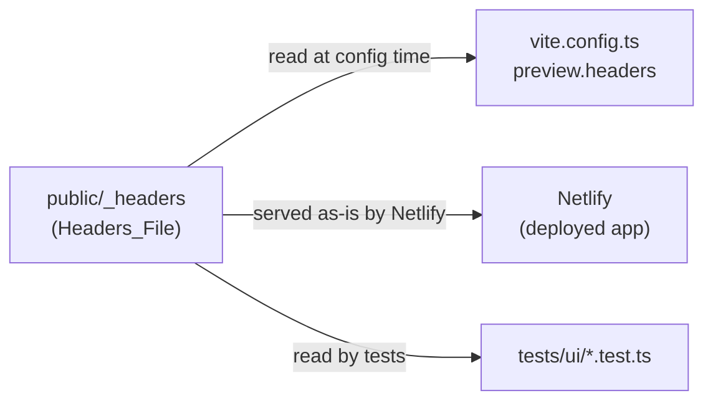
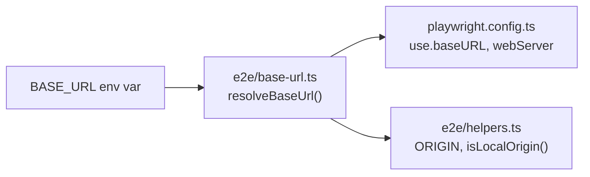

# Design Document

## Overview

`release` is a cleanup and polish pass, not new product logic. Every change lives in `src/ui`, `vite.config.ts`, `package.json`, `public/`, `e2e/`, `tests/`, `scripts/`, `README.md` or `docs/`. The one pre-approved exception is Requirement 1 itself: the spike files it names under `src/zk` are deleted as part of this spec, because the Introduction moves that deletion here from zk-core task 4.3. No other change touches `src/zk` or `src/ledger`; anything else that seems to need one stops and asks huynh. The Release_Gate checks this against the Base_Commit with `git diff --stat 3655ff7 HEAD -- src/zk src/ledger`, which passes only when it lists the deleted `src/zk/spike*.ts` files and nothing else.

The seven requirements split into three kinds of work:

- **Mechanical removal and checks** (Requirements 1, 5, 7): delete files, replace the README, run grep-based gate commands. No new runtime behaviour.
- **One small shared mechanism reused twice** (Requirement 2's header file, Requirement 6's `BASE_URL`): a single source of truth read by both the app/preview server and the test tooling, so there is never a second copy to drift.
- **Small, targeted UI and CSS changes** (Requirements 3, 4): the Verify_Anchor text, a row style, and layout CSS for narrow viewports.

## Architecture

### Headers: one file, two readers



`public/_headers` is the only place the CSP and the two extra headers are written. A small parser (`scripts/parse-headers.ts`, exporting `headersFor(path, text)`) turns the Netlify `_headers` text format into a `Record<string, string>` for one path. `vite.config.ts` calls it once, at config-load time, to build `preview.headers`, so the preview server (used by the local e2e run) sends the same headers Netlify will send from the file. No header text is ever typed a second time in `vite.config.ts`.

The file sets, for `/*`:

```
Content-Security-Policy: default-src 'self'; connect-src 'self' data:; script-src 'self' 'wasm-unsafe-eval'; worker-src 'self'; object-src 'none'; base-uri 'none'; frame-ancestors 'none'; form-action 'none'; style-src 'self'; img-src 'none'
X-Content-Type-Options: nosniff
Referrer-Policy: no-referrer
```

No `Cross-Origin-Opener-Policy` or `Cross-Origin-Embedder-Policy` line, because the prover stays single-threaded (tech.md).

`connect-src` carries `data:` because bb.js 6.0.0 embeds its gzipped WASM as a `data:application/gzip;base64` URL and fetches it, so the prover does not start without it (approved by huynh). A `data:` fetch makes no network request, so `connect-src` still allows no origin other than `'self'`. `headers_file_policy` pins `connect-src` to exactly `'self'` and `data:` (no http, https, ws or wss origin, no wildcard, no `blob:`) and pins `default-src`, `script-src` and `worker-src` to their values without `data:`.

`style-src 'self'` is not a guess. The terminal draws its cell positions with React's `style` prop, which sets the DOM `style` IDL property directly rather than writing an HTML `style="..."` attribute or a `<style>` tag, so it needs no `'unsafe-inline'`. Inspecting the built output (`dist/index.html`, the built CSS, the built JS) today finds no `<style>` tag, no `style="..."` text, no `url(...)`, no `data:` or `blob:` image reference and no `` element. A Vitest check gated on `CHECK_DIST=1` (following the pattern of `tests/ui/dist-clean.test.ts` and `scripts/check-dist-vk`) re-derives the needed source list from `dist/` on every build and fails ONLY when the Built_Output needs a source that the headers do not grant. A granted source that nothing uses does not fail the check.

#### Favicon

The headers file starts with `img-src 'none'`. `index.html` has no icon link, so the browser may still request `/favicon.ico`. If that request raises a `securitypolicyviolation` event or a console error, observed by `csp_no_violation` in the e2e or by a check in a real browser, the rule is: change `img-src` to `'self'` and record the reason in this section, without asking huynh. 

**Outcome (task 1.3):** `csp_no_violation` ran on the built page against the committed `public/_headers` (`img-src 'none'`, `connect-src 'self' data:`), served by the preview server from that file. Headless Chromium made no `/favicon.ico` request (`FAVICON REQUESTS SEEN: 0`), and the run raised no `securitypolicyviolation` event and no console error. `img-src 'none'` held, so `public/_headers` keeps it. A real browser that does request `/favicon.ico` would be blocked silently by `img-src 'none'` or show a console error; if that is seen, switch to `'self'` under the same rule.

### BASE_URL: one resolver, two readers



Today `playwright.config.ts` and `e2e/helpers.ts` each hardcode the loopback origin. `e2e/base-url.ts` becomes the one place that reads `BASE_URL`:

- `resolveBaseUrl(env = process.env): string` returns `env.BASE_URL` when set, else the loopback preview origin.
- `isLocalOrigin(url: string, origin: string): boolean` is the pure rule the Route_Guard runs: true for `blob:`/`data:` URLs or when the URL's origin equals `origin`, false otherwise (unparseable URLs are treated as not local, so they are aborted and recorded, never silently allowed).

`playwright.config.ts` calls `resolveBaseUrl()` for `use.baseURL` and only defines `webServer` when `BASE_URL` is unset, so a run against a draft deploy starts no local preview server. `e2e/helpers.ts` keeps exporting `ORIGIN` (now `= resolveBaseUrl()`) and its `guardLocalOnly` wraps `isLocalOrigin` with the live `ORIGIN`, so every existing Playwright spec is unchanged.

## Components and Interfaces

| Component | Path | Responsibility |
|---|---|---|
| `headersFor` | `scripts/parse-headers.ts` (new) | Parse `public/_headers` into a header map for one path. Used by `vite.config.ts` and by tests. |
| `public/_headers` | `public/_headers` (new) | The one copy of the CSP and the two extra headers, for `/*`. |
| `resolveBaseUrl`, `isLocalOrigin` | `e2e/base-url.ts` (new) | Resolve the e2e target origin from `BASE_URL`, and classify a request URL as local or foreign to it. |
| Prove screen anchor | `src/ui/terminal-view.tsx` (changed) | Today the `<a data-testid="verify-link">` child is `{link}`, so the full Verify_Link is printed as the anchor text. This is a change: the anchor text becomes `OPEN VERIFIER` and the full Verify_Link is only its `href`. It stays the only element with an `href`. The grid Link_Row (`linkRow` in `src/ui/model/screens/ctm300.ts`: prefix, first 40 characters, length) is unchanged, and no grid row holds the full Verify_Link. |
| Verdict row style | `src/ui/model/screens/ctm300.ts`, `src/ui/model/screens/ctm900.ts`, `src/ui/terminal-view.tsx` | A screen can mark one body row index as the Verdict_Row; the view draws that row with the same CSS class as the title row. |
| Narrow-screen CSS | `src/ui/terminal.css` | A media query below the grid's natural width switches the frame to its own horizontal scroll, raises the minimum font size, and keeps the PF bar wrapping inside the viewport. |
| README | `README.md` | Rewritten to the eight required sections, in order. |
| Release gate | run by hand per Requirement 7, no new file | The quoted commands of Requirement 7, run in order, each exit status and summary line reported. |

### Verdict row: a row index, not a new render path

Each screen module adds one small export, `verdictRowOf(state): number | null`, that returns the 1-based body row of the Verdict_Row only when its text is present, and `null` otherwise (which satisfies Requirement 3.4). The texts are the ones the model produces today. Where each lives:

- **CTM900, body row 17** (`VERDICT_ROW` in `ctm900.ts`, text from `verdictText`): `VERIFIED`; `REJECTED AT <STEP>` where `<STEP>` is a name of `VERIFY_STEP_ORDER` in `src/ui/model/verify-flow.ts`; `REJECTED: VERIFIER ERROR` (`MESSAGES.VERIFIER_ERROR`). `VERIFYING` (a run in progress, `MESSAGES.VERIFYING`) is not a verdict and keeps the normal style. With no outcome, `verdictRowOf` is `null`.
- **CTM300, prove state `done`, body row 8** (`RESULT_ROW`): `PROOF GENERATED` (`MESSAGES.DONE`).
- **CTM300, prove state `failed`**: row 8 reads `PROOF NOT GENERATED` and keeps the normal style. The verdict is body row 9 (`RESULT_ROW + 1`), which holds `prove.message`. That text is one of: `REJECTED: <CheckReason>` from `checkBatch` (`prove-flow.ts` builds it as `MESSAGES.REJECTED` plus the reason, for example `REJECTED: UNBALANCED`; the reasons are `OUT_OF_RANGE`, `UNBALANCED` and `OVER_LIMIT_UNFLAGGED`); a text of `PROVE_ERROR_MESSAGES` in `src/zk/prove-service.ts` (for example `PROOF GENERATION FAILED: DEBITS NOT EQUAL TO CREDITS`); or `MESSAGES.UNEXPECTED` (`PROOF GENERATION FAILED: UNEXPECTED ERROR`). The same text is repeated on the status row (row 24). The status row keeps its own style and is not the Verdict_Row.
- CTM300 `idle` (row 8 `PF5: GENERATE PROOF`) and `proving` (rows 8 and 9) have no verdict, so `verdictRowOf` is `null`.

So `verdictRowOf(state)` returns 8 (CTM300 done), 9 (CTM300 failed), 17 (CTM900 with a verdict text), or `null`. `terminal-view.tsx` asks the current screen for the index and applies the existing `ct-row-title` class (today used only for the title row) to that body row, in addition to the title row. The `rows` array index is the row number minus one. No new CSS rule is needed: the class that already draws inverse video is reused, which makes "the same style rule as the title row" true by construction rather than by two copies of a colour rule.

### Narrow-screen CSS

`.ct-root`'s font size is `min(calc(100vw / 50), calc(100vh / 32), 26px)`, which can fall under 11px on a 375px-wide viewport. The media query (`@media (max-width: 480px)` or similar) raises the floor of that `min()` to `11px` and lets `.ct-frame` become the horizontal scroll container (`overflow-x: auto`, `max-width: 100vw`) instead of relying on `.ct-root`'s `overflow-x: hidden`, so the grid scrolls inside its own frame rather than widening the page (keeping `document.documentElement.scrollWidth <= 375`, Requirement 4.1). `.ct-pfbar`'s existing `flex-wrap` already keeps PF buttons from overflowing sideways; the query adds enough `min-width`/padding to each `.ct-pf` button to reach the 24px minimum tap size without changing the PF bar's wrap behaviour.

### README structure

Second-level headings, in order: what CryptTerm is, trust model, the two tamper cases, run locally, regenerate samples and circuit identity, stack and versions, how Kiro was used, license. The trust-model section keeps the existing bullet points from the product steering file and adds the exact phrases "DEMO ONLY" and "public by design". The stack section is generated by reading `package.json`'s `dependencies`/`devDependencies` rather than typed by hand, so Requirement 5.4's version check cannot drift. The Kiro section names the specs, the steering files, the save hook, the circuit-auditor agent, the property tests and `tests/PBT-LOG.md` in 15 lines or fewer.

## Data Models

No new domain data types. The only new shapes are internal to the release tooling:

```ts
// scripts/parse-headers.ts
interface HeadersBlock {
  readonly path: string; // e.g. "/*"
  readonly headers: ReadonlyMap<string, string>; // header name -> value, as written
}
function parseHeadersFile(text: string): readonly HeadersBlock[];
function headersFor(path: string, text: string): Readonly<Record<string, string>>;

// e2e/base-url.ts
function resolveBaseUrl(env?: Record<string, string | undefined>): string;
function isLocalOrigin(url: string, origin: string): boolean;

// src/ui/model/screens/ctm300.ts, ctm900.ts
function verdictRowOf(state: TerminalState): number | null; // 1-based body row, or null
```

## Correctness Properties

*A property is a characteristic or behavior that should hold true across all valid executions of a system — a formal statement about what the system should do.*

Most acceptance criteria in this spec check one fixed artifact (a README, a headers file, a built `dist/`) against one fixed expectation, or drive one fixed Playwright path. Those are examples or integration checks, not properties, and are listed as such in the Testing Strategy below. Two pieces of behaviour genuinely vary with input and are worth a property each.

### Property 1: The full Verify_Link never appears on a body row

For any proof bundle and the Verify_Link derived from it, rendering the Prove_Screen with that proof present shall produce a grid where no body row contains the full Verify_Link as a substring, while the one anchor's visible text is exactly `OPEN VERIFIER` and its `href` equals the Verify_Link exactly.

**Validates: Requirements 3.1, 3.2**

### Property 2: The route guard is exact about the configured origin

For any configured base origin and any request URL, the guard shall let the request continue when the URL's scheme is `blob:` or `data:`, or the URL's origin equals the configured origin, and shall abort the request and record its origin in every other case, including an unparseable URL.

**Validates: Requirements 2.7, 6.1**

## Error Handling

- **Missing or malformed `public/_headers`**: `vite.config.ts` throws at config-load time (dev, preview and build all fail loudly) rather than starting with no CSP.
- **Guard default**: `isLocalOrigin` treats anything it cannot parse as a URL as not local, so an unparseable request is aborted and recorded rather than let through.
- **Draft deploy preconditions**: the release task loads the Netlify power overview and runs `netlify status` before any deploy. If the CLI is not logged in, the project is not linked, or the linked site does not match, the task stops and asks huynh. It reports the site and account to huynh, waits for his confirmation, and only then runs `netlify deploy --dir dist --no-build`, with neither `--prod` nor `--build`. It never deploys anything other than the contents of `dist/`.
- **Release gate commands**: each command in Requirement 7 is run to completion and its exit status checked; a non-zero exit stops the gate at that command rather than continuing past it.
- No step in this spec logs batch data; the only identifiers any check or report may quote are file paths, command names, exit statuses and the Draft_URL.

## Testing Strategy

**Unit / example tests** (Vitest):
- `headers_file_policy`: parses `public/_headers` and compares every directive and header against the fixed list above, and checks that no COOP or COEP header is present (Requirement 2.1, 2.4).
- `csp_matches_build` (gated on `CHECK_DIST=1`): scans `dist/` for the sources the Built_Output needs and fails ONLY when one is not granted by the headers file (Requirement 2.2).
- `preview_headers_from_file`: loads `vite.config.ts`'s resolved config and compares `preview.headers` to `headersFor('/*', ...)` of the same file text (Requirement 2.5).
- `ctm300_verify_anchor`: a model example that scans every row of the Prove_Screen with a proof for the full `prove.link` and finds none, while the Link_Row is still present (the scan is for the full link, not the prefix `/verify#b=`, which the Link_Row legitimately holds). The Playwright part of `e2e/prover.spec.ts` reads the `href` of the anchor, asserts the anchor text is `OPEN VERIFIER`, asserts `a[href]` matches exactly one element, and asserts the page text holds the full link nowhere (Requirement 3.1, 3.2).
- `verdict_row_inverse`: a model example over `verdictRowOf` that takes every text from the model and does not retype it: `verdictText` and `VERIFY_STEP_ORDER` (`VERIFIED`, `REJECTED AT <STEP>` for each step, row 17), `MESSAGES.VERIFIER_ERROR` (row 17), `MESSAGES.DONE` (`PROOF GENERATED`, row 8), the `checkBatch` reasons behind `MESSAGES.REJECTED` (`REJECTED: <CheckReason>`, row 9), every text of `PROVE_ERROR_MESSAGES` (row 9) and `MESSAGES.UNEXPECTED` (row 9). It also checks that `null` comes back for CTM300 idle, proving, and the failed row 8 (`PROOF NOT GENERATED`), for CTM900 `VERIFYING` and for CTM900 with no outcome, and that the status row is never the Verdict_Row. A Playwright assertion compares the computed colors of the Verdict_Row with those of the title row (Requirement 3.3, 3.4).
- `guard_base_url`: `resolveBaseUrl`/`isLocalOrigin` with `BASE_URL` set and unset (Requirement 6.1, 6.2).
- `readme_sections`, `readme_commands`, `readme_versions`, `readme_kiro_section`: fixed-document checks against `README.md` and `package.json` (Requirement 5).
- `spike_files_removed`, `spike_word_absent`, `dist_no_spike_files`: the grep/`find` checks of Requirement 1, run as Vitest examples wrapping the same commands so they are part of `npm test`, in addition to being quoted directly in the task report.

**Property tests** (fast-check with Vitest, 100+ runs each, tagged `Feature: release, Property N: <text>`):
- Property 1 over generated bundles (reusing the existing bundle arbitraries under `tests/support/`).
- Property 2 over generated URLs (same-origin, foreign-origin, `blob:`, `data:`, and unparseable strings) and generated base origins.

**Integration / e2e** (Playwright, against the Preview_Server or, with `BASE_URL` set, the Draft_URL):
- `csp_no_violation`, `route_guard_records_foreign_origin`: the judge path raises no CSP violation and no console error naming the CSP (Requirement 2.6, 2.7).
- `img_src_decision`: observes the `/favicon.ico` request on the built page with a `securitypolicyviolation` listener and a console listener, and checks the `img-src` value of the headers file against the outcome (Requirement 2.3). The outcome is recorded in the Favicon note above.
- `narrow_screen`: the three fixed-viewport, fixed-screen assertions of Requirement 4.
- `remote_e2e`: the full suite run once against the Draft_URL after the Draft_Deploy (Requirement 6.6).

**Operational checks** (run by hand, output quoted in the task report, not expressed as code):
- The Draft_Deploy flow of Requirement 6.3 to 6.5, done as the zk-spike did it: load the Netlify power overview, run `netlify status` first, report the site and account to huynh, wait for his confirmation, then run `netlify deploy --dir dist --no-build` with neither `--prod` nor `--build`. The zk-spike ran the CLI as `npx --yes netlify-cli@27.20.1`, an npx run and not a dependency; see `docs/spike-results.md` for why (an older CLI could not read the login). `netlify-cli` is not added to `package.json` or `package-lock.json`, and `git status --short package.json package-lock.json` prints nothing during group 3 (Requirement 6.7).
- The Release Gate commands of Requirement 7.1, 7.2, 7.3, 7.5, 7.6, 7.7, 7.8, including the trademark search written as `grep -rniw "i[b]m\|32[7]0" src e2e public README.md` and the local-path searches written as `grep -rn "/User[s]/[A-Za-z]" README.md docs src e2e` and `grep -rni "lavopavde[n]" README.md docs src e2e public`, so no search's own pattern contains the text it looks for. The core-untouched check is `git diff --stat 3655ff7 HEAD -- src/zk src/ledger`, which passes when it lists only the deleted `src/zk/spike*.ts` files of Requirement 1. A diff of the working tree proves nothing after a commit, so it is not used.
