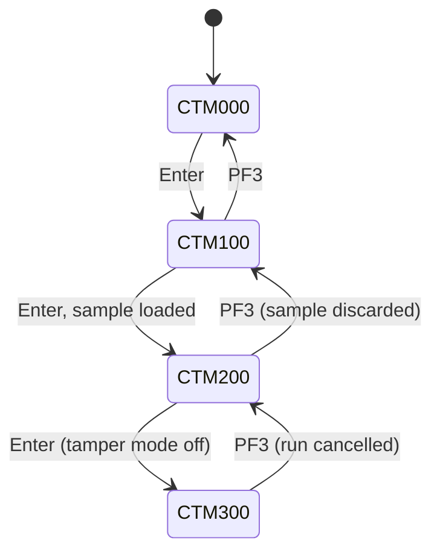
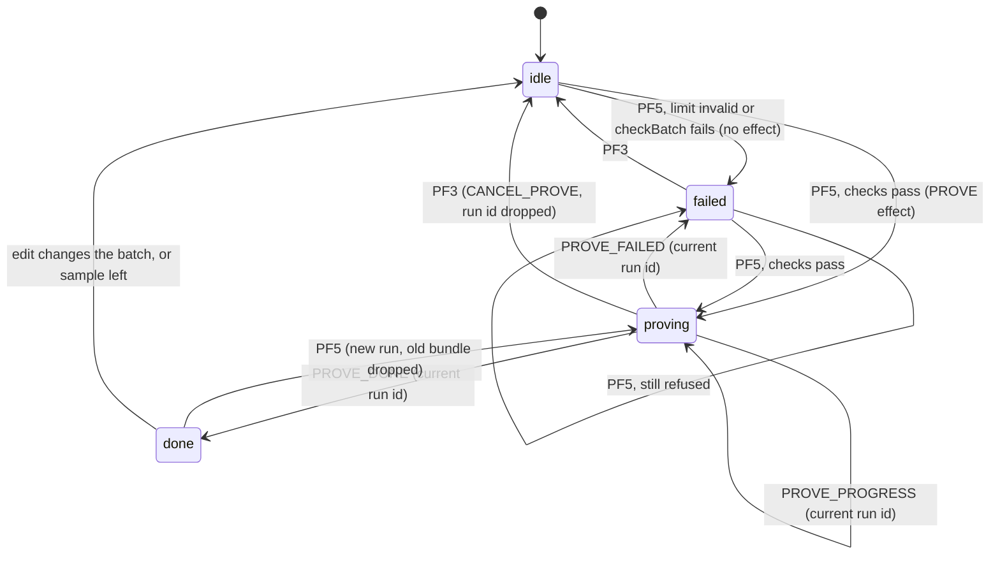
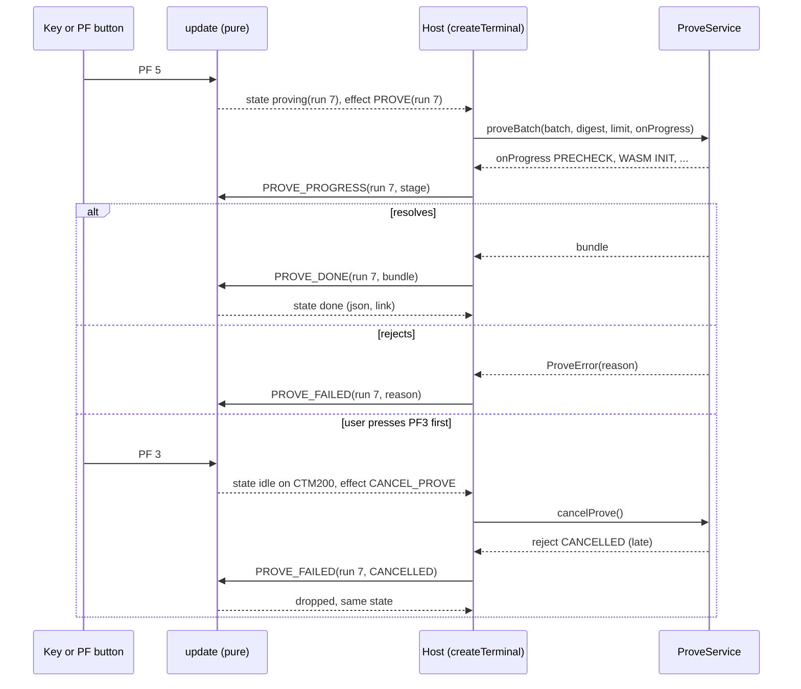

# Design Document: terminal-ui

## Findings for review

The review decisions below are accepted. The remaining risks are at the end ("Risks and open points").

1. **Verify_Link placement (accepted).** A bundle link is about 27,000 characters (zk-core design, section A), so it does not fit on an 80x24 grid. The grid row shows the first characters and the length. The full link is a real `<a>` element under the grid, and the e2e test reads that element. Requirements 8.4 and 10.3 now say "on the page".
2. **Success wording (accepted).** Requirement 8.2 now says `PROOF GENERATED`. VERIFIED belongs to the verifier and never appears on CTM300.
3. **`handleKey` takes no screen id (accepted).** No part of the key mapping depends on the screen, so a screen parameter would be unused.

## Overview

`terminal-ui` is the prover side of CryptTerm. The core is a pure state machine, `update(state, action) -> { state, effects }`, with no React, DOM or network. Effects are plain data. A small host, `createTerminal`, runs them through injected dependencies (the `ProveService`, the sample loader, clipboard, download, open-link) and feeds each result back as an action. Node tests drive the whole terminal with fakes. The React layer only draws `renderGrid(state)`, attaches one `keydown` listener and runs the browser versions of the dependencies.

Direction stays `ui -> zk -> ledger`. No existing file in `src/zk` or `src/ledger` changes. `src/ledger/mask.ts` is the only new file there.

## Architecture

### Module layout

| File | Contents |
|------|----------|
| `src/ledger/mask.ts` (new, pure) | `maskAccount`, `MASK_CHAR`, `MASK_WIDTH`, `VISIBLE_DIGITS` |
| `src/ui/model/types.ts` | `ScreenId`, `PfNumber`, `FieldId`, `TerminalState`, `ProveState`, `Action`, `Effect`, `Update`, `Field`, `PfEntry`, `ScreenLayout`, `ScreenDef` |
| `src/ui/model/messages.ts` | `MESSAGES`: every fixed status text, one place |
| `src/ui/model/amount-input.ts` | `parseAmountInput`, `AMOUNT_INPUT_MESSAGES`, `formatCents` |
| `src/ui/model/samples.ts` | `SAMPLES`, `SampleName`, `sampleByNumber` |
| `src/ui/model/grid.ts` | `ROWS`, `COLS`, `renderGrid`, `renderStatusRow`, `inputFields`, `cursorCell` |
| `src/ui/model/screens/ctm000.ts` to `ctm300.ts`, `screens/index.ts` | one `ScreenDef` per screen, and `SCREENS`, `layoutOf(state)` |
| `src/ui/model/keys.ts` | `KeyEventLike`, `handleKey`, `pfAction` |
| `src/ui/model/navigation.ts` | `goTo(state, screen)`: the keep/discard rules |
| `src/ui/model/tamper.ts` | `workingBatch`, `isTampered`, `pageSlots`, `applyAmountEdits` |
| `src/ui/model/prove-flow.ts` | `startProve`, `onProveProgress`, `onProveDone`, `onProveFailed`, export helpers |
| `src/ui/model/digest-status.ts` | `checkSignature(digest, keys = TRUSTED_SOURCE_KEYS)` |
| `src/ui/model/links.ts` | `VERIFY_LINK_PREFIX`, `verifyLinkFor`, `bundleFileName` |
| `src/ui/model/update.ts` | `initialState`, `update` |
| `src/ui/model/terminal.ts` | `createTerminal`, `Terminal`, `TerminalDeps` (the effect host) |
| `src/ui/sample-loader.ts` | `createSampleLoader`: the only `fetch` call under `src/ui` |
| `src/ui/browser-deps.ts` | real clipboard, download and open-link |
| `src/ui/theme.ts`, `src/ui/terminal.css` | palette, font, grid metrics, reduced-motion block |
| `src/ui/terminal-view.tsx`, `src/ui/app.tsx` | presentational view and the wiring (listener, host, deps) |

### Screen flow



| Transition | Kept | Discarded |
|------------|------|-----------|
| CTM000 to CTM100 | nothing yet | none |
| CTM100 to CTM000 | nothing | pending load (its late result is dropped by load id) |
| CTM100 to CTM200 (`SAMPLE_LOADED`) | `sample`, with `edits` empty, page 0, tamper off | selection field |
| CTM200 to CTM300 | `sample`, `edits`, `page` | tamper mode (off already), page fields |
| CTM300 to CTM200 (PF3) | `sample`, `edits`, `page`, a `done` bundle | a `proving` run (`CANCEL_PROVE`, run id dropped), a `failed` message, the limit field |
| CTM200 to CTM100 (PF3) | nothing | `sample`, `edits`, tamper flag, page, `prove` (bundle included) |

Requirement 2.6 is the CTM300 and CTM200 rows. Requirement 8.6 is the last row plus the edit rule in section G. `goTo` in `navigation.ts` is the only code that changes `screen`.

## Components and Interfaces

### A. Terminal data model

```ts
export type ScreenId = 'CTM000' | 'CTM100' | 'CTM200' | 'CTM300';
export type PfNumber = 1 | 2 | 3 | 4 | 5 | 6 | 7 | 8 | 9 | 10 | 11 | 12;
export type FieldId = 'select' | 'limit' | `amt:${number}`;   // amt:<slot>, slot = 0-based posting index

export interface LoadedSample {
  readonly name: SampleName;
  readonly batch: Batch;              // as parsed, never changed
  readonly digest: SignedDigest;      // Original_Digest, Object.freeze'd, never replaced
  readonly signatureValid: boolean;   // checkSignature result, computed once at load
}
export interface Cursor { readonly fieldId: FieldId; readonly offset: number }

export type ProveState =
  | { readonly kind: 'idle' }
  | { readonly kind: 'proving'; readonly runId: number; readonly stage: ProveStage }
  | { readonly kind: 'failed'; readonly message: string }
  | { readonly kind: 'done'; readonly bundle: ProofBundle; readonly json: string; readonly link: string };

export interface TerminalState {
  readonly screen: ScreenId;
  readonly fields: Readonly<Partial<Record<FieldId, string>>>; // text of every input Field
  readonly cursor: Cursor | null;          // null when the screen has no input Field
  readonly status: string;                 // row 24 text, from MESSAGES only
  readonly sample: LoadedSample | null;
  readonly edits: ReadonlyMap<number, Cents>; // slot -> amount, only slots that differ from the sample
  readonly tamper: boolean;                // CTM200 Tamper_Mode
  readonly page: number;                   // CTM200 page index, 0-based
  readonly pendingLoad: number | null;     // id of the sample load in flight
  readonly prove: ProveState;
  readonly nextLoadId: number;             // monotonic, never reset
  readonly nextRunId: number;              // monotonic, never reset
}
```

Working_Batch is derived, not stored: `workingBatch(sample, edits)` copies the sample's postings and replaces `amountCents` for each slot in `edits`. Invariant: every entry in `edits` differs from the sample's amount, so `isTampered(state)` is `edits.size > 0` and equals "Working_Batch differs from the loaded batch".

**Fields and screens.** A screen is a list of fields, as in a block-mode terminal. Every cell outside an input field is protected.

```ts
export const ROWS = 24, COLS = 80, BODY_ROWS = 22, PF_ROW = 23, STATUS_ROW = 24;
export type Field =
  | { readonly kind: 'text'; readonly protected: true; readonly row: number; readonly col: number; readonly text: string }
  | { readonly kind: 'input'; readonly protected: false; readonly id: FieldId; readonly row: number; readonly col: number; readonly length: number };
export interface PfEntry { readonly pf: PfNumber; readonly label: string; run(state: TerminalState): Update }
export interface ScreenLayout { readonly fields: readonly Field[]; readonly pf: readonly PfEntry[] }
export interface Update { readonly state: TerminalState; readonly effects: readonly Effect[] }
export interface ScreenDef {
  layout(state: TerminalState): ScreenLayout;
  submit(state: TerminalState, values: Readonly<Record<string, string>>): Update; // Enter
}
```

Rows and columns are 1-based. A layout never uses rows 23 and 24 and its fields never overlap (`layout_fields_valid`). `PfEntry.run` is the handler, so the PF_Bar and the handlers come from the same list.

**Render.** `renderGrid(state): string[]` is total and pure:

```
rows = 22 lines of 80 spaces
for f of layoutOf(state).fields:
  text  -> paint f.text at (row, col)
  input -> paint (value + '_' * (length - value.length)) at (row, col)
row 23 = fit(pf.map(e => `PF${e.pf} ${e.label}`).join('  '))
row 24 = renderStatusRow(state)
fit(s, n) = every char outside 0x20..0x7E replaced by '?', then slice(0, n).padEnd(n)
```

`renderStatusRow`: when `isTampered(state)` and the screen is CTM200 or CTM300, the row is `fit(status, 71) + ' ' + 'TAMPERED'`. Otherwise it is `fit(status, 80)`. Every message in `MESSAGES` is at most 70 characters (`messages_fit_status_line`). `cursorCell(state)` returns `{ row, col }` of the cursor or `null`, for the view.

**Actions.** User actions come from `handleKey` or from a PF_Bar button. System actions are the results of effects.

```ts
export type UserAction =
  | { readonly type: 'PF'; readonly pf: PfNumber }
  | { readonly type: 'ENTER' }
  | { readonly type: 'TAB'; readonly back: boolean }
  | { readonly type: 'BACKSPACE' }
  | { readonly type: 'CHAR'; readonly ch: string };
export type SystemAction =
  | { readonly type: 'SAMPLE_LOADED'; readonly loadId: number; readonly sample: LoadedSample }
  | { readonly type: 'SAMPLE_FAILED'; readonly loadId: number }
  | { readonly type: 'PROVE_PROGRESS'; readonly runId: number; readonly stage: string }
  | { readonly type: 'PROVE_DONE'; readonly runId: number; readonly bundle: ProofBundle }
  | { readonly type: 'PROVE_FAILED'; readonly runId: number; readonly reason: ProveReason | 'UNEXPECTED' }
  | { readonly type: 'CLIPBOARD_DONE'; readonly ok: boolean };
export type Action = UserAction | SystemAction;
```

No system action carries a thrown value. The host maps a rejection to `reason` before dispatch, so nothing can reach the status line except a fixed text.

**Effects.**

```ts
export type Effect =
  | { readonly type: 'LOAD_SAMPLE'; readonly loadId: number; readonly name: SampleName }
  | { readonly type: 'PROVE'; readonly runId: number; readonly batch: Batch; readonly digest: SignedDigest; readonly limitCents: Cents }
  | { readonly type: 'CANCEL_PROVE' }
  | { readonly type: 'CLIPBOARD_WRITE'; readonly text: string }
  | { readonly type: 'DOWNLOAD'; readonly filename: string; readonly text: string }
  | { readonly type: 'OPEN_LINK'; readonly href: string };
```

**Field editing (inside `update`).**

| Action | Rule |
|--------|------|
| `CHAR` | Needs a cursor and a code point in 0x20 to 0x7E, else the state is returned unchanged. Overwrites the character at `offset` when `offset < value.length`, appends when the field has room, ignores the key when the field is full. `offset` moves by one. |
| `BACKSPACE` | When `offset > 0`, removes the character before `offset` and moves `offset` back. |
| `TAB` | Input fields sorted by `(row, col)`. Moves to the next (or previous when `back`), wrapping at both ends, with `offset = value.length`. No fields: unchanged. |
| `ENTER` | Collects the text of all input fields of the screen into one `values` record and calls `ScreenDef.submit` once (Requirement 1.4). |
| `PF` | Finds the `PfEntry` with that `pf` in the layout and runs it. No entry: status `PF KEY NOT ACTIVE`, no effects. |

After every update `settle` repairs the cursor: if `cursor.fieldId` is not an input field of the new layout, the cursor goes to the first one (offset 0), or becomes `null`. `settle` also clamps `offset` to the value length. A cursor therefore never rests on a protected cell (Requirement 1.3).

**Stale results are dropped.** `update` returns the same state object, with no effects, for any system action that does not match the current load id or run id, or that arrives on the wrong screen. Tests assert `Object.is(next, prev)`.

**The effect host and the injected Prove_Port.**

```ts
export interface TerminalDeps {
  readonly prove: ProveService;                                   // Prove_Port (src/zk/prove-service.ts)
  readonly loadSample: (name: SampleName) => Promise<{ batch: Batch; digest: SignedDigest }>;
  readonly writeClipboard: (text: string) => Promise<void>;
  readonly download: (filename: string, text: string) => void;
  readonly openLink: (href: string) => void;
  readonly trustedKeys?: Readonly<Record<string, string>>;        // default TRUSTED_SOURCE_KEYS
}
export interface Terminal {
  getState(): TerminalState;
  dispatch(action: Action): void;
  subscribe(listener: () => void): () => void;
}
export function createTerminal(deps: TerminalDeps, initial?: TerminalState): Terminal;
```

`dispatch` computes `update`, stores the new state, notifies subscribers, then runs the effects. The state is stored before any effect runs, so an effect that calls back synchronously is safe (the real service calls `onProgress('PRECHECK')` inside `proveBatch`).

| Effect | What the host does | Action that re-enters |
|--------|--------------------|-----------------------|
| `LOAD_SAMPLE` | `deps.loadSample(name)`, then `checkSignature(digest, trustedKeys)` | `SAMPLE_LOADED` with `signatureValid`, or `SAMPLE_FAILED` on any rejection |
| `PROVE` | `deps.prove.proveBatch(batch, digest, limitCents, stage => dispatch(PROVE_PROGRESS))` | `PROVE_DONE`, or `PROVE_FAILED` with `reason = err instanceof ProveError && Object.hasOwn(PROVE_ERROR_MESSAGES, err.reason) ? err.reason : 'UNEXPECTED'`. A synchronous throw is `UNEXPECTED`. |
| `CANCEL_PROVE` | `deps.prove.cancelProve()` | none (the rejection that follows is `CANCELLED` with an old run id, and is dropped) |
| `CLIPBOARD_WRITE` | `deps.writeClipboard(text)` | `CLIPBOARD_DONE` with `ok` |
| `DOWNLOAD`, `OPEN_LINK` | call the dep | none |

Every action from an effect carries the id of the load or run that started it. Production passes `{ proveBatch, cancelProve }` from `src/zk/prove-service.ts` as `prove`. Tests pass a fake that records calls and settles on demand, so "the Prove_Port was never called" is a plain assertion on the fake.

### B. Screens

Row numbers are 1-based. Column widths come from `POSTING_COLUMNS` in `layout.ts` (record id 20, account 20, amount 13). Every screen has row 1 `CTMnnn  <NAME>` on the left and `DEMO DATA` at column 72.

| Screen | Body | Input fields |
|--------|------|--------------|
| CTM000 LOGON | `CRYPTTERM`, `BLOCK-MODE TERMINAL`, `DEMO`, `PRESS ENTER` | none |
| CTM100 BATCH SELECT | the four rows of `SAMPLES` with number, label and note, then `SELECT NO:` | `select`, length 1 |
| CTM200 BATCH VIEW | row 2 batch id, count, `PAGE p/q`. Row 3 digest status and, when tampered, `TAMPERED` at column 40. Row 5 column headers. Rows 6 to 17: up to 12 postings (`PAGE_SIZE = 12`). Row 19 `DEBITS` and `CREDITS` through `formatCents`. Row 21 a tamper hint, row 22 `ENTER: PROVE SCREEN` | in tamper mode, one `amt:<slot>` field (length 13) per posting row, column 67 |
| CTM300 PROVE | batch id, totals, `POLICY LIMIT (CENTS)`, result lines, link row | `limit`, length 13, prefilled `LIMIT_CENTS.toString()` on every entry |

A CTM200 posting row: slot number (1-based), record id right-aligned in 20, `maskAccount(account)`, `D` or `C` from `SIDE_DEBIT_LETTER` and `SIDE_CREDIT_LETTER`, `formatCents(amountCents)` right-aligned in 14, `Y` or `N`, then the optional edit field. Columns: 1, 5, 26, 47, 49, 64, 67.

**PF table.** Entries exist only where the screen handles the key. `PF3` is absent on CTM000, so PF3 there leaves the screen unchanged (Requirement 2.5).

| PF | CTM000 | CTM100 | CTM200 | CTM300 |
|----|--------|--------|--------|--------|
| PF3 BACK | none | to CTM000 | to CTM100 | to CTM200 |
| PF5 PROVE | none | none | none | start a run |
| PF7 PREV, PF8 NEXT | none | none | page back, forward | none |
| PF9 COPY, PF10 SAVE, PF11 LINK | none | none | none | only when `prove.kind === 'done'` |
| PF12 TAMPER (`END TAMPER` when on) | none | none | toggle Tamper_Mode | none |
| Enter | to CTM100 | load the selected sample | tamper off: to CTM300. Tamper on: apply edits | validate the limit field |

F11 and F12 are not handled at all, so the browser keeps full screen and developer tools. PF11 and PF12 are reachable through Alt+Minus, Alt+Equal and the on-screen buttons, which resolves requirements note 4.

### C. Key handling

```ts
export interface KeyEventLike {
  readonly key: string; readonly code: string;
  readonly altKey: boolean; readonly ctrlKey: boolean; readonly metaKey: boolean; readonly shiftKey: boolean;
}
export interface KeyResult { readonly action: UserAction | null; readonly preventDefault: boolean }
export function handleKey(e: KeyEventLike): KeyResult;
export function pfAction(pf: PfNumber): UserAction;   // { type: 'PF', pf }, used by handleKey and by the PF_Bar buttons
```

A DOM `KeyboardEvent` is structurally a `KeyEventLike`. `handleKey` checks these rules in order and the first match wins:

| # | Condition | Result |
|---|-----------|--------|
| 1 | `e.key` is one of `F1` to `F10` (own-property lookup in a frozen table that holds exactly those ten keys, no number parsing). Modifiers are ignored, so Ctrl+F5 does not hard-reload either. | `PF n`, `preventDefault: true` |
| 2 | `e.altKey`, no `ctrlKey`, no `metaKey`, and `e.code` is an own key of `ALT_CODES`. `e.key` is not read. | `PF n`, `preventDefault: true` |
| 3 | `ctrlKey`, `metaKey` or `altKey` is set (no binding matched) | `null`, `false`. Browser shortcuts (Cmd+R, Cmd+Option+I, Ctrl+C) are never touched. |
| 4 | `key === 'Tab'` | `TAB` with `back: e.shiftKey`, `true` |
| 5 | `key === 'Enter'` | `ENTER`, `true` |
| 6 | `key === 'Backspace'` | `BACKSPACE`, `true` |
| 7 | `key.length === 1` and the code point is 0x20 to 0x7E | `CHAR`, `true` (stops space from scrolling and `/` or `'` from opening quick find) |
| 8 | anything else | `null`, `false` |

`ALT_CODES` is `{ Digit1: 1, ... Digit9: 9, Digit0: 10, Minus: 11, Equal: 12 }`. Rule 2 matches on `code` because macOS Option changes `key` (Option+1 gives `¡`, Option+5 gives `∞`), and rule 3 then keeps those characters out of fields.

**F11 and F12 are not handled.** They match no rule except 3 or 8, so plain, with Shift, or with any other modifier they return `null`, `false` (an Alt+F11 has `code` `F11`, which is not in `ALT_CODES`). The browser keeps full screen on F11 and developer tools on F12, and judges may open developer tools to check the no-network claim. From the keyboard, PF11 and PF12 are reached only through rule 2.

**Why `preventDefault` is reported for every F1 to F10 key, handled or not.** F5 reloads the page and F1 opens help in some browsers. A screen that ignores PF5 must still not lose its state to a reload. `handleKey` therefore decides from the key alone, and the key table holds exactly F1 to F10.

**Shell wiring (`app.tsx`).**

```
useEffect(() => {
  const onKeyDown = (ev: KeyboardEvent) => {
    const r = handleKey(ev);
    if (r.preventDefault) ev.preventDefault();
    if (r.action !== null) terminal.dispatch(r.action);
  };
  document.addEventListener('keydown', onKeyDown);
  return () => document.removeEventListener('keydown', onKeyDown);
}, [terminal]);
```

PF_Bar buttons call `terminal.dispatch(pfAction(pf))`, so key and button run the same action (Requirement 2.4). Buttons use `tabIndex={-1}` and `onMouseDown={e => e.preventDefault()}` so they never take focus, which stops Enter or Space from activating a focused button on top of the global listener. Held keys repeat: a repeated PF5 hits the single-run guard in section F.

### D. Amount_Input and `formatCents`

```ts
export type AmountInputError = 'EMPTY' | 'NOT_DIGITS' | 'LEADING_ZERO' | 'OUT_OF_RANGE';
export type AmountInputResult = { readonly ok: true; readonly value: Cents } | { readonly ok: false; readonly error: AmountInputError };
export const AMOUNT_INPUT_MESSAGES: Readonly<Record<AmountInputError, string>>;
export function parseAmountInput(text: string): AmountInputResult;
export function formatCents(cents: Cents): string;
```

```
parseAmountInput(text):
  if typeof text !== 'string' or text.length === 0            -> EMPTY
  if not /^[0-9]+$/.test(text)                                -> NOT_DIGITS   // sign, '.', 'e', space, letters, non-ASCII digits
  if text.length > 1 and text[0] === '0'                      -> LEADING_ZERO
  if text.length > POSTING_COLUMNS.amount.width (13)          -> OUT_OF_RANGE // checked before BigInt
  v = BigInt(text)                                            // digit text only, no Number step
  if v >= AMOUNT_BOUND_CENTS                                  -> OUT_OF_RANGE
  ok(v)

formatCents(c):  c < 0n or not a bigint -> 'INVALID'
  `${c / 100n}.${(c % 100n).toString().padStart(2, '0')}`      // integer arithmetic and strings only
```

| Error | Message |
|-------|---------|
| `EMPTY` | `AMOUNT REQUIRED` |
| `NOT_DIGITS` | `AMOUNT MUST BE DIGITS ONLY, IN CENTS` |
| `LEADING_ZERO` | `AMOUNT MUST NOT START WITH ZERO` |
| `OUT_OF_RANGE` | `AMOUNT OUT OF RANGE` |

The messages never contain the typed text. `formatCents(1234n)` is `12.34` and the result for any non-negative bigint matches `^(0|[1-9][0-9]*)\.[0-9]{2}$`. It accepts any non-negative bigint, because the totals can exceed `2^40` (64 postings of `2^40 - 1` is below `7.1e13` cents, 15 characters). The typed Amount_Input is in cents and the displayed amounts are in `D.CC`. The tamper column header says `NEW CENTS` for that reason (open point 4).

### E. Mask_Function (`src/ledger/mask.ts`)

```ts
export const MASK_CHAR = 'X';
export const MASK_WIDTH = POSTING_COLUMNS.account.width;   // 20
export const VISIBLE_DIGITS = 4;
export function maskAccount(account: bigint): string;
```

```
maskAccount(a):
  if typeof a !== 'bigint' or a < 0n or a > ID_MAX -> MASK_CHAR.repeat(20)    // fail closed, never throws
  digits = padDigits(a, 20)                                                    // layout.ts
  MASK_CHAR.repeat(16) + digits.slice(-4)
```

`X` is chosen over `*` because it reads clearly on a monospace grid and cannot be mistaken for a digit. `maskAccount(7n)` is `XXXXXXXXXXXXXXXX0007`. `maskAccount` is the only way an account becomes text anywhere in `src/ui`: the CTM200 layout is the only code that reads `posting.account`, and `ui_static_scan` checks that no other file under `src/ui` mentions `.account`.

### F. CTM300 prove flow



**PF5 handler (`startProve`).**

```
if prove.kind === 'proving':       status = PROOF IN PROGRESS; no effects          // single run
limit = parseAmountInput(fields.limit)
if !limit.ok:                      status = AMOUNT_INPUT_MESSAGES[error]; cursor stays in 'limit'; no effects
working = workingBatch(sample, edits)
c = checkBatch(working, limit.value)
if !c.ok:                          prove = failed; status = `REJECTED: ${c.reason}`; no effects
runId = nextRunId; nextRunId += 1
prove  = { kind: 'proving', runId, stage: 'PRECHECK' }; status = 'PROVING: PRECHECK'
effects = [{ type: 'PROVE', runId, batch: working, digest: sample.digest, limitCents: limit.value }]
```

`checkBatch` runs on the page before any effect, so a refused batch never reaches the host and the fake port records zero calls. The real service runs `checkBatch` again and also checks the digest shape. A digest that fails (`DIGEST_INVALID`) shows its fixed message through the normal failure path.

**System actions.** All four checks must hold, or the action is dropped (same state object, no effects): `screen === 'CTM300'`, `prove.kind === 'proving'`, `prove.runId === action.runId`.

| Action | Result |
|--------|--------|
| `PROVE_PROGRESS` | If `action.stage` is in `PROVE_STAGES`: `stage` and status `PROVING: <STAGE>`. Another string is ignored. |
| `PROVE_DONE` | `json = bundleToJson(bundle)`, `link = verifyLinkFor(bundle)`, `prove = done`, status `PROOF GENERATED`. If either call throws: `failed` with the `PROVER_FAILED` message. |
| `PROVE_FAILED` | `failed` with `PROVE_ERROR_MESSAGES[reason]` for a `ProveReason`, or `PROOF GENERATION FAILED: UNEXPECTED ERROR` for `UNEXPECTED`. |

**Leaving mid-run.** PF3 on CTM300 with `prove.kind === 'proving'` emits one `CANCEL_PROVE`, sets `prove` to `idle` and goes to CTM200. The real `cancelProve()` clears its active run at once and rejects that run's promise with `ProveError('CANCELLED')` a microtask later. The host turns that into `PROVE_FAILED { runId: old }`, and the reducer drops it because `prove` is no longer `proving` with that id. A resolve that arrives after the cancel is dropped the same way. If the user re-enters CTM300 and presses PF5 before the old promise settles, the new run has a higher id, so the old settle is still dropped. No other path emits `CANCEL_PROVE`, so it is sent once per cancelled run.



**Result screen and exports.** In `done` the CTM300 body shows `PROOF GENERATED`, `CIRCUIT <bundle.circuitVersion>`, `BATCH <bundle.batchId>`, `LIMIT <formatCents(bundle.limitCents)>`, and a link row: `LINK /verify#b=` plus the next 40 characters of the encoded bundle, `...` and `(<length> CHARS)`. The row holds only public data. The full text is `state.prove.link`. The word VERIFIED never appears on the screen.

| Key | Effect | Status after |
|-----|--------|--------------|
| PF9 | `CLIPBOARD_WRITE { text: prove.json }` | `BUNDLE COPIED` on `CLIPBOARD_DONE { ok: true }`, `COPY FAILED` on `ok: false`. The bundle stays in state in both cases. `CLIPBOARD_DONE` is dropped unless the screen is CTM300 and `prove.kind === 'done'`. |
| PF10 | `DOWNLOAD { filename: bundleFileName(bundle), text: prove.json }`. The file name is `<batchId>.proof.json`, safe because `batchId` matches `BATCH_ID_PATTERN`. | `DOWNLOAD STARTED` |
| PF11 | `OPEN_LINK { href: prove.link }` | `OPENING VERIFIER` |

`verifyLinkFor(bundle)` is `'/verify#b=' + encodeBundleForUrl(bundle)`. The bundle is held in memory only: `prove` returns to `idle` when an applied edit changes `edits` (section G) and when CTM200 goes back to CTM100. A `done` state survives CTM300 to CTM200 to CTM300 with no edit in between.

### G. CTM200: digest status, paging and tamper mode

**Digest status.** `checkSignature(digest, keys)` is `isSignedDigestShape(digest) && Object.hasOwn(keys, digest.sourceKeyId) && await verifyDigest(digest, keys[digest.sourceKeyId])`, and any throw gives `false`. The host runs it once at load. `__proto__` and `constructor` are not own properties of the frozen key table, so they fail. Row 3 reads `SIGNATURE VALID (ORIGINAL BATCH)` or `SIGNATURE INVALID (ORIGINAL BATCH)`, and never changes text after an edit. While `isTampered`, `TAMPERED` is added at column 40 of the same row. No text on the screen claims that the Working_Batch matches the signed root.

**Paging.** `pageCount = ceil(n / 12)`. PF8 on the last page sets status `LAST PAGE`, and PF7 on the first sets `FIRST PAGE`, with the page unchanged. A page change clears the typed text of all tamper fields.

**Tamper mode.** PF12 toggles `tamper`, clears the page's edit fields, and puts the cursor in the first one. The tamper amount fields start empty. An empty field means "no change" for that slot.

```
submit (tamper on):
  typed  = pageSlots(state).map(slot => [slot, values['amt:'+slot]]).filter(text !== '')
  if typed is empty                    -> status NO AMOUNT ENTERED, nothing else
  parsed = typed.map(parseAmountInput)
  if any not ok                        -> status = message of the first failure, cursor to that field,
                                          edits, prove and all other fields unchanged   // atomic, Requirement 6.5
  for each (slot, v): v == sample amount ? edits.delete(slot) : edits.set(slot, v)
  clear the page's fields; status AMOUNTS UPDATED
  if the edit map changed: prove = idle                                                 // bundle dropped, Requirement 8.6
```

Edits accumulate because `edits` is only ever changed here, and `sample` is never touched. Moving 1 cent between two same-side postings is two typed values in one submit, so the debit and credit totals stay equal. The original digest is never read for writing: no code under `src/ui` creates or replaces a `SignedDigest`.

### H. Sample_Loader

```ts
export type FetchLike = (url: string) => Promise<{ readonly ok: boolean; text(): Promise<string> }>;
export function createSampleLoader(fetchFn?: FetchLike): TerminalDeps['loadSample'];
```

`fetchFn` defaults to `(url) => fetch(url)`, the one `fetch` call under `src/ui`. The loader requests `/samples/<name>.dat` and `/samples/<name>.digest.json`, where `name` comes from the `SAMPLES` table and never from typed text. It rejects when a response is not `ok`, when `parseBatch` throws, or when `JSON.parse` fails or `isSignedDigestShape` is false. The rejection carries no text, and the host maps it to `SAMPLE_FAILED`, which shows `SAMPLE LOAD FAILED`.

CTM100 Enter sets `pendingLoad = nextLoadId`, status `LOADING SAMPLE`, and emits `LOAD_SAMPLE`. Enter while a load is pending only repeats the status. A result is dropped unless `loadId === pendingLoad` and the screen is CTM100, so PF3 during a load cannot jump the user to CTM200 later.

### I. React shell and theme

- `terminal-view.tsx` is presentational: `TerminalView({ state, onPf })`. It draws rows 1 to 22 as `<pre>` lines, the cursor and input-field underlines as overlays placed with `ch` and `lh` units, the PF_Bar as `<button data-testid="pf-N">` elements, and row 24 in a `role="status"` `aria-live="polite"` element. The grid text has an `aria-label` for the screen name. There is no `<input>`, and the document listener is the only key source.
- When `prove.kind === 'done'`, the view renders `<a data-testid="verify-link" href={link} rel="noopener">{link}</a>` below the grid. It is the only `href` in the view and holds only the public bundle (Requirement 9.2).
- `app.tsx` builds `createTerminal(deps)` once (`useState` initializer), reads state with `useSyncExternalStore`, and installs the listener of section C. `browser-deps.ts` has `writeClipboard` (`navigator.clipboard.writeText`), `download` (Blob and `URL.createObjectURL`, a temporary `<a download>`, revoke) and `openLink` (`window.open(href, '_blank', 'noopener')`).
- `theme.ts` exports `THEME` (palette, font stack, grid metrics, `SCANLINE_ALPHA`) and `contrastRatio(a, b)`. `terminal-view.tsx` sets the palette as CSS variables from it, so there is one source. `terminal.css` holds the layout rules and a `@media (prefers-reduced-motion: reduce)` block that sets `animation: none` for the cursor blink and the flicker. Effect layers (scanlines, glow) are `pointer-events: none`.
- Look: phosphor green on near-black, inverse-video header and status line, bright underlined input cells, a double-rule frame drawn with CSS borders. The font is a local monospace stack with no web font. The grid scales with `min(100vw / 50, 100vh / 32)` so the 80x24 grid fits a phone width.

| Role | Proposed value | Ratio on `#07110a` |
|------|----------------|--------------------|
| text | `#3dff7a` | 14.4 |
| dim text | `#2fbf5f` | 8.0 |
| inverse text on text colour | `#031006` on `#3dff7a` | 14.6 |
| text under scanlines (`SCANLINE_ALPHA` 0.25) | `#3dff7a` darkened 25% | 8.0 |
| dim text under scanlines | `#2fbf5f` darkened 25% | 4.66 |

The ratios were computed with the WCAG formula. `theme_contrast` recomputes them from `THEME`, including the scanline case, so a palette change that drops below 4.5 fails the test.

### J. Playwright and build

- `@playwright/test` 1.62.0, exact pin, installed with `PLAYWRIGHT_SKIP_BROWSER_DOWNLOAD=1`. No `playwright install` appears anywhere (`playwright_pin` scans `package.json`, `playwright.config.ts`, `e2e` and `scripts`).
- `playwright.config.ts`: `testDir: 'e2e'`, `workers: 1`, `retries: 0`, `timeout: 120_000`, project `chromium` (`devices['Desktop Chrome']`, headless), `use.baseURL: 'http://127.0.0.1:4173'`, `webServer: { command: 'npm run build && npm run preview:e2e', url: 'http://127.0.0.1:4173/', reuseExistingServer: false, timeout: 180_000 }`. No COOP/COEP header is set. At the top, `existsSync(chromium.executablePath())` must hold, else the config throws `CHROMIUM NOT CACHED: STOP AND ASK`. The cached revision is `chromium-1234`, which is the revision of 1.62.0.
- `package.json` scripts: `preview:e2e` = `vite preview --host 127.0.0.1 --port 4173 --strictPort`, `test:e2e` = `playwright test`.
- `e2e/prover.spec.ts` registers `context.route('**/*')` before navigation. It continues requests to `http://127.0.0.1:4173/`, `blob:` and `data:`, aborts the rest, and records their origins (scheme, host, port). Each test ends by asserting that the list is empty.

| Test | Steps |
|------|-------|
| `prover_clean_to_link` | Enter, `1`, Enter, Enter (CTM300), F5. Wait for `PROOF GENERATED` (up to 90 s). Read `verify-link`. It starts with `/verify#b=` and `decodeBundle` accepts the rest. |
| `prover_unbalanced_no_worker` | Select `3`, go to CTM300, F5. Status holds `REJECTED: UNBALANCED`. `page.on('worker')` fired zero times. |
| `prover_f5_no_reload` | Same flow, with a `window` marker set before F5 and a `framenavigated` counter. The marker survives and the counter is unchanged. It uses the unbalanced sample so no proof runs. |
| `prover_move_cent_makes_bundle` | Clean sample, tamper mode (button `pf-12`), read two same-side amounts from the grid, type one cent less and one cent more (in cents), Enter, PF12 off, Enter, F5. A bundle and link appear and `TAMPERED` shows on the status row. |

**Requirements note 6: do not add the harness page.** `prover_clean_to_link` runs the real Worker, the Artifact, the SRS and the shipped key assets through the production build, which is what the harness would check, without a second build mode, a second entry or a `node_modules/.cryptterm-e2e` output. The remaining gap is the Verify_Worker in a real browser. The verifier spec's e2e covers it.

**Build checks.** `npm run build` then `npm run check:dist-vk` must print `check-dist-vk: PASS`. This closes the check that `zk-core` Requirement 7.7 deferred, because `app.tsx` now imports `prove-service.ts` and the worker chain. `dist_clean` lists `dist` and scans it for `e2e`, `tests`, `scripts` and the demo key file name and key bytes.

**Files outside `src/` that change.** `package.json` and `package-lock.json` (pinned dev dependency, two scripts), `tsconfig.json` (`include` gains `e2e` and `playwright.config.ts`), `index.html` (title `CRYPTTERM`, `color-scheme` meta), `src/main.tsx` (imports `terminal.css`), new `playwright.config.ts`, `e2e/prover.spec.ts`, `tests/ui/*`, `tests/ledger/mask.prop.test.ts`, and the helpers `tests/support/terminal-arbitraries.ts` and `tests/support/fake-prove.ts`. `vite.config.ts` does not change.

## Data Models

**Samples** (`SAMPLES`, in menu order):

| No | `name` | Label | Note |
|----|--------|-------|------|
| 1 | `clean` | CLEAN | BALANCED, WITHIN LIMIT |
| 2 | `over-limit-unflagged` | OVER-LIMIT UNFLAGGED | ONE POSTING OVER LIMIT, NO REVIEW FLAG |
| 3 | `unbalanced` | UNBALANCED | DEBITS DO NOT EQUAL CREDITS |
| 4 | `large` | LARGE | 64 POSTINGS, 6 PAGES |

`sampleByNumber(text)` is an exact string match against `no`, so `'1 '`, `'01'` and `'__proto__'` are not samples.

**Status texts** (`MESSAGES`, all at most 70 characters, none built from user input):

| Key | Text |
|-----|------|
| `SELECT_INVALID` | `ENTER A SAMPLE NUMBER FROM 1 TO 4` |
| `LOADING` / `LOAD_FAILED` / `SAMPLE_LOADED` | `LOADING SAMPLE` / `SAMPLE LOAD FAILED` / `SAMPLE LOADED` |
| `PF_INACTIVE` | `PF KEY NOT ACTIVE` |
| `FIRST_PAGE` / `LAST_PAGE` | `FIRST PAGE` / `LAST PAGE` |
| `TAMPER_ON` / `TAMPER_OFF` | `TAMPER MODE ON` / `TAMPER MODE OFF` |
| `NO_EDITS` / `EDITS_APPLIED` | `NO AMOUNT ENTERED` / `AMOUNTS UPDATED` |
| `LIMIT_OK` | `LIMIT ACCEPTED` |
| `IN_PROGRESS` | `PROOF IN PROGRESS` |
| `REJECTED` | `REJECTED: ` followed by `UNBALANCED`, `OVER_LIMIT_UNFLAGGED` or `OUT_OF_RANGE` |
| `PROVING` | `PROVING: ` followed by a name from `PROVE_STAGES` |
| `DONE` | `PROOF GENERATED` |
| `UNEXPECTED` | `PROOF GENERATION FAILED: UNEXPECTED ERROR` |
| `COPIED` / `COPY_FAILED` | `BUNDLE COPIED` / `COPY FAILED` |
| `DOWNLOAD` / `OPENING` | `DOWNLOAD STARTED` / `OPENING VERIFIER` |

Amount messages are in section D. Prove failures use `PROVE_ERROR_MESSAGES` from `src/zk/prove-service.ts` unchanged.

**Tables elsewhere:** `ALT_CODES` and the F1 to F10 key table (section C), the PF table (section B), the palette (section I).

## Correctness Properties

*A property is a characteristic or behavior that should hold true across all valid executions of a system-essentially, a formal statement about what the system should do. Properties serve as the bridge between human-readable specifications and machine-verifiable correctness guarantees.*

The properties cover the pure model (`update`, `renderGrid`, `handleKey`, `parseAmountInput`, `formatCents`, `maskAccount`) and the effect host driven by a fake Prove_Port. The React view, the theme and the browser checks are tested by examples, scans and Playwright (see "Testing Strategy"). Reachable states are built from `initialState()` by random user actions plus the `SAMPLE_LOADED` result of a generated batch.

### Property 1: Every screen is exactly 24 rows of 80 printable characters

For any reachable state, `renderGrid` returns exactly 24 strings, each exactly 80 characters, each character in 0x20 to 0x7E. Row 23 equals the PF_Bar text built from the layout's `pf` list and row 24 equals `renderStatusRow(state)`.

**Validates: Requirements 1.1**

### Property 2: The PF_Bar lists exactly the handled PF keys

For any reachable state and any `pf` from 1 to 12, `pf` appears in the PF_Bar of that state if and only if `update(state, PF pf)` does not take the inactive path. The inactive path returns the same state with only `status` set to `PF KEY NOT ACTIVE` and no effects. Each bar entry shows its number and label.

**Validates: Requirements 1.5**

### Property 3: Tab moves through input fields in order and wraps

For any reachable state whose screen has `k` input fields, any starting cursor and any sequence of Tab and Shift+Tab presses, the cursor field equals the field at index `(start + forward - backward) mod k` of the fields sorted by `(row, col)`. With `k = 0` the state is unchanged.

**Validates: Requirements 1.2**

### Property 4: Printable keys edit unprotected fields only

For any reachable state, field text, cursor offset and printable ASCII character, `CHAR` produces the field value of the reference model (overwrite below the end, append with room, ignore when full) and moves the offset accordingly. For any state with `cursor === null` and for any non-printable character, the state is unchanged. After any action the cursor is `null` or names an input field of the current layout.

**Validates: Requirements 1.3**

### Property 5: F1 to F10 map to their PF keys, F11 and F12 are left to the browser

For any `key` from `F1` to `F10`, any combination of the four modifier flags and any `code`, `handleKey` returns `{ action: { type: 'PF', pf: n }, preventDefault: true }`, and for any reachable state `update(state, handleKey(...).action)` deep-equals `update(state, pfAction(n))`, which is what the PF_Bar button dispatches. For any `key` `F11` or `F12`, any combination of modifier flags and any `code` that is not an Alt-binding code with `altKey` true, `ctrlKey` and `metaKey` false, `handleKey` returns `{ action: null, preventDefault: false }`.

**Validates: Requirements 2.1, 2.3, 2.4**

### Property 6: Alt bindings match on `code` and ignore `key`

For any `key` string (including Option-modified characters such as `¡` and `∞`), any `code` and any modifier flags, `handleKey` returns `PF n` with `preventDefault: true` through the Alt path if and only if `altKey` is true, `ctrlKey` and `metaKey` are false and `code` is one of the twelve bound codes, with `n` given by the table. For any event with `ctrlKey` or `metaKey` set and no F1 to F10 key, the result is `{ action: null, preventDefault: false }`.

**Validates: Requirements 2.2**

### Property 7: Screens move one step at a time and PF3 keeps or discards the right state

For any sequence of user actions and sample load results, every transition goes from a screen to its neighbour, the screen is always one of the four ids, and PF3 on CTM000 returns the same state. After CTM300 to CTM200 the `sample`, `edits` and `page` are unchanged. After CTM200 to CTM100 `sample` is `null`, `edits` is empty, `tamper` is false and `prove` is `idle`.

**Validates: Requirements 2.5, 2.6**

### Property 8: A masked account shows only its last four digits

For any account from 0 to `ID_MAX`, `maskAccount` returns exactly 20 characters whose first 16 are `MASK_CHAR` and whose last 4 equal the last 4 digits of the account's zero-padded 20-digit decimal form. For any value outside that range, or any non-bigint, it returns 20 mask characters and does not throw.

**Validates: Requirements 4.1**

### Property 9: No rendered text shows an account in full

For any generated batch, any page and any set of tamper edits, no row of `renderGrid` contains the zero-padded 20-digit form of any account, nor its decimal form when that has more than 4 digits. Accounts are drawn so that their decimal text occurs nowhere else in the rendering.

**Validates: Requirements 4.2**

### Property 10: Paging shows every posting exactly once, in order

For any batch of 1 to 64 postings, pressing PF8 from page 0 until the page stops changing shows, page by page, the slot numbers `1..n` exactly once and in order. PF7 on the first page and PF8 on the last page leave the page unchanged.

**Validates: Requirements 4.3**

### Property 11: Displayed totals equal the bigint sums

For any generated batch and any set of edits, the debit and credit totals in the CTM200 grid equal `formatCents` of separately computed bigint sums over the Working_Batch.

**Validates: Requirements 4.4**

### Property 12: Formatted cents convert back to the same amount

For any amount from 0 to `2^40 - 1` (and any non-negative bigint), `formatCents` matches `^(0|[1-9][0-9]*)\.[0-9]{2}$` and `BigInt` of the text without the dot equals the amount. Only integer arithmetic and string handling are used.

**Validates: Requirements 4.4**

### Property 13: Valid digit text parses to the same bigint

For any text of 1 to 13 digits with no leading zero (or exactly `0`) whose value is below `2^40`, `parseAmountInput` returns `ok` with `BigInt(text)`. The boundary values `0` and `1099511627775` are always generated.

**Validates: Requirements 5.1, 5.3**

### Property 14: Invalid text is rejected with a fixed message that does not echo it

For any text that is empty, holds a sign, decimal point, exponent, whitespace, letter or non-ASCII digit, has a leading zero before another digit, has 14 or more digits, or is at least `2^40` (the generator includes `1099511627776` and every value within 4 of `2^53`), `parseAmountInput` returns an error whose message is in `AMOUNT_INPUT_MESSAGES`. After submitting that text in a field, no row of the grid contains any part of the text.

**Validates: Requirements 5.2, 5.3, 5.5**

### Property 15: A rejected submit changes nothing

For any tamper submit in which at least one typed amount is invalid and the others are any mix of valid texts, the resulting state has the same `edits`, `prove`, `sample` and other field texts as before, the status is the fixed message, and the cursor is on the first invalid field.

**Validates: Requirements 5.4, 6.5**

### Property 16: Edits accumulate as the reference model says, and TAMPERED follows the difference

For any sequence of valid tamper submits, the Working_Batch equals the sample with each edited slot replaced and every other field of every posting unchanged. The status row of CTM200 and of CTM300 contains `TAMPERED` if and only if the Working_Batch differs from the loaded batch, including after every edit is reverted by typing the original amounts.

**Validates: Requirements 6.2, 6.3**

### Property 17: The original digest never changes

For any sequence of user and system actions, `state.sample.digest` stays the same object with the same content, and `signatureValid` does not change after load.

**Validates: Requirements 6.4**

### Property 18: A refused batch never reaches the Prove_Port

For any generated batch (including malformed postings) and any limit text, PF5 on CTM300 with no run active leaves the fake Prove_Port with zero calls and sets `REJECTED: <reason>` exactly when `checkBatch(workingBatch, limit)` fails or the limit is invalid. In every other case it emits exactly one `PROVE` effect with the Working_Batch, the Original_Digest and the parsed limit, and the fake records one `proveBatch` call.

**Validates: Requirements 7.2**

### Property 19: One proof at a time

For any number of PF5 presses (any interleaving with progress actions) while a run is pending, the fake Prove_Port records exactly one `proveBatch` call, and each extra press sets `PROOF IN PROGRESS`.

**Validates: Requirements 7.4**

### Property 20: Unexpected failures show fixed text only

For any rejection value that is not a `ProveError` (strings, objects, `Error`s whose message holds a sentinel, `undefined`), the status becomes `PROOF GENERATION FAILED: UNEXPECTED ERROR`, no row contains the sentinel, the run ends and PF5 starts a new run.

**Validates: Requirements 7.5**

### Property 21: A run that was left never changes the screen

For any interleaving of leave (PF3), settle of the old run (resolve, reject or progress, in any order), re-entry and a new PF5, the host emits `CANCEL_PROVE` once per cancelled run, and the state after each old-run settle is the same object as before it.

**Validates: Requirements 8.1**

### Property 22: Copy and save effects carry exactly the bundle text

For any bundle in `done` state, PF9 emits one `CLIPBOARD_WRITE` whose text equals `bundleToJson(bundle)`, and PF10 emits one `DOWNLOAD` with that text and the file name `<batchId>.proof.json`. No effect holds any other text. PF9, PF10 and PF11 emit nothing when `prove.kind !== 'done'`.

**Validates: Requirements 8.3**

### Property 23: The verify link decodes to the same bundle

For any bundle, the part of `verifyLinkFor(bundle)` after `#b=` decodes with `decodeBundle` to a value deep-equal to the bundle, and the link starts with `/verify#b=`.

**Validates: Requirements 8.4**

### Property 24: The bundle is dropped when the batch changes or the sample is left

For any `done` state, an applied edit that changes `edits`, or two PF3 presses from CTM300, leaves `prove.kind === 'idle'`. An edit of a slot to its present value leaves a `done` state in place.

**Validates: Requirements 8.6**

## Error Handling

All texts are fixed and in `MESSAGES`, `AMOUNT_INPUT_MESSAGES` or `PROVE_ERROR_MESSAGES`. None is built from typed text, a posting, a thrown value or a response body.

| Situation | Behaviour | Status text |
|-----------|-----------|-------------|
| Unhandled PF key | no change, `preventDefault` still reported | `PF KEY NOT ACTIVE` |
| Bad sample number | stay on CTM100 | `ENTER A SAMPLE NUMBER FROM 1 TO 4` |
| Fetch, parse or digest-shape failure on load | stay on CTM100 | `SAMPLE LOAD FAILED` |
| Invalid typed amount or limit | no edit, no run, cursor in the field | the `AMOUNT_INPUT_MESSAGES` text |
| `checkBatch` refuses | `prove` is `failed`, no effect | `REJECTED: UNBALANCED`, `REJECTED: OVER_LIMIT_UNFLAGGED` or `REJECTED: OUT_OF_RANGE` |
| PF5 during a run | no effect | `PROOF IN PROGRESS` |
| `ProveError` from the service | `prove` is `failed`, PF5 accepted again | `PROVE_ERROR_MESSAGES[reason]` |
| Any other rejection or synchronous throw | same | `PROOF GENERATION FAILED: UNEXPECTED ERROR` |
| `bundleToJson` or `verifyLinkFor` throws on a resolved bundle | `failed` | the `PROVER_FAILED` message |
| Clipboard write rejects | bundle kept, PF10 still available | `COPY FAILED` |
| Stale load, progress, result or clipboard action | dropped, same state object | none |
| Account outside the 64-bit range reaches the renderer | 20 mask characters | none |
| Non-ASCII character reaches `fit` | replaced by `?` | none |

No `console.*` call exists under `src/ui`. The host never reads `error.message`, and a `catch` clause does not bind the thrown value.

## Testing Strategy

PBT applies to the model: it is pure, with a large input space (key sequences, batches, texts). It does not apply to the React view, the CSS, the Playwright runs or the build checks, which use examples, scans and real-browser tests.

**Libraries and seeds.** Vitest and fast-check in Node, through `runProperty` from `tests/support/pbt.ts`, with the fixed seed in the test source and at least 200 runs. Each property test carries the comment `Feature: terminal-ui, Property <n>: <text>` and one test per property. Failures reproduce from the logged seed. A real bug found goes into `tests/PBT-LOG.md` with a regression example.

**Helpers (new).** `tests/support/fake-prove.ts` builds a fake `ProveService` that records every call, holds each run until `resolve(bundle)`, `reject(value)` or `progress(stage)` is called, and counts `cancelProve`. `tests/support/terminal-arbitraries.ts` has `keyEventArb`, `userActionArb`, `sampleStateArb(batch)` (drives CTM000, CTM100, `SAMPLE_LOADED`) and a fake `fetch` that serves the committed `public/samples` files. Existing `batchArb`, `proofBundleArb`, `shapedDigest` and `SENTINEL` are reused.

| Test | Covers | Kind | Runs | Seed |
|------|--------|------|------|------|
| `screen_grid_shape` | P1 | property | 200 | 20264001 |
| `pf_bar_matches_handlers` | P2 | property | 200 | 20264002 |
| `tab_order` | P3 | property | 200 | 20264003 |
| `field_input_protected` | P4 | property | 200 | 20264004 |
| `pf5_does_not_reload`, `pf_bar_buttons_match_keys`, `f11_f12_not_handled` | P5 | property (F1 to F10 mapping and parity, F11 and F12 unhandled), plus the F5-on-CTM300 example | 200 | 20264005 |
| `alt_bindings_work` | P6 | property, plus 12 macOS examples | 200 | 20264006 |
| `screen_flow` | P7 | property | 200 | 20264007 |
| `mask_account` (`tests/ledger/mask.prop.test.ts`) | P8 | property, plus `0`, `7`, `9999`, `10000`, `ID_MAX` | 200 | 20264008 |
| `masked_accounts` | P9 | property | 200 | 20264009 |
| `paging_covers_all_postings` | P10 | property | 200 | 20264010 |
| `totals_match_invariants` | P11 | property | 200 | 20264011 |
| `format_cents_roundtrip` | P12 | property | 200 | 20264012 |
| `tamper_input_validation` (valid) | P13 | property | 200 | 20264013 |
| `tamper_input_validation` (invalid) | P14 | property, plus `abc`, `-5`, empty, `007`, `12345678901234`, `9007199254740993` | 200 | 20264014 |
| `tamper_input_validation` (atomic) | P15 | property | 200 | 20264015 |
| `tamper_edits_accumulate`, `tamper_status` | P16 | property, plus the move-one-cent example | 200 | 20264016 |
| `tamper_keeps_digest` | P17 | property | 200 | 20264017 |
| `precheck_rejects_without_worker` | P18 | property | 200 | 20264018 |
| `single_proof_at_a_time` | P19 | property | 200 | 20264019 |
| `prove_error_display` | P20 | property for non-`ProveError` values, plus an example per reason (nine) | 200 | 20264020 |
| `leave_mid_proof` | P21 | property over settle order | 200 | 20264021 |
| `bundle_actions` | P22 | property, plus the rejecting-clipboard example | 200 | 20264022 |
| `verify_link_roundtrip` | P23 | property | 200 | 20264023 |
| `bundle_dropped_on_change` | P24 | property | 200 | 20264024 |

**Example tests (Node).** `logon_to_select`, `batch_select_lists_samples`, `sample_load` (all four samples, fake fetch, URLs recorded), `sample_load_failure` (one case per defect, sentinel text in the served files), `digest_status` (four samples, unknown key id, `__proto__`, flipped signature byte, and the edit-then-compare of row 3), `tamper_toggle`, `limit_field_prefill_and_rules`, `prove_progress_stages`, `tamper_cases_on_ctm300`, `prove_success_screen`, `bundle_dropped_on_change` examples, `layout_fields_valid`, `messages_fit_status_line`, `enter_submits_whole_screen`.

**Scans and checks (Node).** `ui_static_scan` (uses `stripComments`; forbidden names in Requirement 9.1, `.account` read only in `screens/ctm200.ts`, `fetch(` only in `sample-loader.ts`), `ui_wording_scan`, `url_holds_only_bundle` (`renderToStaticMarkup(createElement(TerminalView, ...))` with sentinel data, then every `href` is the verify link), `theme_contrast` (reads `THEME` and `terminal.css`), `playwright_pin`, `no_private_key_in_src` (existing, must keep passing).

**Browser and build.** `e2e/prover.spec.ts` as in section J. `npm run build` then `npm run check:dist-vk` (`dist_vk_asset`), and `dist_clean`.

The existing `ledger-save` hook runs `tests/ledger` and `tests/zk` on save of `src/ledger` or `src/zk` files. A matching hook for `src/ui` is out of scope here, since hooks are edited by huynh.

## Risks and open points

The three review decisions at the top, the risks below and leaving out the harness page (risk 9) are accepted.

1. **Verify_Link placement (accepted).** The link is about 27,000 characters, so it cannot be grid text. The grid row shows a prefix and the length, and the full link is an `<a>` under the grid. Requirements 8.4 and 10.3 say "on the page".
2. **Success wording (accepted).** Requirement 8.2 says `PROOF GENERATED`. The design and tests assert that the screen never shows VERIFIED.
3. **No screen parameter on `handleKey` (accepted).** The mapping needs none. If a later screen needs a screen-specific key rule, the parameter can be added then.
4. **Cents versus display units.** Amounts display as `D.CC` and are typed in cents (Requirement 5 allows no decimal point), so `12.34` is edited by typing `1235`. The tamper column header reads `NEW CENTS`. The alternative is to display cents everywhere, which removes the mismatch but makes `formatCents` trivial and the totals harder to read. Recommend keeping `D.CC` with the header.
5. **Enter in tamper mode applies edits.** Reaching CTM300 from CTM200 needs PF12 first (to leave tamper mode), then Enter. The hint row on CTM200 says so.
6. **Alt+digit on other platforms.** On macOS (huynh's machine) Alt+digit is free. Linux Chrome may use Alt+digit for tab switching, which the page cannot override. The PF_Bar buttons are the fallback. F11 and F12 are not handled, so they are never involved.
7. **Limit field is reset to the default on each CTM300 entry.** A `done` bundle shows its own limit, so a changed limit field never misdescribes it. Keeping the typed limit across visits would need one more state field.
8. **`/verify` has no route yet.** PF11 opens `/verify#b=...`, which the SPA fallback serves as the terminal until the verifier spec adds CTM900. `verify_link_roundtrip` checks the link text only.
9. **Verify_Worker in a real browser** is first exercised by the verifier spec's e2e, since the prover spec never verifies. The harness page of zk-core section G is not added (section J).
10. **Cancel timing.** The model relies on the real `cancelProve` clearing its active run synchronously and rejecting with `CANCELLED` later. A service that delayed the clear would reject a new PF5 with `BUSY`. The fake in tests can reproduce both orders, and the real service is covered by `leave_mid_proof` with the real `createProveService` and a stub backend in one example.
