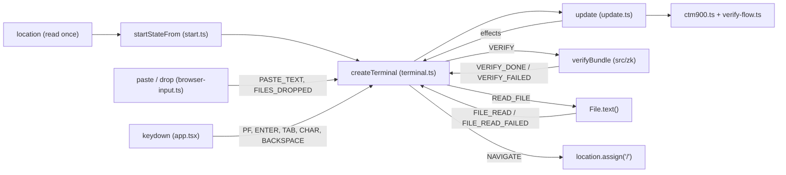
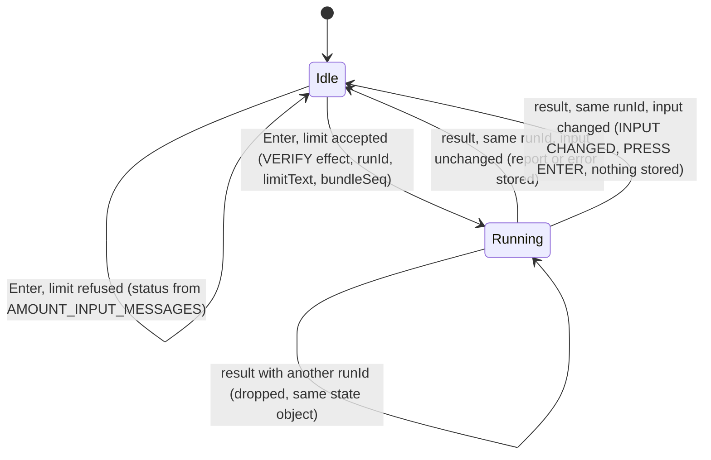

# Design Document: verifier

## Findings for review

These come from reading the code that CTM900 plugs into. Each one changes or confirms something in the requirements.

1. **`src/zk` and `src/ledger` need no change, not even a new export.** Everything CTM900 needs is already exported: `verifyBundle`, `VerifyReport`, `VerifyStepName`, `VERIFY_DETAILS` (`src/zk/verifier.ts`), `CIRCUIT_VERSION` (`src/zk/circuit-identity.ts`), `decodeBundle` (`src/zk/bundle.ts`), `TRUSTED_SOURCE_KEYS` (`src/ledger/trusted-keys.ts`) and `LIMIT_CENTS` (`src/ledger/invariants.ts`). The step order is not exported as a value, so `verify-flow.ts` declares `VERIFY_STEP_ORDER` itself and a test pins it to the keys of `VERIFY_DETAILS`.
2. **`src/ui/terminal-view.tsx` does not change.** Requirement note 9 lists it as expected. The view reads only `renderGrid(state)`, `layoutOf(state)`, `state.screen` (for an `aria-label`) and `state.prove`, so a new screen id needs nothing there. Its one `href` stays the CTM300 link and CTM900 draws no anchor.
3. **`goTo` is exhaustive over `ScreenId`.** Adding `'CTM900'` to the union breaks the `switch` in `navigation.ts` at compile time. CTM900 is never entered by `goTo` (it is a start screen chosen by the route), so the parameter type becomes `Exclude<ScreenId, 'CTM900'>`. That is a type-only edit.
4. **The initial state has no cursor.** `createTerminal(deps, initial)` stores `initial` as given, and only `update` calls `settle`. A CTM900 start state therefore calls `settle` itself, or the first typed digit would be dropped.
5. **The limit field has no clear key.** `settle` puts the cursor at offset 0, and `typeChar` overwrites the character under the cursor. Typing `500000` over `1000000` gives `5000000`. `Tab` moves the cursor to the end of the field text (`tab` in `update.ts`), and `Backspace` then deletes. The e2e test clears the field that way.
6. **PF11 opens the link with `window.open(href, '_blank', 'noopener')`** (`openLink` in `browser-deps.ts`). The `href` is the relative `/verify#b=...` of `verifyLinkFor`. The result is a new tab at the same origin, with no handle back to the prover page.
7. **The Verify_Worker is opened on first use.** `verifyBundle` creates its proof checker lazily (`browserVerifyProof` in `verifier.ts`), so importing it into the UI starts no worker.
8. **The bundle size limit is not exported.** `src/zk/bundle.ts` holds `const MAX_INPUT_CHARS = 1_048_576` (module-private, checked by `decodeBundle`, which returns `TOO_LARGE`). The file-size check of a drop (see `onFilesDropped`) needs the same number. This design does not change `src/zk`. `verify-flow.ts` declares `MAX_BUNDLE_FILE_BYTES = 1_048_576` with a comment that names `MAX_INPUT_CHARS` in `src/zk/bundle.ts` as its origin, and the test `verify_file_limit_pinned` fails if the two drift apart (see Testing Strategy). The code should reuse `MAX_INPUT_CHARS` if it is ever exported. Exporting it is a new export in an existing `src/zk` file, which Requirement 6.5 allows, but it is not part of this design and needs approval first.

## Overview

`verifier` adds CTM900 VERIFY to the existing block-mode terminal. It is one more `ScreenDef` in the same pure state machine, `update(state, action) -> { state, effects }`, started when the page path is `/verify`. The bundle text enters through three doors (the URL fragment, a paste, a dropped `.json` file) and lands in one state field. Enter starts one `verifyBundle(text, { limitCents })` call through a new effect. The result is mapped, fail closed, to six step rows and a verdict.

Direction stays `ui -> zk -> ledger`. The model stays free of React, DOM and network. The DOM glue (paste, drop) is one small file outside the model, and the effect host in `terminal.ts` runs three new effects through injected dependencies, the same way it runs `PROVE`.

## Architecture



### Run control

One run at a time. The run slot is held until the verifier settles, because `verifyBundle` has no cancel call. A settle compares the input of the run with the input now on screen.



### Module layout

| File | Contents |
|------|----------|
| `src/ui/model/screens/ctm900.ts` (new) | `ctm900: ScreenDef`: layout rows, the PF3 entry, `submit = startVerify` |
| `src/ui/model/verify-flow.ts` (new) | `EMPTY_VERIFY`, `VERIFY_STEP_ORDER`, `MAX_BUNDLE_FILE_BYTES`, `startVerify`, `onVerifyDone`, `onVerifyFailed`, `onPasteText`, `onFilesDropped`, `onFileRead`, `onFileReadFailed`, `leaveVerify`, `normalizeReport`, `verifyShown` |
| `src/ui/model/start.ts` (new) | `startStateFrom(loc)`: route choice and the one read of the fragment |
| `src/ui/model/source-key-id.ts` (new) | `sourceKeyIdOf(text, keys)`: the key id for the SIGNATURE row, by own-property lookup |
| `src/ui/browser-input.ts` (new) | `installBundleInput(target, terminal)`: the `paste`, `dragover` and `drop` listeners |
| `e2e/helpers.ts` (new) | the guard and page helpers shared by both Playwright specs |
| `e2e/verifier.spec.ts` (new) | the Verify_E2E |

### Existing `src/` files that change

Each was read. Nothing else under `src/` changes.

| File | Change | Reason |
|------|--------|--------|
| `src/main.tsx` | call `startStateFrom(location)` once and pass the result to `<App start=... />` | The route and the fragment are read once per page load, outside React, so StrictMode cannot repeat the read. |
| `src/ui/app.tsx` | accept the `start` prop, pass it to `createTerminal`; add `verify: verifyBundle` and `navigate` to the deps; call `installBundleInput(document, terminal)` in the existing layout effect | The shell builds the host and owns the document listeners. |
| `src/ui/browser-deps.ts` | add `navigate(href)`, which calls `location.assign(href)` | PF3 is a plain page navigation (Requirement 1.4). |
| `src/ui/model/types.ts` | `ScreenId` gains `'CTM900'`; add `BundleSource`, `DroppedFile`, `VerifyRun`, `VerifyOutcome`, `VerifyState`; `TerminalState` gains `verify`; `SystemAction` gains `PASTE_TEXT`, `FILES_DROPPED`, `FILE_READ`, `FILE_READ_FAILED`, `VERIFY_DONE`, `VERIFY_FAILED`; `Effect` gains `VERIFY`, `READ_FILE`, `NAVIGATE` | The screen model and its actions and effects are declared here. |
| `src/ui/model/update.ts` | `initialState` gets `verify: EMPTY_VERIFY`; `reduce` gets one `case` per new action, each a call into `verify-flow.ts` | `reduce` is an exhaustive `switch`. |
| `src/ui/model/terminal.ts` | `TerminalDeps` gains `verify` and `navigate`; `run` handles `VERIFY`, `READ_FILE` and `NAVIGATE` | The effect host runs every effect. |
| `src/ui/model/messages.ts` | add the fixed texts listed under Data Models | One place for every status text. |
| `src/ui/model/navigation.ts` | the `screen` parameter of `goTo` becomes `Exclude<ScreenId, 'CTM900'>` | Finding 3. |
| `src/ui/model/prove-flow.ts` | add the word `export` to `limitRefused` | CTM900 reuses the exact limit refusal of CTM300 (message from `AMOUNT_INPUT_MESSAGES`, cursor kept in the limit field). |
| `src/ui/model/screens/common.ts` | `SCREEN_NAMES` gains `CTM900: 'VERIFY'` | `headerFields` builds the title row from this table. |
| `src/ui/model/screens/index.ts` | `SCREENS` gains `CTM900: ctm900` | `layoutOf` and `enter` read this table. |

Checked and unchanged: `src/ui/terminal-view.tsx`, `src/ui/model/grid.ts`, `keys.ts`, `amount-input.ts`, `links.ts`, `digest-status.ts`, `sample-loader.ts`, `theme.ts`, `terminal.css`, and every file in `src/zk` and `src/ledger`.

Outside `src/`: `e2e/prover.spec.ts` changes to import the helpers that move to `e2e/helpers.ts` (no behavior change). `tests/support/terminal-host.ts` passes the two new deps. `tests/support/terminal-arbitraries.ts` adds `'CTM900'` to `SCREEN_IDS` and a `stateOn` case, which the existing screen properties then cover.

## Components and Interfaces

### CTM900 screen (`screens/ctm900.ts`)

Rows and columns are 1-based. Fixed text is built from literals and `VERIFY_DETAILS` only.

| Row | Content |
|-----|---------|
| 1 | `CTM900  VERIFY` at column 1 and `DEMO DATA` at column 72 (`headerFields('CTM900')`) |
| 3 | `BUNDLE SOURCE  <NONE\|LINK\|PASTE\|FILE>` |
| 4 | `BUNDLE LENGTH  <n> CHARS` (`n` is `verify.bundleText.length`) |
| 6 | `POLICY LIMIT (CENTS)` at column 1 and the `limit` input at column 22, length 13 (the same field id, length and prefill as CTM300) |
| 8 | `PASTE A BUNDLE OR DROP A .JSON FILE, THEN PRESS ENTER` |
| 10 to 15 | one Step_Row per step, shown only while `verifyShown(state)` holds: `<STEP padded to 12>  <OK\|FAIL\|NOT RUN padded to 7>  <detail>` |
| 17 | the Verdict_Row: `VERIFIED`, `REJECTED AT <STEP>` or `REJECTED: VERIFIER ERROR`; `VERIFYING` while a run is active |
| 18 | `SOURCE KEY <id>  DEMO KEY`, only when the stored report has `passed >= 2` and a key id |
| 20 | `VERIFIER CIRCUIT <CIRCUIT_VERSION>` |
| 23 | PF_Bar: `PF3 BACK` |
| 24 | status line |

The longest Step_Row is `DIGEST_MATCH  FAIL     PUBLIC INPUTS DO NOT MATCH SIGNED DIGEST`, 65 characters, so every row fits in 80 columns. Row 8 and the row 20 label do not contain the words `VERIFIED` or `POLICY LIMIT`, so the e2e locators stay unique.

The layout reads `bundleText` only for `.length`. No row, no status text and no DOM node holds any part of it.

PF entries: `[{ pf: 3, label: 'BACK', run: leaveVerify }]`. `runPf` in `update.ts` already answers any other PF key with `PF KEY NOT ACTIVE` and no effect, and the PF_Bar buttons come from the same list (`terminal-view.tsx`), so Requirement 1.3 and 1.5 need no new code.

### Start state (`start.ts`)

```ts
export interface LocationLike { readonly pathname: string; readonly hash: string }
export function startStateFrom(loc: LocationLike): TerminalState;
```

It reads `loc.pathname` once and `loc.hash` once. `VERIFY_PATH` and `HASH_PREFIX` are cut from `VERIFY_LINK_PREFIX` (`/verify` and `#b=`), so the reader and the writer of the link share one constant.

- `pathname !== '/verify'` (exact compare): return `initialState()`. `/verify/`, `/verifyx`, `/VERIFY` and `/verify/x` are therefore CTM000.
- Otherwise: `settle({ ...initialState(), screen: 'CTM900', fields: { limit: LIMIT_CENTS.toString() }, verify })`, where `verify` has source `LINK`, the text after `#b=` and `bundleSeq` 1 when the hash starts with `#b=` and has at least one more character, and `EMPTY_VERIFY` otherwise. The status is `BUNDLE READY, PRESS ENTER` for a link and empty otherwise.

The hash is not read again, and a later `hashchange` has no listener. The fragment is never written back.

### Bundle input (`browser-input.ts`)

```ts
export function installBundleInput(target: InputTarget, terminal: Pick<Terminal, 'getState' | 'dispatch'>): () => void;
```

`InputTarget` is the part of `Document` that is used: `addEventListener` and `removeEventListener` for `paste`, `dragover` and `drop`. The event types are small structural interfaces (`clipboardData.getData`, `dataTransfer.files`, `preventDefault`), so tests call the handlers with fakes.

| Event | While `terminal.getState().screen === 'CTM900'` | Otherwise |
|-------|--------------------------------------------------|-----------|
| `paste` | `preventDefault()`; read `text/plain`; dispatch `PASTE_TEXT` | nothing |
| `dragover` | `preventDefault()`, so the browser allows the drop | nothing |
| `drop` | `preventDefault()`; dispatch `FILES_DROPPED` with the dropped files (the model decides count, name and size; the listener reads no file) | nothing |

The returned function removes the three listeners. No handler touches `location`, `history` or any storage.

### Pure flow (`verify-flow.ts`)

```ts
export const VERIFY_STEP_ORDER: readonly VerifyStepName[];     // FORMAT, SIGNATURE, DIGEST_MATCH, POLICY, CIRCUIT, PROOF
export const EMPTY_VERIFY: VerifyState;
export function startVerify(state, values): Update;             // Enter
export function onVerifyDone(state, action): Update;
export function onVerifyFailed(state, action): Update;
export function onPasteText(state, action): Update;
export function onFilesDropped(state, action): Update;
export function onFileRead(state, action): Update;
export function onFileReadFailed(state, action): Update;
export function leaveVerify(state): Update;                     // PF3
export function normalizeReport(report: unknown): number | null; // passed count, or null
export function verifyShown(state): VerifyShown | null;        // what the layout may draw
```

**`startVerify`** (Requirements 2, 4.1, 4.2):

1. If `verify.run !== null`: return the same state with status `VERIFY IN PROGRESS` and no effect.
2. `parseAmountInput(values.limit ?? '')`. On failure return `limitRefused(state, error)` from `prove-flow.ts`: the status is the matching `AMOUNT_INPUT_MESSAGES` text, the cursor stays in the limit field, and there is no effect. No typed text is copied into any message.
3. On success: `runId = state.nextRunId`; store `run = { runId, limitText: values.limit, bundleSeq }`, clear `result`, set status `VERIFYING`, set `nextRunId: runId + 1`, and return one effect `{ type: 'VERIFY', runId, text: verify.bundleText, limitCents: parsed.value }`. `limitCents` is the `bigint` that `parseAmountInput` built from the digits. With source `NONE` the text is `''`, so the verifier reports `REJECTED AT FORMAT` through the same path.

**`onVerifyDone`** (Requirements 4.3 to 4.5, 5):

1. Not on CTM900, `run === null` or `run.runId !== action.runId`: return the same state object and no effects (the `isCurrentRun` pattern of `prove-flow.ts`).
2. Otherwise the run ends (`run: null`).
3. If `run.bundleSeq !== verify.bundleSeq` or `run.limitText !== (state.fields.limit ?? '')`: store no result, status `INPUT CHANGED, PRESS ENTER`.
4. Otherwise `passed = normalizeReport(action.report)`. `null` stores `{ kind: 'error' }` with status `REJECTED: VERIFIER ERROR`. A number stores `{ kind: 'report', passed, keyId }` with status `VERIFICATION COMPLETE`. `keyId` is kept only when `passed >= 2` and `action.keyId` is a string, so a key id can never show for a failed or skipped SIGNATURE step.

**`onVerifyFailed`** is step 1 to 3 with `report = null`, so a rejected promise ends in the same error outcome.

**`normalizeReport`** is the fail-closed gate. It returns the number of passed steps only for a report that has all of: a `verdict` of `VERIFIED` or `REJECTED`; a `steps` array of 1 to 6 entries; entry `i` is an object whose `name` is `VERIFY_STEP_ORDER[i]` and whose `ok` is a boolean; for `VERIFIED`, six entries all `ok === true`; for `REJECTED`, the last entry `ok === false` and every earlier entry `ok === true`. Anything else, including a getter that throws, returns `null`. It never reads `detail`.

**Display from the number only.** The stored outcome holds `passed` (0 to 6), not the report. A step `i < passed` is `OK` with `VERIFY_DETAILS[name].ok`, step `i === passed` is `FAIL` with `VERIFY_DETAILS[name].fail`, and later steps are `NOT RUN`. The verdict is `VERIFIED` only when `passed === 6`, and otherwise `REJECTED AT ${VERIFY_STEP_ORDER[passed]}`. Nothing a verifier (real or fake) returns, other than `name` and `ok`, can reach the grid.

**`verifyShown`** returns the stored outcome only while `result.limitText === state.fields.limit` and `result.bundleSeq === verify.bundleSeq`. Editing the limit or replacing the bundle after a verdict therefore hides the verdict at once, so the screen never shows a verdict for input that is no longer on it. This is derived in the layout and needs no hook in `typeChar`.

**`onPasteText`**: ignored (same state) off CTM900 or for text that is not a non-empty string. Otherwise `bundleText = text`, `source = 'PASTE'`, `bundleSeq + 1`, `pendingRead = null` (so an older file read is dropped), status `BUNDLE READY, PRESS ENTER`. A run in flight is left alone: it settles as stale.

**`onFilesDropped`** (Requirement 3.4, 3.5): checks run in this order, and the first failure ends the function.

1. The drop must hold exactly one file whose `name` ends in `.json` after `toLowerCase()`. Otherwise the state keeps its text and source and the status becomes `DROP ONE .JSON FILE`.
2. The file's `size` (bytes, read from `file.size` before any read of the content) must be a non-negative safe integer that is at most `MAX_BUNDLE_FILE_BYTES` (1,048,576). Otherwise the state keeps its text and source and the status becomes `FILE TOO LARGE`. No `READ_FILE` effect is emitted, so `file.text()` is never called for such a file. A `size` that is not a non-negative safe integer is refused the same way (fail closed). A file of exactly 1,048,576 bytes passes this check, and a file of 1,048,577 bytes does not.
3. A file that passes both checks sets `pendingRead = state.nextLoadId`, increments `nextLoadId`, and returns `{ type: 'READ_FILE', readId, file }`.

A refused drop (step 1 or 2) changes only the status line. It leaves `pendingRead`, `bundleSeq`, `bundleText` and `source` as they were, so an older accepted read that is still pending stays current. The model never calls `file.text()`. The size check bounds a file by bytes, and `decodeBundle` bounds the text by characters, so a file that passes the byte check never has more characters than the limit. The check refuses a large file early and does not replace the `TOO_LARGE` check inside the Verifier (see Finding 8).

**`onFileRead`**: current only on CTM900 with `pendingRead === action.readId`. Then the text replaces the bundle exactly as in `onPasteText` with source `FILE`. A result with another id, or after a newer paste or drop, is dropped with the same state object. **`onFileReadFailed`** clears `pendingRead` when current and sets `FILE READ FAILED`.

**`leaveVerify`** returns the unchanged state and one effect `{ type: 'NAVIGATE', href: '/' }`.

### Source key id (`source-key-id.ts`)

```ts
export function sourceKeyIdOf(text: string, keys: Readonly<Record<string, string>>): string | null;
```

After a report whose SIGNATURE step is `ok === true`, the host decodes the bundle text a second time with `decodeBundle(text)` inside `try`, then tests `Object.hasOwn(TRUSTED_SOURCE_KEYS, id)` where `id` is the decoded `sourceKeyId` (the host passes `deps.trustedKeys ?? TRUSTED_SOURCE_KEYS` as `keys`, so tests can inject a table). The function returns the id only when that test is true, and `null` for anything else: an inherited name (`__proto__`, `constructor`, `toString`), an unknown id, or a failed decode. A `null` shows nothing: the SOURCE KEY row is not drawn, and no error text, status text or message is written for it. The returned string is a key of the trusted table, never text taken from a rejected bundle. This decision is final: `src/zk/verifier.ts` does not change and the report does not carry the key id.

### Effect host additions (`terminal.ts`)

```ts
interface TerminalDeps {
  // existing members ...
  readonly verify: (text: string, policy: { readonly limitCents: Cents }) => Promise<unknown>;
  readonly navigate: (href: string) => void;
}
```

`app.tsx` passes `verifyBundle` for `verify`. Its type `(input: unknown, policy: VerifyPolicy) => Promise<VerifyReport>` is assignable, and the wider `Promise<unknown>` lets tests inject a fake that returns `null` or a malformed report.

- `VERIFY`: `start(() => deps.verify(effect.text, { limitCents: effect.limitCents }))`. On resolve, `keyId = signatureOk(report) ? sourceKeyIdOf(effect.text, keys) : null`, then dispatch `VERIFY_DONE { runId, report, keyId }`. On reject or a synchronous throw, dispatch `VERIFY_FAILED { runId }`. The rejection value is never bound. The chain ends with the same `.then(undefined, ignore)` as the other effects.
- `READ_FILE`: `start(() => effect.file.text())`, then `FILE_READ { readId, text }` or `FILE_READ_FAILED { readId }`.
- `NAVIGATE`: `deps.navigate(effect.href)` inside `try`.

`signatureOk(report)` is a guarded read: `steps` is an array and the entry named `SIGNATURE` has `ok === true`. It is only an optimization (skip the decode for a failed bundle). Display is still decided by `normalizeReport`.

## Data Models

```ts
export type BundleSource = 'NONE' | 'LINK' | 'PASTE' | 'FILE';

/** What a drop hands over. `File` satisfies it. The model reads `name` and `size` only, and calls `text()` never (the host calls it, after the model emitted READ_FILE). */
export interface DroppedFile {
  readonly name: string;
  readonly size: number;   // bytes, from File.size
  text(): Promise<string>;
}

export interface VerifyRun {
  readonly runId: number;
  readonly limitText: string;   // the limit field text when the run started
  readonly bundleSeq: number;   // the bundle version when the run started
}

export type VerifyOutcome =
  | { readonly kind: 'report'; readonly passed: number; readonly keyId: string | null }
  | { readonly kind: 'error' };

export interface VerifyState {
  /** The one copy of the Bundle_Text. Never drawn, never copied into any other field. */
  readonly bundleText: string;
  readonly source: BundleSource;
  /** Starts at 0 (1 for a link), +1 on every replacement of `bundleText`. A number, so a run compares versions without a second copy of the text. */
  readonly bundleSeq: number;
  /** Id of the file read in flight, from `nextLoadId`. */
  readonly pendingRead: number | null;
  readonly run: VerifyRun | null;
  readonly result: { readonly outcome: VerifyOutcome; readonly limitText: string; readonly bundleSeq: number } | null;
}
```

`TerminalState` gains `readonly verify: VerifyState`. Run ids come from the existing `nextRunId`, read ids from the existing `nextLoadId`. Both are monotonic and never reset, so an id never repeats.

New actions (all `SystemAction`, because the host or the DOM raises them):

```ts
| { type: 'PASTE_TEXT'; text: string }
| { type: 'FILES_DROPPED'; files: readonly DroppedFile[] }
| { type: 'FILE_READ'; readId: number; text: string }
| { type: 'FILE_READ_FAILED'; readId: number }
| { type: 'VERIFY_DONE'; runId: number; report: unknown; keyId: string | null }
| { type: 'VERIFY_FAILED'; runId: number }
```

New effects:

```ts
| { type: 'VERIFY'; runId: number; text: string; limitCents: Cents }
| { type: 'READ_FILE'; readId: number; file: DroppedFile }
| { type: 'NAVIGATE'; href: string }
```

The `VERIFY` effect carries a reference to the same string as `verify.bundleText`. A string is immutable, so this is not a second copy, and an effect is not part of the state.

New `MESSAGES` (each at most 70 characters, none built from input):

| Key | Text |
|-----|------|
| `VERIFYING` | `VERIFYING` |
| `VERIFY_IN_PROGRESS` | `VERIFY IN PROGRESS` |
| `VERIFY_DONE` | `VERIFICATION COMPLETE` |
| `INPUT_CHANGED` | `INPUT CHANGED, PRESS ENTER` |
| `VERIFIER_ERROR` | `REJECTED: VERIFIER ERROR` |
| `BUNDLE_READY` | `BUNDLE READY, PRESS ENTER` |
| `DROP_ONE_JSON` | `DROP ONE .JSON FILE` |
| `FILE_TOO_LARGE` | `FILE TOO LARGE` |
| `FILE_READ_FAILED` | `FILE READ FAILED` |

`PF KEY NOT ACTIVE` is the existing `MESSAGES.PF_INACTIVE`. The word `VERIFIED` is in none of these texts. It exists in one place, the Verdict_Row builder, and only for `passed === 6`.

## Privacy and security

- **Network.** The model, `browser-input.ts` and the new host code call no `fetch`, XHR, WebSocket, beacon or `importScripts`. The only requests the verify path causes are the same-origin assets of the existing Verify_Worker. `NAVIGATE` is a same-origin `location.assign('/')`.
- **No logging or storage.** No `console.*`, no `localStorage`, `sessionStorage`, `indexedDB`, `caches` or cookie, and no `history` call. `ui_static_scan` already scans every file under `src/ui` and `src/main.tsx`, so the new files are covered without a change to the scan.
- **The fragment is public by design.** `#b=` holds only the public proof bundle, so reading it is not a privacy event. It is read once, held in one field, and never written back to the URL, `history` or storage.
- **The bundle text is never drawn.** The grid shows the source name and the character count. A 5 MB paste changes one number on the screen.
- **Nothing from a rejected bundle is echoed.** The grid can show only: fixed texts, the six step names, `OK`, `FAIL` or `NOT RUN`, the `VERIFY_DETAILS` strings chosen by position, the verifier's own `CIRCUIT_VERSION`, and one key id that is an own key of `TRUSTED_SOURCE_KEYS`, with `DEMO KEY` beside it. The `detail` of a returned report is never read, the circuit version of a bundle is never shown, and no thrown value is bound or kept.
- **Fail closed.** `VERIFIED` needs `normalizeReport` to return 6, which needs six named steps in order, all `ok === true`. A rejected promise, a `null`, an empty `steps`, a short `VERIFIED` and a getter that throws all end in `REJECTED: VERIFIER ERROR`.
- **The decode in `sourceKeyIdOf` is a second read of the string, not a second copy.** See decision 2. The key id is shown only if `Object.hasOwn(TRUSTED_SOURCE_KEYS, id)`, and a failed decode shows nothing and writes no error text.
- **A dropped file is size-checked before it is read.** A file over 1,048,576 bytes (`file.size`) is refused with `FILE TOO LARGE` and no `READ_FILE` effect, so an oversized file is never loaded into memory by the app.
- **No key material.** CTM900 imports the public key table only. The demo private key stays under `scripts/`, and `no-private-key-in-src` already guards that.

## Correctness Properties

*A property is a characteristic or behavior that should hold true across all valid executions of a system-essentially, a formal statement about what the system should do. Properties serve as the bridge between human-readable specifications and machine-verifiable correctness guarantees.*

All properties run on the pure model with an injected fake `verify` (or `createVerifier` with an ephemeral trusted key and a stub proof check where Requirement 5.7 asks for it). The browser-only criteria (6.2, 7.1 to 7.6) and the one-shot checks (1.4, 2.1, 4.1, 4.3, 6.1, 6.3, 6.4, 6.5) are examples or smoke checks and are listed in the Testing Strategy.

### Property 1: Route choice

For any pathname string, `startStateFrom` returns a state on CTM900 if and only if the pathname equals `/verify` exactly. Every other string (`/`, `/verify/`, `/verifyx`, `/VERIFY`, `/verify/x`, any random string) gives CTM000.

**Validates: Requirements 1.1**

### Property 2: Screen shape and PF bar on CTM900

For any reachable state on CTM900, `renderGrid` returns exactly 24 rows of exactly 80 characters, row 1 starts with `CTM900  VERIFY` and holds `DEMO DATA`, the PF_Bar lists PF3 BACK only, and the on-screen buttons are the same list as the key handlers. This is the existing screen-shape and PF-bar properties run with `CTM900` added to `SCREEN_IDS`.

**Validates: Requirements 1.2, 1.3**

### Property 3: Inactive PF keys

For any reachable state on CTM900 and any PF key from 1 to 12 except 3, the status line becomes `PF KEY NOT ACTIVE` and no effect is returned.

**Validates: Requirements 1.5**

### Property 4: Limit field editing matches CTM300

For any sequence of `CHAR`, `BACKSPACE` and `TAB` actions applied to the prefilled limit field, the resulting `limit` text on CTM900 equals the one on CTM300.

**Validates: Requirements 2.2**

### Property 5: Limit acceptance and refusal

For any limit text, Enter on CTM900 with no run active calls the verifier exactly once with `limitCents === BigInt(text)` when `parseAmountInput` accepts the text, and otherwise calls it zero times, writes the matching `AMOUNT_INPUT_MESSAGES` text to the status line, keeps the cursor in the limit field, and shows no part of the typed text in any row. The generators include the empty text, signs, decimal points, exponents, whitespace, leading zeros, 14 or more digits, `2^40 - 1`, `2^40`, and values within 4 of `2^53`.

**Validates: Requirements 2.3, 2.4, 2.5**

### Property 6: Fragment source

For any hash string, `startStateFrom` on `/verify` gives source `LINK` and `bundleText === hash.slice(3)` if and only if the hash starts with `#b=` and holds at least one character after it. Otherwise the source is `NONE` and the text is empty. The location is read once for the pathname and once for the hash.

**Validates: Requirements 3.1, 3.2**

### Property 7: Paste and drop acceptance rules

For any text, `PASTE_TEXT` replaces the Bundle_Text with it and sets source `PASTE` if and only if the text is a non-empty string, and otherwise changes nothing. For any list of dropped files (each with any name and any `size`), the model emits one `READ_FILE` effect if and only if the list holds exactly one file whose name ends in `.json` in any letter case and whose `size` is a non-negative safe integer of at most 1,048,576. Otherwise it keeps the Bundle_Text and the source, emits no effect, and writes the status line as follows: `DROP ONE .JSON FILE` when the list holds no file, more than one file, or one file whose name does not end in `.json`, and `FILE TOO LARGE` when it holds exactly one `.json` file whose `size` is above 1,048,576 or is not a non-negative safe integer. The generators include sizes 0, 1,048,575, 1,048,576, 1,048,577, 2^53, `NaN`, `Infinity`, `-1` and `1.5`.

**Validates: Requirements 3.3, 3.4, 3.5**

### Property 8: The newest source wins

For any interleaving of `PASTE_TEXT`, `FILES_DROPPED` and the settles `FILE_READ` or `FILE_READ_FAILED` of any earlier read ids, the held Bundle_Text and source are those of the newest accepted paste or the newest accepted file read, and a settle with a read id that is not the pending one leaves the same state object.

**Validates: Requirements 3.6**

### Property 9: The Bundle_Text is held once and never drawn

For any sequence of pastes, drops, file reads and runs, the state holds at most one string value longer than 1,000 characters, and for any pasted text that holds a sentinel, no grid row, no status text and no rendered DOM text contains the sentinel or any 20-character slice of the text. The only things shown are the source name and the length.

**Validates: Requirements 3.7, 3.8**

### Property 10: One run at a time

For any number of Enter presses while a run is active, with any edits to the bundle or the limit in between, the verifier is called exactly once, and each press answers `VERIFY IN PROGRESS`.

**Validates: Requirements 4.2**

### Property 11: Stale results are dropped

For any interleaving of edits to the bundle or the limit and of settles of the active run, a report or an error is shown only when the bundle version and the limit text equal those of the run that produced it. A settle of the active run over changed input stores nothing, ends the run, and writes `INPUT CHANGED, PRESS ENTER`. A settle with a run id that is not the active one returns the same state object. An edit after a stored verdict hides it. No stale verdict, and no `VERIFIED`, is ever in a grid row.

**Validates: Requirements 4.3, 4.4**

### Property 12: Fail closed

For any value that the verifier resolves with that is not a well-formed report (`null`, wrong types, empty `steps`, steps out of order or with a wrong name, `VERIFIED` without six passing steps, `REJECTED` with no failed last step, a getter that throws), and for any rejection, the Verdict_Row and the status line show `REJECTED: VERIFIER ERROR`, and the word `VERIFIED` is in no row.

**Validates: Requirements 4.5**

### Property 13: Step rows, verdict and no echo

For any well-formed report that first fails at step `k` (0 to 5) or passes all six steps, whatever its `detail` texts hold, the screen shows the six Step_Rows in order with `OK` for the steps before `k`, `FAIL` at `k`, and `NOT RUN` after, each with the `VERIFY_DETAILS` text for that step and outcome. The Verdict_Row is `VERIFIED` only when all six are `OK`, and otherwise `REJECTED AT <STEP>`. The word `VERIFIED` appears once, in that row, for a pass, and nowhere for any other state (before a run, while running, after a stale drop, after a failure). The source key id and `DEMO KEY` show only when `k >= 2` or all pass. The verifier's `CIRCUIT_VERSION` is always shown. Sentinels in `detail` fields, in the key id of a failed report and in any bundle field appear in no row and no DOM text.

**Validates: Requirements 5.1, 5.2, 5.3, 5.4, 5.5, 5.6, 6.4**

### Property 14: Key id comes from the trusted table by own property

For any key id string and any key table, `sourceKeyIdOf` returns the id if and only if the bundle decodes and `Object.hasOwn(keys, id)` is true for the decoded id. `__proto__`, `constructor`, `toString` and every other inherited name return `null`, and so does a text that does not decode. A `null` result draws no key row and writes no error text.

**Validates: Requirements 5.4**

### Property 15: Any bad input ends in a named rejection

For any string that is not a valid bundle encoding, pasted into the terminal and sent with Enter to the real `createVerifier` (ephemeral trusted key, stub proof check), the run ends with `REJECTED AT FORMAT`, no step after `FORMAT` is `OK`, nothing throws, and `VERIFIED` is never shown. The fixed examples cover the empty text, random text, a valid bundle cut short, a signed bundle with a wrong `circuit_version` (`REJECTED AT CIRCUIT`), and a 5 MB text.

**Validates: Requirements 5.7**

## Error Handling

| Condition | Behavior |
|-----------|----------|
| Limit text refused by `parseAmountInput` | Status is the matching `AMOUNT_INPUT_MESSAGES` text, cursor stays in the limit field, no run. |
| Enter while a run is active | `VERIFY IN PROGRESS`, no second call. |
| Enter with no bundle (`NONE`) | The verifier gets `''` and reports `REJECTED AT FORMAT`. |
| Verifier rejects, throws synchronously, or resolves with a value that fails `normalizeReport` | `REJECTED: VERIFIER ERROR` in the Verdict_Row and the status line. The thrown value is never bound. |
| Result of a run whose input changed | Dropped. `INPUT CHANGED, PRESS ENTER`. |
| Result with a run id that is not the active one | Dropped. Same state object. |
| Drop of no file, several files or a file not named `*.json` | `DROP ONE .JSON FILE`. Text and source are kept. |
| Drop of one `.json` file with `size` above 1,048,576 bytes (or a `size` that is not a non-negative safe integer) | `FILE TOO LARGE`. Checked before any read. No `READ_FILE` effect. Text, source and any pending read are kept. |
| Decode of the bundle text fails after a passing SIGNATURE step | No source key row and no message. The step rows and the verdict are unaffected. |
| `File.text()` rejects | `FILE READ FAILED`. Text and source are kept. |
| Paste of empty text | Ignored. |
| Bundle text over 1,048,576 characters (paste or link) | Not limited by the UI. `decodeBundle` returns `TOO_LARGE`, and the verifier reports `REJECTED AT FORMAT`. Only a dropped file is size-checked by the UI, before its read. |
| Verify_Worker fails or times out (60 s) | `createProofVerifier` resolves `false`, so the report is `REJECTED AT PROOF`. |
| PF3 | `location.assign('/')`. If it throws, the host ignores it, as for `OPEN_LINK`. |

## Testing Strategy

PBT applies to the model: it is a pure state machine with large input spaces (limit texts, bundle texts, file lists, action interleavings). It does not apply to the DOM glue, the screen look or the browser behavior, which use example tests and Playwright.

**Property tests** use fast-check 4.10.3 through `runProperty` in `tests/support/pbt.ts`, with a fixed seed written in each file's source (20264901 to 20264915, one per property) and at least 200 runs. Each test carries the tag `Feature: verifier, Property <n>: <text>`. Files are `tests/ui/verify-*.prop.test.ts`, and the shared arbitraries (malformed reports, interleavings, limit texts) go in `tests/support/verify-arbitraries.ts`. A fake verifier in `tests/support/fake-verify.ts` records its arguments and settles on demand. Properties that need the real report path use `createVerifier` with the ephemeral key helpers of `tests/support/signed-bundle.ts`.

| Test name | Covers | Kind |
|-----------|--------|------|
| `verify_route_choice` | Property 1 | property, plus the six listed paths as examples |
| `screen_grid_shape`, `pf_bar_matches_handlers`, `pf_bar_buttons_match_keys` | Property 2 | existing properties, `CTM900` added to `SCREEN_IDS` and `stateOn` |
| `verify_pf_inactive` | Property 3 | property |
| `verify_limit_field_rules` | Properties 4, 5 and Requirement 2.1 | property, plus the prefill example |
| `verify_hash_source` | Property 6 | property, plus the `#x=abc`, `#B=abc`, `#b`, `#b=` and hash-change examples |
| `verify_paste_and_drop` | Property 7 | property for the model; examples with fake events for `preventDefault` and the `.json` read; size examples: a `.json` file of 1,048,576 bytes is accepted for reading (one `READ_FILE` effect, `pendingRead` set), a `.json` file of 1,048,577 bytes is refused with `FILE TOO LARGE`, emits no `READ_FILE` effect, never has `text()` called (the fake file records calls), and leaves `bundleText`, `source`, `bundleSeq` and `pendingRead` unchanged |
| `verify_file_limit_pinned` | Finding 8 | example: `MAX_BUNDLE_FILE_BYTES` equals 1,048,576, and `decodeBundle` of a 1,048,576-character text does not return `TOO_LARGE` while one of 1,048,577 characters does, so the constant cannot drift from `MAX_INPUT_CHARS` in `src/zk/bundle.ts` |
| `verify_single_run_and_stale_drop` | Properties 8, 10, 11 | properties; one example for Requirement 4.3 |
| `verify_text_not_drawn`, `verify_text_held_once` | Property 9 | property, plus the 5 MB example (state walk and `renderToStaticMarkup`) |
| `verify_fails_closed` | Property 12 | property, plus the four listed examples |
| `verify_steps_render` | Properties 13, 14 | property for rows and sentinels; property for `sourceKeyIdOf` including a bundle with `source_key_id` `__proto__` |
| `verify_bad_inputs` | Property 15 | property and four examples |
| `verify_run_start`, `verify_pf3_navigates` | Requirements 4.1, 1.4 | examples with a recording host and no `history` call |
| `ui_static_scan`, `ui_wording_scan`, `url_holds_only_bundle` | Requirements 6.1, 6.3, 6.4 | existing tests; the last gains CTM900 markup and a paste of a sentinel text |
| `verify_step_order_pinned` | finding 1 | example: `VERIFY_STEP_ORDER` equals the keys of `VERIFY_DETAILS` |

Done-when for Requirement 6.5 is `git diff --name-only -- src/zk src/ledger`, which must print nothing.

### E2E design (`e2e/verifier.spec.ts`)

**Setup.** The spec runs against `npm run build` served by `vite preview --host 127.0.0.1 --port 4173 --strictPort`, as `playwright.config.ts` already arranges (`webServer`). `vite preview` serves `index.html` for `/verify` (default `appType: 'spa'`), and the direct-visit test confirms it. The existing helpers of `e2e/prover.spec.ts` move to `e2e/helpers.ts` and are exported: `ORIGIN`, `guardLocalOnly`, `statusRow`, `gridText`, `press`, `loadSample`, `openProveScreen`, `postingRows`, `amountText`, `PROOF_WAIT_MS`. `prover.spec.ts` imports them and its tests are unchanged. `helpers.ts` is not a `*.spec.ts` file, so Playwright does not run it as a test.

Every test calls `const nonLocalOrigins = await guardLocalOnly(context)` before any navigation. The route is registered on the context, so it also covers the new tab that PF11 opens. Every test ends with `expect(nonLocalOrigins, 'e2e_local_only: non-local origins').toEqual([])`.

New helpers in `helpers.ts`:

```ts
const VERIFY_WAIT_MS = 90_000;   // cold Verify_Worker: SRS, key and WASM start

// CTM100 -> CTM200 -> CTM300 -> F5, then waits for PROOF GENERATED. Returns the link text.
async function proveSample(page: Page, sampleNo: string): Promise<string>;

// Presses PF11 and returns the page that opens. See "Popup handling".
async function openVerifyTab(context: BrowserContext, page: Page): Promise<Page>;

// The six Step_Rows as { FORMAT: 'OK' | 'FAIL' | 'NOT RUN', ... }, parsed from the grid text
// with /^(FORMAT|SIGNATURE|DIGEST_MATCH|POLICY|CIRCUIT|PROOF)\s+(OK|FAIL|NOT RUN)\b/.
async function stepsOf(page: Page): Promise<Record<string, string>>;

// The Verdict_Row text: the grid line that is exactly VERIFIED, REJECTED AT <STEP> or
// REJECTED: VERIFIER ERROR. The status row holds other text, so it never matches.
async function verdictOf(page: Page): Promise<string | null>;

// Clear, type, confirm. See "Limit field".
async function setLimit(page: Page, digits: string): Promise<void>;
```

**Popup handling (a).** In the real code, PF11 runs `openVerifier`, which emits `OPEN_LINK { href: state.prove.link }`, and the host calls `openLink`, which is `window.open(href, '_blank', 'noopener')` (`browser-deps.ts`). The `href` is the relative `/verify#b=<base64url>` of `verifyLinkFor`. The result is a new tab of the same context and origin, and the prover page does not navigate. Because of `noopener`, the test does not depend on `opener()`. It waits on the context:

```ts
async function openVerifyTab(context: BrowserContext, page: Page): Promise<Page> {
  // The listener is registered before PF11 is pressed, in the same Promise.all.
  const [tab] = await Promise.all([
    context.waitForEvent('page'),
    page.getByTestId('pf-11').click(),   // a real click is a user gesture, so the popup blocker allows it
  ]);
  await tab.waitForLoadState('domcontentloaded');
  await tab.bringToFront();              // the document keydown listener needs the focused tab
  return tab;
}
```

The first test then asserts, against the real code: `new URL(tab.url()).pathname === '/verify'`; `tab.url() === ORIGIN + link` (the `href` that `proveSample` read from the `verify-link` anchor, so the tab holds exactly the link the prover page shows); the prover page still shows `CTM300` and its URL is unchanged (the link opened in a new tab and not in place); and the status line of the prover page reads `OPENING VERIFIER`. It also waits for the CTM900 title row and `BUNDLE SOURCE  LINK` before pressing Enter, so the first key is never sent to a screen that is not drawn yet.

**Limit field (b).** CTM900 prefills `1000000` with the cursor at offset 0, and typing overwrites the character under the cursor, so typing `500000` first would give `5000000`. `setLimit` clears the field with the screen's own keys, then types, and confirms the field before Enter. There is one input field, so `Tab` moves the cursor to the end of the text:

```ts
async function setLimit(page: Page, digits: string): Promise<void> {
  const row = page.locator('pre').filter({ hasText: 'POLICY LIMIT (CENTS)' });
  await press(page, 'Tab');                                   // cursor to the end of the field text
  for (let i = 0; i < 13; i += 1) await press(page, 'Backspace');  // 13 is the field length; extra presses at offset 0 do nothing
  await expect(row).toHaveText(/POLICY LIMIT \(CENTS\)\s+_{13}$/);   // empty field: 13 fill characters
  await page.keyboard.type(digits);
  await expect(row).toHaveText(new RegExp(`POLICY LIMIT \\(CENTS\\)\\s+${digits}_{${13 - digits.length}}$`));
}
```

Enter is pressed only after the second `expect` passes. `toHaveText` collapses runs of whitespace, so the match does not depend on the exact padding.

**Cases.**

| Test | Steps | Expected |
|------|-------|----------|
| `verifier_clean_verified` | `loadSample('1')`, `openProveScreen`, `proveSample`, `openVerifyTab`, check `BUNDLE SOURCE  LINK`, Enter | Poll `verdictOf` to `VERIFIED` (timeout `VERIFY_WAIT_MS`). `stepsOf` is six `OK`. The grid holds `SOURCE KEY DEMO-` and `DEMO KEY`, holds the verifier's `CIRCUIT_VERSION`, and holds no part of the encoded bundle (the first 40 characters after `#b=` are absent from `gridText`). |
| `verifier_policy_500000` | prove the clean sample, `openVerifyTab`, `setLimit(tab, '500000')`, Enter | `verdictOf` is `REJECTED AT POLICY`. `FORMAT`, `SIGNATURE`, `DIGEST_MATCH` are `OK`, `POLICY` is `FAIL`, `CIRCUIT` and `PROOF` are `NOT RUN`. This fails before the proof check, so it is fast. |
| `verifier_move_cent_digest_match` | the move-1-cent flow of `prover_move_cent_makes_bundle` (tamper two same-side postings, tamper off, prove), `openVerifyTab`, Enter | `verdictOf` is `REJECTED AT DIGEST_MATCH`. `FORMAT` and `SIGNATURE` are `OK`, `DIGEST_MATCH` is `FAIL`, the last three are `NOT RUN`. This is the case of the video. |
| `verifier_truncated_format` | build a link from a fixture bundle (`fc.sample(proofBundleArb, { seed, numRuns: 1 })` and `encodeBundleForUrl`) and cut it to its first 200 characters; `page.goto('/verify#b=' + cut)`, Enter | `verdictOf` is `REJECTED AT FORMAT`. `FORMAT` is `FAIL` and the other five rows are `NOT RUN`. No prover run is needed. |
| `verifier_direct_visit` | `page.goto('/verify')`, then `page.reload()` | The title row `CTM900  VERIFY` is drawn both times, the grid shows `BUNDLE SOURCE  NONE`, and no `pre` holds the word `VERIFIED`. |

The three bundle cases that need a proof run `proveSample` with `PROOF_WAIT_MS` (90 s), and each test keeps the existing 120 s Playwright timeout plus an explicit `test.setTimeout(240_000)` for the two that prove and then verify in a cold worker. Tests are independent: none reuses another test's link, so any one can run alone.

## Decisions

These are choices the design had to make where the requirements text can be read two ways. Items 1 to 3 are decided. None needs a change in `src/zk` or `src/ledger`.

1. **Decided: a result with a run id that is not the active one (Requirement 4.4).** The text says to drop the result, show no report, end the run and write `INPUT CHANGED, PRESS ENTER`. Ending the active run on a foreign id would free the slot while the real call is still unsettled, and Requirement 4.2 says the screen keeps answering `VERIFY IN PROGRESS` until it settles. The design therefore returns the same state object for a foreign id, and ends the run and writes the message only for the active run that settles over changed input. Property 11 pins this reading. A result with a foreign run id leaves the state unchanged (the same state object).
2. **Decided: reading the bundle text for the key id (Requirement 3.8).** Requirement 3.8 says the only use of the text is the argument of the verifier call. The `SIGNATURE` row needs the key id, and the report does not carry it, so after a passing `SIGNATURE` step the host decodes the bundle text again with `decodeBundle` and keeps only the key id, and only if `Object.hasOwn(TRUSTED_SOURCE_KEYS, id)` is true. If the decode fails, or the id is not an own key of the table, nothing is shown and no error text is written. No second copy of the text is made or stored, and Property 9 counts long strings in the state. `src/zk/verifier.ts` does not change.
3. **Decided: verdict hidden on edit (Requirement 4.3).** The text stores the report on settle. The user story says the verdict must always belong to the bundle and limit on screen, so `verifyShown` hides a stored verdict as soon as the limit text or the bundle changes. It is derived in the layout and adds no state.
4. **Note: `terminal-view.tsx` is not changed.** Requirement note 9 expected an edit. Finding 2 shows none is needed.
