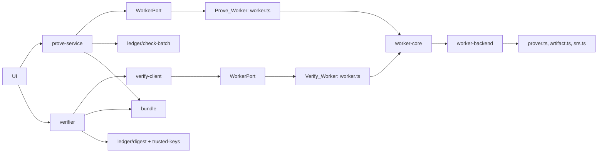
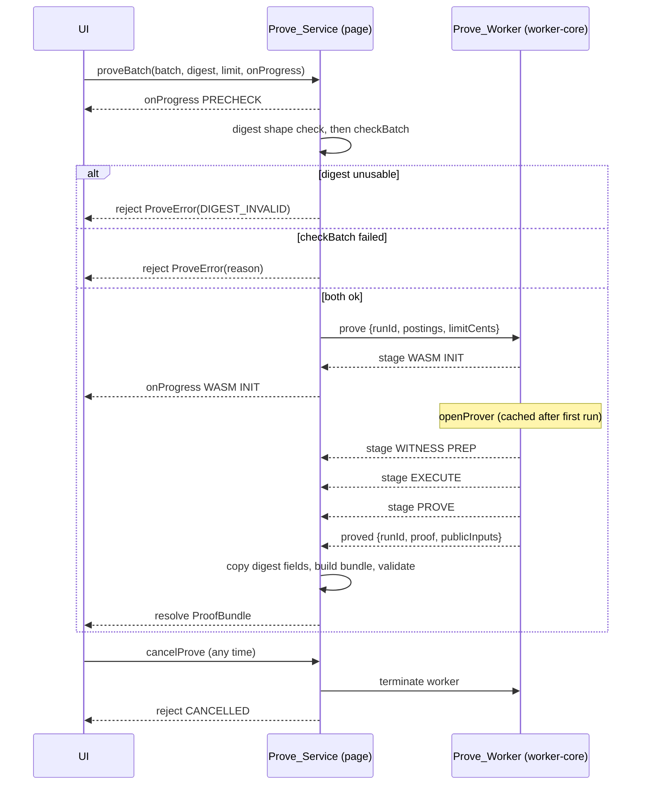
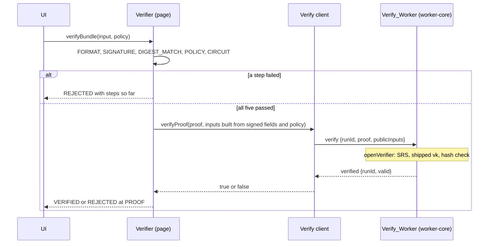

# Design Document: zk-core

## Findings for review

No open items.

Resolved:

- Research results (key computable without a prove call but needs the SRS; same 3680 bytes from `circuitComputeVk`, `proveCircuit` and native `bb`; depends on `oracleHashType`; `circuitVerify` can throw or return `false`): informational, see section D. No requirement changed.
- `DIGEST_INVALID`: an unusable digest is rejected with the new reason `DIGEST_INVALID` (nine reasons) by the digest shape check of section F, before `checkBatch` and before any worker work.
- `CIRCUIT_VERSION` is `nargo-1.0.0+` plus the first 32 hex characters of the Artifact sha256 (44 characters).
- `VK_URL` and `loadVkFromUrl` are added as new exports of `src/zk/artifact.ts`.
- Steering edits (`tech.md` "Verifier order" with `FORMAT` first, and the `noir.md` rule that `VK_HASH` is the SHA-256 of the shipped verification key bytes) happen in the first task.
- The two compare tests, `digest_match_compares_public_inputs` and `policy_compares_public_inputs_and_bundle_limit`, are properties that include the hand-built examples.
- An injected `WorkerPort` is accepted: the service and the worker core take the port or factory as an argument.
- `dist_vk_asset` runs on the e2e build output in this spec. The `terminal-ui` spec adds the same check on `dist` in its first wiring task, once the app imports the prove service or the verifier. Requirement 7.7 is read as written (it already names the E2E_Build).
- Digest patterns: `digest.ts` gets exports only (`hasExactDigestKeys`, `ROOT_HEX_PATTERN`, `SIGNATURE_HEX_PATTERN`) and `digest-shape.ts` imports them, with no copy and no drift test.
- Harness page location: the harness is built with `vite build --mode e2e` into `node_modules/.cryptterm-e2e/`, not into `dist`, so Netlify never publishes it and no top-level directory is added. The production build has only `index.html` as an entry (checked in the same task as `find dist -path '*e2e*'`). Section G has the detail.
- Harness tooling: `@playwright/test` 1.62.0 is accepted. Its browser revision, chromium-1234, is the one in `~/Library/Caches/ms-playwright`. It runs only against the local harness on localhost, downloads no browser, and the task stops and asks if the cached Chromium is missing.

## Overview

`zk-core` adds six things on top of the spike and `ledger-format`:

- `checkBatch` in `src/ledger`, a pure pre-check that mirrors the circuit constraints.
- A proof bundle: type, strict codec, JSON and URL forms.
- A worker module with a small message protocol, run twice: a Prove_Worker and a Verify_Worker.
- `proveBatch` and `cancelProve` (promise API on the page).
- Generated circuit identity: `CIRCUIT_VERSION`, `VK_HASH` and the shipped verification key.
- `verifyBundle`, which runs six steps and never throws.

Everything that touches `Worker` is behind a `WorkerPort` interface, so Node tests drive the same service and worker code with an in-process port and a stub or a disk-backed backend. Direction: `ui -> zk -> ledger`, `scripts -> zk, ledger`.

## Architecture

New files, plus two existing files under `src/` that get new exports only, and nothing else changes in them:

- `src/zk/artifact.ts` gains `VK_URL` and `loadVkFromUrl`.
- `src/ledger/digest.ts` gains three new exports for names it keeps private today: `hasExactDigestKeys` (the exact-key rule: a plain object whose own keys are exactly `batchId`, `merkleRoot`, `recordCount`, `signature`, `sourceKeyId`), `ROOT_HEX_PATTERN` (`/^0x[0-9a-f]{64}$/`) and `SIGNATURE_HEX_PATTERN` (`/^[0-9a-f]{128}$/`). The names are the ones `digest.ts` already uses. The edit adds the `export` keyword to those three existing declarations. No body, constant value or other export changes, so `verifyDigest` and `digestMessage` behave as before.

No other file in `src/zk` or `src/ledger` changes. Outside `src/`, the harness tooling edits (accepted, see Findings) are: in `package.json` the new scripts (`gen:identity`, `build:e2e`, `preview:e2e`, `test:e2e`, `check:dist-vk`) and the exact-pinned dev dependency `@playwright/test` 1.62.0; in `vite.config.ts` an `e2e` mode (section G); in `tsconfig.json` the `include` entries `e2e` and `playwright.config.ts`; and the new root file `playwright.config.ts`.

**Steering updates (first task).** `tech.md` "Verifier order" gets `FORMAT` as step 1 (six steps), and `noir.md` "Where version-sensitive choices must be written down" gets the rule that `VK_HASH` is the SHA-256 of the shipped verification key bytes (computed with `circuitComputeVk` and `PROOF_SETTINGS`, the same bytes as `bb write_vk -t noir-recursive`). These are the only steering edits, and `steering_edits_present` checks them.

| File | Responsibility |
|------|----------------|
| `src/ledger/check-batch.ts` | `checkBatch(batch, limitCents)`, `CheckReason`, `CheckResult`. |
| `src/ledger/digest.ts` | Existing file, exports only: `hasExactDigestKeys`, `ROOT_HEX_PATTERN`, `SIGNATURE_HEX_PATTERN` (above). |
| `src/zk/artifact.ts` | Existing file, exports only: `VK_URL`, `loadVkFromUrl` (below). |
| `src/ledger/digest-shape.ts` | `isSignedDigestShape(value)`: the `SignedDigest` shape rules of `verifyDigest`, without the signature check (section F). A new file that imports the rules from `digest.ts` and restates none of them. |
| `src/zk/sha256.ts` | `sha256Hex(bytes)` through `crypto.subtle`. The one definition of the hash used for `VK_HASH` and the artifact checks. |
| `src/zk/base64.ts` | Strict `bytesToBase64`, `base64ToBytesStrict`, `bytesToBase64Url`, `base64UrlToBytesStrict` (alphabet, length, padding bits and re-encode checks). |
| `src/zk/bundle.ts` | `ProofBundle`, `BUNDLE_KEYS` (the one key mapping), field validators, `bundleToJson`, `encodeBundleForUrl`, `decodeBundle`, `BundleFormatError`, `BUNDLE_FORMAT_CODES`, `rootToDigestHex`. |
| `src/zk/circuit-identity.ts` | GENERATED: `CIRCUIT_VERSION`, `VK_HASH`, `VK_BYTE_LENGTH`. |
| `src/zk/artifacts/ledger_audit.vk` | GENERATED binary: the verification key (3680 bytes). |
| `src/zk/circuit-vk.ts` | `assertShippedVk(bytes)`: length equals `VK_BYTE_LENGTH` and `sha256Hex(bytes)` equals `VK_HASH`, else a fixed `Error`. |
| `src/zk/worker-protocol.ts` | Message types, `PROVE_STAGES`, fail codes, runtime guards `isWorkerRequest`, `isWorkerEvent`. No globals. |
| `src/zk/worker-core.ts` | `createWorkerCore(backend, post)`: the request handler, stage sequencing, error mapping. No globals, no Vite imports, so Node can import it. |
| `src/zk/worker-backend.ts` | `createBrowserBackend()`: the `WorkerBackend` built from `artifact.ts`, `srs.ts`, `srs-assets.ts`, `prover.ts` and the noir WASM URLs (Vite `?url` imports). |
| `src/zk/worker.ts` | Worker entry: `createWorkerCore(createBrowserBackend(), (e) => self.postMessage(e))` and one `message` listener. |
| `src/zk/worker-port.ts` | `WorkerPort`, `PortFactory`, `openBrowserPort()` (the only `new Worker(...)`). |
| `src/zk/prove-service.ts` | `createProveService(openPort)`, default `proveBatch`, `cancelProve`, `ProveError`, `PROVE_ERROR_MESSAGES`. |
| `src/zk/verify-client.ts` | `createProofVerifier(openPort)`: a `ProofVerifier` backed by the Verify_Worker, with a 60,000 ms timeout. |
| `src/zk/verifier.ts` | `verifyBundle`, `createVerifier(deps)`, `VerifyReport`, `VERIFY_DETAILS`. |
| `scripts/gen-circuit-identity.ts` | Identity_Script. npm script `gen:identity`. |
| `scripts/check-dist-vk` | Build output check for `dist_vk_asset` (section G). npm script `check:dist-vk`. |
| `e2e/harness/harness.html`, `e2e/harness/harness.ts` | The browser harness page (section G). Built only in `--mode e2e`. |
| `e2e/worker-browser.spec.ts`, `playwright.config.ts` | `worker_browser_e2e` and its Playwright config (section G). |
| `.kiro/agents/circuit-auditor.json` | Requirement 11 (config only, not designed further here). |
| `tests/support/zk-env.ts` (extended), `tests/support/in-process-port.ts`, `tests/support/bundle-arbitraries.ts` | Shared test helpers ("Testing Strategy"). |

The `artifact.ts` edit: `VK_URL` (`./artifacts/ledger_audit.vk?url&no-inline`, the same pattern as the Artifact and SRS files) and `loadVkFromUrl(url)`, which reuses the existing same-origin check and returns the bytes of a plain GET. It does not hash them. `circuit-vk.ts` does.



## Components and Interfaces

### A. Bundle format

```ts
export interface ProofBundle {
  readonly batchId: string;
  readonly recordCount: number;
  readonly merkleRoot: bigint;
  readonly limitCents: Cents;
  readonly signature: string;
  readonly sourceKeyId: string;
  readonly proof: Uint8Array;                       // concatenated 32-byte elements
  readonly circuitVersion: string;
  readonly vkHash: string;
  readonly publicInputs: readonly [string, string, string]; // canonical decimals
}
```

**Key table.** `BUNDLE_KEYS` in `bundle.ts` holds these ten rows in this order. Encoder, decoder, allow-list test and key-order test all read it.

| # | JSON key | TS field | JSON type | Field rule | Violation code |
|---|----------|----------|-----------|------------|----------------|
| 1 | `batch_id` | `batchId` | string | `BATCH_ID_PATTERN` | `BAD_VALUE` |
| 2 | `record_count` | `recordCount` | number | safe integer, 1 to 64 | `BAD_VALUE` |
| 3 | `merkle_root` | `merkleRoot` | string | `^(0\|[1-9][0-9]{0,76})$`, value below `FIELD_MODULUS` (77 digits) | `BAD_VALUE` |
| 4 | `limit_cents` | `limitCents` | string | `^(0\|[1-9][0-9]{0,12})$`, value below `2^40` | `BAD_VALUE` |
| 5 | `signature` | `signature` | string | `^[0-9a-f]{128}$` | `BAD_VALUE` |
| 6 | `source_key_id` | `sourceKeyId` | string | `^[A-Za-z0-9._-]{1,64}$` | `BAD_VALUE` |
| 7 | `proof` | `proof` | string | canonical base64 with padding, decoded length greater than 0 and a multiple of 32 | `BAD_PROOF` |
| 8 | `circuit_version` | `circuitVersion` | string | `^[A-Za-z0-9._+-]{1,64}$` | `BAD_VALUE` |
| 9 | `verification_key_hash` | `vkHash` | string | `^[0-9a-f]{64}$` | `BAD_VALUE` |
| 10 | `public_inputs` | `publicInputs` | array of 3 strings | each `^(0\|[1-9][0-9]{0,76})$` and below `FIELD_MODULUS` | `BAD_PUBLIC_INPUTS` |

A value of the wrong JSON type (for example `record_count` as a string, or `public_inputs` not an array) gives `WRONG_TYPE`. Regexes run before `BigInt(...)`, so the longest string that reaches `BigInt` is 77 characters. The `source_key_id` rule allows `__proto__`, `constructor` and `toString` on purpose, so they reach the `SIGNATURE` step. The `circuit_version` rule allows the generated value `nargo-1.0.0+<32 hex>`.

**Canonical JSON text** (`bundleToJson`): `JSON.stringify` of an object literal built in the key-table order from validated values, with `merkle_root` and `limit_cents` as `toString(10)`, `proof` as `bytesToBase64`, no whitespace. Every string field has a restricted alphabet, so `JSON.stringify` writes no escapes. `bundleToJson` validates its argument with the same validators and throws `BundleFormatError` for an invalid `ProofBundle`.

**URL form** (`encodeBundleForUrl`): base64url (RFC 4648 section 5, no padding) of the UTF-8 bytes of the canonical JSON text. It contains only `A-Za-z0-9_-`, so it is valid in a URL fragment without escaping. CTM900 places it after `#` (the fragment is never sent to a server). A 14,656-byte proof gives about 20 KB of JSON and about 27 KB of URL form.

**`decodeBundle(input: string): ProofBundle`**, steps in order, first defect wins:

1. `typeof input !== 'string'` throws `NOT_TEXT`. `input.length > 1_048_576` throws `TOO_LARGE`. Nothing else has run yet.
2. Trim ASCII whitespace (` `, tab, CR, LF) from both ends. Let `t` be the result.
3. Decide the form by the first character. `{` means JSON text (`strict = false`). A non-empty `t` that matches `^[A-Za-z0-9_-]+$` means URL form. Anything else, including the empty string, throws `SYNTAX`. The two forms cannot overlap because `{` is not in the base64url alphabet.
4. URL form: `base64UrlToBytesStrict(t)` (length mod 4 is not 1, and re-encoding gives `t`, so non-zero padding bits are rejected), then UTF-8 decode with `fatal: true`. A failure throws `SYNTAX`. The decoded text must start with `{`, else `SYNTAX`. Continue with `text = decoded` and `strict = true`.
5. `JSON.parse(text)`; a throw gives `SYNTAX`. The result is an object because the text starts with `{`.
6. `Object.keys(parsed)`: any key outside the ten names (this includes `__proto__`, which `JSON.parse` creates as an own data property) throws `UNKNOWN_KEY`. A name missing as an own property throws `MISSING_KEY`. The decoder never spreads or assigns `parsed` into another object. It reads the ten values with `Object.hasOwn` and builds a fresh object literal.
7. Per-field checks in key-table order: `WRONG_TYPE`, then the row's violation code. `proof` is decoded with `base64ToBytesStrict` (alphabet, padding, re-encode equality).
8. Canonical check: `bundleToJson(candidate)` must equal `text` with `[ \t\r\n]` removed (`strict`: `text` unchanged). A difference throws `NOT_CANONICAL`. This one rule rejects duplicate keys (`JSON.parse` keeps the last), a different key order, escapes such as `\u0041`, `1.0` or `1e0` for `record_count`, and a leading `+` or zero. Whitespace inside a string cannot reach this step because the field rules reject it first.

`BundleFormatError extends Error` with `readonly code`. Its message is `BUNDLE FORMAT ERROR <CODE>`. It has no `cause` and holds no input fragment.

**One list of codes** (`BUNDLE_FORMAT_CODES`):

| Code | Defect |
|------|--------|
| `NOT_TEXT` | input is not a string |
| `TOO_LARGE` | more than 1,048,576 characters |
| `SYNTAX` | not JSON text or URL form, JSON parse error, bad base64url, bad UTF-8 |
| `UNKNOWN_KEY` | a key outside the ten (including `__proto__`) |
| `MISSING_KEY` | one of the ten is absent |
| `WRONG_TYPE` | a value of the wrong JSON type |
| `BAD_VALUE` | a string or number outside its field rule |
| `BAD_PROOF` | `proof` not canonical base64, empty, or not a multiple of 32 bytes |
| `BAD_PUBLIC_INPUTS` | `public_inputs` not an array of exactly 3 canonical decimals below `FIELD_MODULUS` |
| `NOT_CANONICAL` | all fields valid, text not the canonical form |

**Where the values come from at proving time.**

- `proof`: `ProveResult.proof` from `proveCircuit` is `Uint8Array[]` (458 elements of 32 bytes for this circuit, 14,656 bytes). The worker concatenates the elements. It requires every element to be 32 bytes and at least one element, else `PROVER_FAILED`. Only these proof bytes go into `proof`. Public inputs are not part of them.
- `publicInputs`: `ProveResult.publicInputs` is `Uint8Array[]` of 32-byte elements. The worker runs `decodePublicInputs` (existing, `bytes32ToField`) and requires exactly 3 values, else `PROVER_FAILED`. The values are `[merkle_root, record_count, limit_cents]` as the circuit used them (order observed in the spike, Node and Chrome). Each is written with `toString(10)`. They are not taken from the digest or from the `limitCents` argument.
- The page copies `batchId`, `merkleRoot` (from the digest hex through `BigInt`), `recordCount`, `signature`, `sourceKeyId` from the digest, `limitCents` from the argument, `circuitVersion` from `CIRCUIT_VERSION` and `vkHash` from `VK_HASH`.

### B. Verifier

```ts
export type VerifyStepName = 'FORMAT' | 'SIGNATURE' | 'DIGEST_MATCH' | 'POLICY' | 'CIRCUIT' | 'PROOF';
export interface VerifyStep { readonly step: VerifyStepName; readonly ok: boolean; readonly detail: string }
export interface VerifyReport { readonly verdict: 'VERIFIED' | 'REJECTED'; readonly steps: readonly VerifyStep[] }
export interface VerifyPolicy { readonly limitCents: Cents }
export type ProofVerifier = (proof: Uint8Array, publicInputs: readonly [string, string, string]) => Promise<boolean>;

export interface VerifierDeps {
  readonly trustedKeys: Readonly<Record<string, string>>; // default TRUSTED_SOURCE_KEYS
  readonly circuitVersion: string;                        // default CIRCUIT_VERSION
  readonly vkHash: string;                                // default VK_HASH
  readonly verifyProof: ProofVerifier;                    // default: Verify_Worker client
}
export function createVerifier(deps: VerifierDeps): (input: unknown, policy: VerifyPolicy) => Promise<VerifyReport>;
export const verifyBundle: (input: unknown, policy: VerifyPolicy) => Promise<VerifyReport>; // createVerifier(defaults)
```

`deps` exist so tests can use an ephemeral trusted key, other circuit constants and a recording `verifyProof`. Production code calls `verifyBundle` and never passes `deps`. `verifier.ts` also exports `proofStep(deps, bundle, policy): Promise<boolean>`, the same function the pipeline calls for `PROOF`, so a test can run that step alone on a bundle whose `publicInputs` hold garbage.

**Steps.** A step runs only if all earlier steps passed. The report holds every step that ran, up to and including the first failure.

| Step | Input | Check | Trusts |
|------|-------|-------|--------|
| `FORMAT` | the raw `input` | `decodeBundle(input)` returns | nothing |
| `SIGNATURE` | `batchId`, `merkleRoot`, `recordCount`, `signature`, `sourceKeyId` | `sourceKeyId` is an own property of `trustedKeys`; `verifyDigest(digest, key)` is true, where `digest` is `{ batchId, merkleRoot: rootToDigestHex(merkleRoot), recordCount, signature, sourceKeyId }` | `TRUSTED_SOURCE_KEYS`, WebCrypto Ed25519 |
| `DIGEST_MATCH` | `publicInputs[0]`, `[1]`, `merkleRoot`, `recordCount` | `publicInputs[0] === merkleRoot.toString(10)` and `publicInputs[1] === String(recordCount)` | the signed `merkleRoot` and `recordCount` from `SIGNATURE` |
| `POLICY` | `policy`, `limitCents`, `publicInputs[2]` | `policy.limitCents` is a `bigint` in `[0, 2^40)`, and `limitCents === policy.limitCents` and `publicInputs[2] === policy.limitCents.toString(10)` | the verifier's own policy |
| `CIRCUIT` | `circuitVersion`, `vkHash` | `circuitVersion === deps.circuitVersion` and `vkHash === deps.vkHash` (exact strings) | the shipped constants |
| `PROOF` | `proof`, signed `merkleRoot`, `recordCount`, `policy.limitCents` | `deps.verifyProof(proof, [merkleRoot.toString(10), String(recordCount), policy.limitCents.toString(10)])` resolves `true` | the shipped verification key (inside the Verify_Worker) |

**Detail strings.** One table, `VERIFY_DETAILS`, keyed by step and outcome. A thrown error or a rejected promise inside a step uses the `fail` text of that step.

| Step | `ok` | `fail` |
|------|------|--------|
| `FORMAT` | `BUNDLE FORMAT VALID` | `BUNDLE FORMAT INVALID` |
| `SIGNATURE` | `SIGNATURE VALID` | `SIGNATURE INVALID` |
| `DIGEST_MATCH` | `PUBLIC INPUTS MATCH SIGNED DIGEST` | `PUBLIC INPUTS DO NOT MATCH SIGNED DIGEST` |
| `POLICY` | `LIMIT MATCHES POLICY` | `LIMIT DOES NOT MATCH POLICY` |
| `CIRCUIT` | `CIRCUIT VERSION AND KEY HASH MATCH` | `CIRCUIT VERSION OR KEY HASH DOES NOT MATCH` |
| `PROOF` | `PROOF VALID` | `PROOF INVALID` |

**How each security rule holds.**

1. **`SIGNATURE` uses only a trusted key.**
   - Lookup: `Object.hasOwn(trustedKeys, sourceKeyId) && typeof trustedKeys[sourceKeyId] === 'string'`. `__proto__`, `constructor`, `toString`, `hasOwnProperty` and `valueOf` are not own properties of the frozen literal, so they fail. An unknown id never reaches `verifyDigest`.
   - Root conversion: `merkle_root` is a canonical decimal below `FIELD_MODULUS` (from `FORMAT`). `rootToDigestHex(root)` is `'0x' + root.toString(16).padStart(64, '0')`, lowercase, 66 characters, the exact shape `verifyDigest` requires. `verifyDigest` itself derives the 71-byte message through `digestMessage(batchId, BigInt(hex), recordCount)`.
   - The signature covers `batch_id`, `merkle_root` and `record_count`. It does not cover `limit_cents`, `public_inputs`, `proof` or `circuit_version`. Those are covered by the later steps.
2. **`PROOF` never uses bundle `public_inputs`.** `DIGEST_MATCH` and `POLICY` read `publicInputs` only to compare strings. `PROOF` builds its array from `merkleRoot` and `recordCount` (verified by `SIGNATURE`) and `policy.limitCents` (the verifier's value, validated at `POLICY`). The only bundle value that reaches the Verify_Worker besides those is `proof`. If a prover supplies a proof for limit 2,000,000 and writes 1,000,000 in every field, `DIGEST_MATCH` and `POLICY` pass and `PROOF` fails, because the proof's real public input is 2,000,000.
3. **`CIRCUIT` and the key.** `CIRCUIT_VERSION` and `VK_HASH` are generated constants. The bundle type has no key field (`zk_static_scan` checks that `bundle.ts` has no identifier containing `verification_key` other than `verification_key_hash`). The Verify_Worker loads the shipped key through `loadVkFromUrl(VK_URL)` and runs `assertShippedVk` (length and sha256 against `VK_HASH`) before use. The `vkHash` string in a bundle is only compared; a bundle that lies about it gains nothing, because the proof is checked against the shipped key either way.
4. **Never throws.** Each step body runs in `runStep(step, fn)`: `try { ok = await fn() } catch { ok = false }`, and `ok` must be exactly `true`. The whole function body is also inside one `try`. If the outer `catch` fires, the report is `{ verdict: 'REJECTED', steps }` with the steps collected so far, and a failed `FORMAT` step if none ran. Bundle fields are read only after `FORMAT` passed, so a hostile `input` object (getters, proxies) can only fail inside `decodeBundle`'s `typeof` check, which throws `NOT_TEXT` before any property access. The `policy` argument is read only inside `POLICY` (and `PROOF`, after `POLICY` passed), so a throwing getter on `policy` fails that step.
5. **Details hold no data.** Every `detail` is a `VERIFY_DETAILS` value. `BundleFormatError` codes, thrown messages and field values are not copied into the report.

**Order of faults.** The step order puts cheap, signed-data checks before the expensive proof, and each fault has one place where it is first visible.

| Fault | Fields that change | First failing step | Why earlier steps pass |
|-------|--------------------|--------------------|------------------------|
| Move 1 cent between two postings (still balanced) | prover root `R'` differs from the signed root `R`; digest fields unchanged | `DIGEST_MATCH` | `merkle_root` and `signature` are copied from the digest, so `SIGNATURE` passes. `public_inputs[0]` is `R'`, not `R`. |
| Edit 1 cent, unbalanced | none (no bundle) | `proveBatch` rejects `UNBALANCED` | `checkBatch` fails before the worker starts. |
| Limit 2,000,000 against policy 1,000,000 | `limit_cents` and `public_inputs[2]` are 2,000,000 | `POLICY` | root, count and signature are unchanged, so `SIGNATURE` and `DIGEST_MATCH` pass. |
| Wrong `circuit_version` or `verification_key_hash` | those strings | `CIRCUIT` | all signed and policy data is untouched. |
| Flipped proof byte | `proof` | `PROOF` | every other field is untouched. |
| Unknown `source_key_id` | that string | `SIGNATURE` | `FORMAT` accepts any id that fits the field rule (Requirement 6.6). |
| Two faults, for example wrong version and wrong limit | both | `POLICY` | the earlier step in the table wins, and later steps do not run. |

**Policy validity and order (Requirement 8.4).** `policy.limitCents` is validated at the start of `POLICY`, not before. An invalid value (not a `bigint`, negative, or at least `2^40`) therefore reports `FORMAT` ok, `SIGNATURE` ok, `DIGEST_MATCH` ok, `POLICY` fail, whenever the bundle is otherwise good. A bad bundle with a bad policy reports the bundle's earlier failure.

### C. Worker protocol

**Messages.** All types in `worker-protocol.ts`. `runId` is a positive safe integer from a counter in the service that sent the request.

```ts
export type WorkerStage = 'WASM INIT' | 'WITNESS PREP' | 'EXECUTE' | 'PROVE';
export type ProveStage = 'PRECHECK' | WorkerStage;
export const PROVE_STAGES: readonly ProveStage[] = ['PRECHECK', 'WASM INIT', 'WITNESS PREP', 'EXECUTE', 'PROVE'];
export type WorkerFailCode = 'ASSET_FAILED' | 'WITNESS_FAILED' | 'PROVER_FAILED';

export type WorkerRequest =                                // page -> worker
  | { readonly type: 'prove'; readonly runId: number; readonly postings: readonly Posting[]; readonly limitCents: Cents }
  | { readonly type: 'verify'; readonly runId: number; readonly proof: Uint8Array; readonly publicInputs: readonly [string, string, string] };

export type WorkerEvent =                                  // worker -> page
  | { readonly type: 'stage'; readonly runId: number; readonly stage: WorkerStage }
  | { readonly type: 'proved'; readonly runId: number; readonly proof: Uint8Array; readonly publicInputs: readonly [string, string, string] }
  | { readonly type: 'verified'; readonly runId: number; readonly valid: boolean }
  | { readonly type: 'failed'; readonly runId: number; readonly code: WorkerFailCode };
```

`PRECHECK` is emitted by the Prove_Service itself on the page. The worker emits the other four stages, each once, in order, at the start of the stage. A request goes page to worker with posting data (Requirement 4.5 limits only the worker-to-page direction). Events carry a run id, a stage name, a code, a boolean, or public values.

**Worker core.** `createWorkerCore(backend: WorkerBackend, post: (event: WorkerEvent) => void)` returns `{ handle(message: unknown): Promise<void> }`. `handle` ignores anything that fails `isWorkerRequest` (no reply, no data). Requests run one at a time (internal promise chain).

```ts
export interface ProverSession {
  readonly hasher: Hasher;
  execute(inputs: CircuitInputs): Promise<Uint8Array>;                        // gzipped witness, executeCircuit
  prove(witness: Uint8Array): Promise<{ proof: Uint8Array[]; publicInputs: Uint8Array[] }>; // proveCircuit
  close(): Promise<void>;
}
export interface VerifierSession {
  verify(proof: Uint8Array[], publicInputs: Uint8Array[]): Promise<boolean>;  // verifyProofWithVk
  close(): Promise<void>;
}
export interface WorkerBackend { openProver(): Promise<ProverSession>; openVerifier(): Promise<VerifierSession> }
```

`prove` request:

| Step | Work | A throw maps to |
|------|------|-----------------|
| emit `WASM INIT` | `session = cached ?? await backend.openProver()` | `ASSET_FAILED` |
| emit `WITNESS PREP` | `buildCircuitInputs(session.hasher, { postings, limitCents })` | `WITNESS_FAILED` |
| emit `EXECUTE` | `session.execute(built.inputs)` | `WITNESS_FAILED` |
| emit `PROVE` | `session.prove(witness)`, then concatenate proof elements and `decodePublicInputs` (3 values) | `PROVER_FAILED` (also for a wrong element size or count) |
| emit `proved` | `{ proof, publicInputs }` | |

`verify` request: `session = cached ?? await backend.openVerifier()` (a throw gives `failed` with `ASSET_FAILED`). The proof is split into 32-byte elements (a length that is not a multiple of 32 gives `verified` with `valid: false`). Each public input becomes `fieldToBytes32(BigInt(s))`. `valid = await session.verify(...)`. If `verify` throws, the reply is `verified` with `valid: false`: a malformed proof is an invalid proof (section D, verify failure modes). No stage events.

After any `failed` or any throw from a session, the core calls `session.close()` (errors ignored) and clears the cache, so the next request starts clean. Sessions are otherwise kept between runs, so a second proof skips WASM init. The core never reads `error.message`, `error.stack` or any property of a caught value. `catch` blocks do not bind the value.

**Browser backend** (`worker-backend.ts`), reusing the spike's loading order:

- `openProver`: `loadArtifactFromUrl(ARTIFACT_URL)`; `initAcvm` and `initAbi` with the `?url&no-inline` WASM URLs (as `spike-worker.ts`); `createBb(await loadSrs(fetchSrsSource(SRS_URLS), SRS_MANIFEST))` (single-thread WASM, `skipSrsInit`); `acirBytes(artifact)`; `new Noir(artifact)`. `execute` is `executeCircuit(noir, inputs)` returning `witness`. `prove` is `proveCircuit(bb, acir, witness)` without its `vk`/`proofSizeBytes`. `close` is `bb.destroy()`.
- `openVerifier`: `createBb(srs)` as above, then `vk = await loadVkFromUrl(VK_URL)` and `await assertShippedVk(vk)`. `verify` is `verifyProofWithVk(bb, vk, publicInputs, proof)`. It loads no Artifact and no noir WASM.
- All requests are same-origin GETs through the existing loaders. The worker reads neither `crossOriginIsolated` nor `SharedArrayBuffer`.

**Port and services.**

```ts
export interface WorkerPort {
  post(message: WorkerRequest): void;
  onMessage(handler: (message: unknown) => void): void;
  onError(handler: () => void): void;   // worker 'error' or 'messageerror'; no payload is passed
  terminate(): void;
}
export type PortFactory = () => WorkerPort;
```

`openBrowserPort()` wraps `new Worker(new URL('./worker.ts', import.meta.url), { type: 'module' })` (the literal form Vite needs) and passes no `ErrorEvent` data on.

**Prove_Service** (`createProveService(openPort)`; the exported `proveBatch` and `cancelProve` use `openBrowserPort`):

- State: `nextRunId`, `active: { runId, port, resolve, reject, onProgress } | null`. The `port` is created on the first run and kept. `cancelProve` and a port error discard it.
- `proveBatch(batch, digest, limitCents, onProgress?)` returns a promise. Order: if `active !== null` reject `BUSY` and leave `active` alone. Set `active`. Call `onProgress('PRECHECK')`. Then, on the page and before anything is posted to a worker, run in this order: (1) the digest check of section F (`isSignedDigestShape(digest)` and the `source_key_id` rule); on failure clear `active` and reject `DIGEST_INVALID`; (2) `checkBatch(batch, limitCents)`; on failure clear `active` and reject with its reason. The digest check runs first because it is cheaper and concerns the signed artifact, not the batch; the order is observable only when both are bad (then `DIGEST_INVALID` wins). Neither check compares the digest root with the batch root. Otherwise post `prove` with the run id.
- On a message: ignore it unless `isWorkerEvent(message)` and `message.runId === active.runId`. `stage` calls `onProgress(stage)`. `failed` rejects with the code as the reason. `proved` assembles the bundle (A), validates it with the codec validators, clears `active`, resolves.
- `cancelProve()`: if `active` is set, reject `CANCELLED`, `port.terminate()`, drop the port, clear `active`. No effect otherwise. The next `proveBatch` opens a fresh port, so the late messages of the old worker have no listener, and any that still arrive carry an old run id.
- Port `onError`: reject the active run with `PROVER_FAILED`, drop the port.
- `ProveError extends Error` with `readonly reason`. The message is `PROVE_ERROR_MESSAGES[reason]` (below). No `cause`. `onProgress` receives one argument, a `ProveStage`. A throw inside `onProgress` is caught and ignored.

| Reason | Message |
|--------|---------|
| `BUSY` | `PROOF RUN ALREADY ACTIVE` |
| `CANCELLED` | `PROOF RUN CANCELLED` |
| `UNBALANCED` | `PROOF GENERATION FAILED: DEBITS NOT EQUAL TO CREDITS` |
| `OVER_LIMIT_UNFLAGGED` | `PROOF GENERATION FAILED: POSTING OVER LIMIT WITHOUT REVIEW FLAG` |
| `OUT_OF_RANGE` | `PROOF GENERATION FAILED: VALUE OUT OF RANGE` |
| `DIGEST_INVALID` | `PROOF GENERATION FAILED: SIGNED DIGEST INVALID` |
| `ASSET_FAILED` | `PROOF GENERATION FAILED: PROVER ASSETS NOT AVAILABLE` |
| `WITNESS_FAILED` | `PROOF GENERATION FAILED: WITNESS REJECTED BY CIRCUIT` |
| `PROVER_FAILED` | `PROOF GENERATION FAILED: PROVER ERROR` |

**Verify client** (`createProofVerifier(openPort)`): its own port and its own run counter, so it is a different worker instance from the Prove_Worker (Requirement 8.6) and a running proof does not block it. Several `verify` calls may be in flight (a map from run id to resolver). It resolves `true` only for `verified` with `valid === true`. It resolves `false` for `valid: false`, for `failed`, for a port error (all pending calls), and after `VERIFY_TIMEOUT_MS = 60_000` (the port is terminated and dropped). It never rejects.

**Testing the protocol in Node without a `Worker`.** Choice: inject the transport. `createProveService` and `createProofVerifier` take a `PortFactory`, and `createWorkerCore` takes `post`. `tests/support/in-process-port.ts` builds a `WorkerPort` whose `post` calls `core.handle(structuredClone(message))` and whose events reach `onMessage` as `structuredClone(event)` on a later microtask, so messages are asynchronous and must be cloneable like real ones. The helper also exposes `emit(message)` to inject a late or foreign message, `terminate` flags, and a log of every event for sentinel scans. Reasons for this choice over a fake global `Worker`: the service and core code under test is the production code with no `if (test)` branches, and `Worker` (browser-only, needs the Vite worker URL) is touched only in `openBrowserPort`, which is a six-line wrapper covered by the Playwright judge path. The core takes a stub `WorkerBackend` for protocol tests, and the disk-backed backend from `zk-env.ts` for full-proof tests.





### D. Verification key handling

**Research record.** Sources, in order of authority (installed code first):

| Source | What it gave |
|--------|--------------|
| `node_modules/@aztec-foundation/bb.js` 6.0.0, `dest/node/cbind/generated/api_types.d.ts` | `CircuitComputeVk { circuit: CircuitInputNoVK; settings: ProofSystemSettings }`, `CircuitComputeVkResponse { bytes: Uint8Array; fields: Uint8Array[]; hash: Uint8Array }`, `CircuitVerify { verificationKey; publicInputs; proof; settings }`. `async.d.ts`: `circuitComputeVk(command): Promise<CircuitComputeVkResponse>`. |
| same package, `src/barretenberg/backend.ts` | `UltraHonkBackend.getVerificationKey` (line 216) calls `circuitComputeVk` and returns `vkResult.bytes`. `generateProof` passes an empty key. `verifyProof` recomputes the key each time. The project keeps the low-level calls (`noir.md` "Why not `UltraHonkBackend`"). |
| Context7 `/aztecprotocol/aztec-packages` (`bb-cli-reference.md`, `bb/readme.md`) | `bb write_vk` writes the verification key and "no proof is constructed". The `on-the-browser.md` "Getting Verification Keys" section returned only an include directive, no code. Context7 is not used for any value below. |
| Node probe, 2026-11-22, Node 24.14.1, bb.js 6.0.0 WASM, `threads: 1`, committed Artifact and SRS (scratch script, deleted, nothing committed) | the numbers below |
| native `~/.bb/bb` 6.0.0 `write_vk -b src/zk/artifacts/ledger_audit.json -t noir-recursive` | a `vk` file and a `vk_hash` file |

**Measured results.**

| Question | Result |
|----------|--------|
| Compute without proving | `api.circuitComputeVk({ circuit: { name: 'ledger_audit', bytecode: acir }, settings: PROOF_SETTINGS })`, 621 ms, SRS loaded. |
| Needs the SRS | Yes. Without `srsInitSrs` the call throws `You need to initialize the global CRS with a call to init_crs_factory(...)!`. |
| Format and size | `bytes`: 3680 bytes, which is 115 field elements of 32 bytes (`fields.length` 115). The first two elements are 15 and 11. `hash`: 32 bytes (bb's own hash, `12e6372d…301e`). |
| Same as the prover's key | `proveCircuit(...).vk` (`response.vk.bytes`) has the same sha256 as `circuitComputeVk().bytes`: `ff7ff0561d1f9d351c9f7304b71cdb410b6ba400e0996971017a4f95952f83cd`. |
| Same as native `bb` | `bb write_vk -t noir-recursive` wrote a 3680-byte `vk` with the same sha256. |
| Deterministic | Two separate WASM instances, and a different circuit `name`, gave identical bytes. The native 16-thread run matched the 1-thread WASM run. Cross-machine determinism is argued from this (no randomness is used when building the key) and re-checked by `circuit_identity_reproducible`. |
| Depends on settings | `oracleHashType: 'keccak'` gives 1888 bytes and a different hash. `disableZk: true` gave identical bytes. `ipaAccumulation: true` throws (needs a Grumpkin SRS). The key also depends on the SRS prefix (commitments), which is the vendored, hash-checked file. |
| `verifyProofWithVk` with the computed key | `true` for the proof from `proveCircuit`. |
| Verify needs the SRS | Yes, same error text without it. |
| Verify failure modes | wrong public input value: `false`. Truncated proof (457 elements) and empty proof: `false`. Flipped proof byte, public input count of 2, element above the field modulus, an all-zero key of 3680 bytes: throws (C++ assertion text, never forwarded). |

**Decisions.**

- **File and form.** `src/zk/artifacts/ledger_audit.vk`: the raw `bytes` of `circuitComputeVk`, 3680 bytes, no header. It is a byte-for-byte match for `bb write_vk -t noir-recursive` output, so anyone can reproduce it with the pinned CLI. Committed, marked generated by `src/zk/circuit-identity.ts` and the README of `scripts/`.
- **Loading.** The browser gets it as a same-origin static asset: `import vkUrl from './artifacts/ledger_audit.vk?url&no-inline'` in `artifact.ts`, fetched by `loadVkFromUrl`. Only the Verify_Worker loads it. Then `assertShippedVk(bytes)`: `bytes.length === VK_BYTE_LENGTH` and `await sha256Hex(bytes) === VK_HASH`, else `Error('SHIPPED VERIFICATION KEY INVALID')`, which becomes `ASSET_FAILED`.
- **`VK_HASH`.** SHA-256 of the 3680 vk bytes, 64 lowercase hex characters. It can be checked with `shasum -a 256 ledger_audit.vk`. bb's own `vk.hash` is not used.
- **`CIRCUIT_VERSION`.** `nargo-<semver>+<first 32 hex of the Artifact sha256>`, built from `ledger_audit.meta.json`: `nargoVersion` is `nargo version = 1.0.0`, parsed with `^nargo version = (\d+\.\d+\.\d+)$` (no match stops the script), and `artifactSha256`. Current value: `nargo-1.0.0+2b08fea52a19e41a63589033287e3ee5` (44 characters). It matches the `circuit_version` field rule.
- **Generated `src/zk/circuit-identity.ts`:** header comment `GENERATED by scripts/gen-circuit-identity.ts. Do not edit.`, then `export const CIRCUIT_VERSION = '...';`, `export const VK_HASH = '...';`, `export const VK_BYTE_LENGTH = 3680;` and a final LF.

**Identity_Script** (`scripts/gen-circuit-identity.ts`, `npm run gen:identity`, run after `npm run build:circuit`). Exports `generateIdentity({ artifactPath, metaPath, srsDir, outDir })` for tests, with a thin command line that has the repo defaults and `--out`, `--artifact`, `--meta` overrides.

1. Read the Artifact file bytes and the meta JSON. A missing or unreadable file, or invalid JSON, stops at step `ARTIFACT` or `META`.
2. `sha256Hex(artifact bytes)` must equal `meta.artifactSha256`, else stop at `ARTIFACT HASH` (a stale meta file).
3. Parse the Artifact, take `bytecode`, `acirBytes(...)`. Load the SRS from `srsDir` through `loadSrs` (manifest and hash checked) and `createBb`. A failure stops at `SRS`.
4. `circuitComputeVk` with `PROOF_SETTINGS`. A failure stops at `VK`. The instance is destroyed in `finally`.
5. Build both outputs in memory. Only then write `ledger_audit.vk` and `circuit-identity.ts` (each through a temporary file and `rename`).
6. Stdout: `WROTE ledger_audit.vk`, `WROTE circuit-identity.ts`, `CIRCUIT_VERSION <value>`, `VK_HASH <value>`. Failures write `CIRCUIT IDENTITY FAILED: <STEP>` to stderr, exit 1, write no file.

The script imports from `src/zk` (`prover.ts`, `srs.ts`, `sha256.ts`) and never from `artifact.ts` (its `?url` import does not run in plain Node). It does not touch the Artifact, the meta file or the circuit.

**Test `shipped_vk_matches_prover_vk`** (full proof): prove the clean sample with `proveCircuit`, then assert `Buffer.compare(shippedFileBytes, result.vk) === 0`, `sha256Hex(result.vk) === VK_HASH` and `result.vk.length === VK_BYTE_LENGTH`. `circuit_identity_reproducible` covers the generated files themselves.

### E. Pre-check

```ts
export type CheckReason = 'OUT_OF_RANGE' | 'UNBALANCED' | 'OVER_LIMIT_UNFLAGGED';
export type CheckResult = { readonly ok: true } | { readonly ok: false; readonly reason: CheckReason };
export function checkBatch(batch: Batch, limitCents: Cents): CheckResult;
```

Rules, in the circuit's constraint order:

1. **`OUT_OF_RANGE`** if any of: `batch.postings` is not an array of length 1 to 64; `limitCents` is not a `bigint` in `[0, 2^40)`; any posting field is outside its range, tested with `typeof v === 'bigint'` first. Ranges: `recordId` and `account` in `[0, 2^64 - 1]`, `side` and `reviewFlag` exactly `0n` or `1n`, `amountCents` in `[0, 2^40)`, `salt` in `[0, 2^248)`. These are the validators of `witness-builder.ts` (`validatePosting`, `validateScalars`), restated with no import from `src/zk`. The parity property keeps them equal.
2. **`UNBALANCED`** if the sum of `amountCents` over `side === 0n` differs from the sum over `side === 1n` (bigint sums; reached only after rule 1, so every value is a bigint).
3. **`OVER_LIMIT_UNFLAGGED`** if any posting has `amountCents > limitCents` and `reviewFlag !== 1n`.

The body is one `try`; a throw (for example a `null` batch) returns `OUT_OF_RANGE`. The result holds no posting value. `checkInvariants` is not reused: it throws on a non-bigint amount and uses the fixed `LIMIT_CENTS`, not the caller's limit.

### F. Digest shape check

No shape-check function exists in `src/ledger` today: `verifyDigest` applies its rules inline. The new file `src/ledger/digest-shape.ts` adds one export and defines no pattern, key list or range of its own:

```ts
import { digestMessage, hasExactDigestKeys, ROOT_HEX_PATTERN, SIGNATURE_HEX_PATTERN } from './digest';
import type { SignedDigest } from './digest';
export function isSignedDigestShape(value: unknown): value is SignedDigest;
```

The imported names are the three new exports of `digest.ts` (Architecture) and the existing `digestMessage`. The function returns `true` if and only if `value` passes every rule that `verifyDigest` applies before it touches the signature or the key. It never throws and it holds no input value in its result.

| Rule | Where it comes from |
|------|---------------------|
| `value` is a plain object whose own keys are exactly `batchId`, `merkleRoot`, `recordCount`, `signature`, `sourceKeyId` | `hasExactDigestKeys` |
| `batchId` and `sourceKeyId` are strings | the `typeof` checks of `verifyDigest` (no pattern on `sourceKeyId`) |
| `merkleRoot` is a string matching `^0x[0-9a-f]{64}$` (checked before `BigInt`) | `ROOT_HEX_PATTERN` |
| `signature` is a string matching `^[0-9a-f]{128}$` | `SIGNATURE_HEX_PATTERN` |
| `recordCount` is a `number` | the `typeof` check of `verifyDigest` |
| `batchId` matches `BATCH_ID_PATTERN` | `digestMessage`, through its triple check |
| `merkleRoot` (as `BigInt`) is below `FIELD_MODULUS` | `digestMessage`, through its triple check |
| `recordCount` is a safe integer from 1 to `CAPACITY` | `digestMessage`, through its triple check, as in `verifyDigest` |

Because each rule exists once, in `digest.ts`, a later change to `verifyDigest` rules (through those names) changes the shape check with it.

Not checked here: the signature itself, whether `sourceKeyId` is a trusted key, and whether the digest root equals the batch root. `proveBatch` never verifies a signature or compares roots, so an edited batch still reaches the proof and is rejected later by the Verifier.

`prove-service.ts` adds one rule on top, because the bundle must hold the id: `sourceKeyId` must match the `source_key_id` row of `BUNDLE_KEYS` (`^[A-Za-z0-9._-]{1,64}$`). A digest that fails `isSignedDigestShape` or this rule is `DIGEST_INVALID`. The check runs on the page after the `PRECHECK` progress call, before `checkBatch`, and before any message is posted to the Prove_Worker, so no witness is built for an unusable digest. Cost: constant time.

### G. Browser harness and asset checks

**Checked first.** `package.json` has no Playwright dependency and `node_modules/@playwright` is absent. There is no `playwright.config.*`, and `e2e/` holds only `.gitkeep`. Playwright's browser cache holds `chromium-1234` and `chromium_headless_shell-1234`, which is the revision of Playwright 1.62.0 (`browsers.json` at tag `v1.62.0`); 1.65.1 (latest) wants 1255. `vite.config.ts` has a `spike` mode (input `spike.html`, `publicDir: false`) and the default mode (entry `index.html`, `public/` copied). The production `App` is a placeholder that imports nothing from `src/zk`.

**Choice: an `e2e` build mode with a harness HTML entry, built into a folder that is not `dist`.** Alternatives considered:

| Option | Why not |
|--------|---------|
| Harness page in `dist` (second entry in the production build) | Widens what Netlify publishes (`tech.md`: a deploy publishes only signed samples and public artifacts). |
| Playwright against `vite dev` | Not "the built app": the `?url&no-inline` asset names, the worker bundle and the single-threaded path would go untested. |
| A global test API in the production `App` | Adds a production surface and UI work that belongs to `terminal-ui`. |
| Reuse `spike.html` | Deleted in the last group, so the check would not survive. |

**Files.**

- `e2e/harness/harness.html`: a static page with a title, one `<p id="result">` and `<script type="module" src="/e2e/harness/harness.ts">`. No styling beyond defaults.
- `e2e/harness/harness.ts`: imports only `../../src/ledger/*` and `../../src/zk/*` (`parseBatch`, `LIMIT_CENTS`, `proveBatch`, `PROVE_STAGES`, `ProveError`, `bundleToJson`, `verifyBundle`). It imports nothing from `scripts/`, so no key or signing code can enter the page (test `e2e_harness_imports`). It makes no `console.*` call and uses no storage. Its only network access is a same-origin GET of `/samples/clean.dat` and `/samples/clean.digest.json`, which are signed synthetic artifacts.
- `vite.config.ts`: for `mode === 'e2e'`, `plugins` as in the default mode, `publicDir: 'public'` (the samples), `build.outDir: 'node_modules/.cryptterm-e2e'`, `build.emptyOutDir: true`, and `rolldownOptions.input` of `{ index: 'index.html', harness: 'e2e/harness/harness.html' }`. The default and `spike` modes are unchanged, and the later removal of the `spike` branch leaves the `e2e` branch alone. The output folder sits under `node_modules`, which `.gitignore` already covers, so no new top-level directory and no `.gitignore` edit. Vite keeps the harness at `node_modules/.cryptterm-e2e/e2e/harness/harness.html`, which the task checks with `ls`.
- `package.json` scripts: `build:e2e` = `tsc --noEmit && vite build --mode e2e`; `preview:e2e` = `vite preview --outDir node_modules/.cryptterm-e2e --host 127.0.0.1 --port 4173 --strictPort`; `test:e2e` = `playwright test`.
- `playwright.config.ts` (repo root): `testDir: 'e2e'`, `testMatch: '**/*.spec.ts'`, `workers: 1`, `retries: 0`, `timeout: 120_000`, `reporter: 'list'`, one project `chromium` (`devices['Desktop Chrome']`, headless), `use.baseURL: 'http://127.0.0.1:4173'`, and `webServer: { command: 'npm run build:e2e && npm run preview:e2e', url: 'http://127.0.0.1:4173/e2e/harness/harness.html', reuseExistingServer: false, timeout: 180_000 }`. No COOP/COEP header is configured anywhere: `vite preview` sends none. The file also holds the cached-Chromium check of "Local-only run".
- `e2e/worker-browser.spec.ts`: the test `worker_browser_e2e`.

**What the harness exposes.** One global, set after the module loads: `window.cryptTermHarness = { proveAndVerifyClean(): Promise<HarnessResult> }`, with

```ts
type HarnessResult =
  | { readonly ok: true; readonly verdict: 'VERIFIED' | 'REJECTED';
      readonly steps: readonly { readonly step: string; readonly ok: boolean }[];
      readonly stages: readonly string[] }
  | { readonly ok: false; readonly reason: string };   // ProveError reason only
```

`proveAndVerifyClean` fetches the two sample files, runs `parseBatch`, calls `proveBatch(batch, digest, LIMIT_CENTS, onProgress)` (the real `openBrowserPort`, so a real `Worker`), turns the bundle into `bundleToJson`, calls `verifyBundle(json, { limitCents: LIMIT_CENTS })`, and returns step names, `ok` flags and the progress stages. It never returns or renders a posting, a bundle value or a thrown message, and it writes the verdict text into `#result` for a human who opens the page.

**Pass criteria of `worker_browser_e2e`** (all in one test, Chromium, single-threaded, no COOP/COEP):

1. The document response has no `cross-origin-opener-policy` and no `cross-origin-embedder-policy` header, and `page.evaluate(() => crossOriginIsolated)` is `false`.
2. `proveAndVerifyClean()` resolves with `ok: true`, `verdict: 'VERIFIED'`, and six `steps` in the order `FORMAT`, `SIGNATURE`, `DIGEST_MATCH`, `POLICY`, `CIRCUIT`, `PROOF`, each `ok: true`.
3. `stages` equals `PROVE_STAGES` (`PRECHECK`, `WASM INIT`, `WITNESS PREP`, `EXECUTE`, `PROVE`).
4. Playwright's `page.on('worker')` saw at least 2 workers (the Prove_Worker and the Verify_Worker), each with a URL under `/assets/`, and none with `thread` in the URL.
5. The recorded list of non-local requests is empty (the guard of "Local-only run" below), and every request the page and its workers made is a GET to `127.0.0.1:4173`.
6. The call finishes inside the 120 s test timeout. No timing gate beyond that: the 30 s gate is the Netlify measurement of the spike.

**Local-only run.** Playwright runs only against the local harness and never touches the network. The e2e runs in Playwright's Chromium 1234, not in huynh's installed Chrome.

1. *No browser download.* The npm registry entries for `@playwright/test`, `playwright` and `playwright-core` 1.62.0 list no install script, so `npm install` of the package fetches no browser. Browsers come only from `playwright install`, and no script, task or config in this repo calls it. As a second guard the task installs the package with `PLAYWRIGHT_SKIP_BROWSER_DOWNLOAD=1 npm install --save-dev @playwright/test@1.62.0` (`.npmrc` has `save-exact=true`, so the version is pinned without `^`). The variable name is read in `playwright-core` 1.62.0 (`lib/coreBundle.js`) and is documented in Playwright's `browsers.md` at tag v1.62.0 under skipping browser downloads. That docs example is for the Java install, so the claim that the Node package downloads nothing rests on the registry check, with the variable as belt and braces.
2. *Cached Chromium, no `executablePath`.* `playwright-core` 1.62.0 pins `chromium` and `chromium-headless-shell` at revision 1234 (`browsers.json`), and `~/Library/Caches/ms-playwright` holds `chromium-1234` and `chromium_headless_shell-1234`. With no `executablePath`, no `channel` and no `PLAYWRIGHT_BROWSERS_PATH`, Playwright resolves that cache by itself. Hard-coding `executablePath` would tie the config to one machine and add nothing.
3. *Stop and ask if the browser is missing.* The top of `playwright.config.ts` checks with `existsSync` that `chromium.executablePath()` exists. If it does not, the config throws `CHROMIUM NOT CACHED: STOP AND ASK` before any test or web server starts. If a launch still fails with Playwright's `Executable doesn't exist` message (for example a missing headless shell), the task stops and asks huynh. It never runs `playwright install` on its own.
4. *Local requests only, enforced.* The spec registers `context.route('**/*', handler)` before the first navigation. The handler continues a request only if its URL starts with `http://127.0.0.1:4173/` or its scheme is `blob:` or `data:`. It aborts every other request (`route.abort()`) and pushes the request's origin (scheme, host and port only, no path or query) to a `nonLocal` array. `worker_browser_e2e` asserts that `nonLocal` is empty at the end, so one stray request fails the test even though it was aborted. As a second signal, `context.on('request')` records every request seen, including any from workers that a route does not intercept, and criterion 5 checks that list too. The harness opens no external URL and no test calls `page.goto` with another host.
5. *Web server.* `webServer` binds `127.0.0.1` with `--strictPort`, so it cannot fall back to another port or to a public interface.

**Asset wiring check `dist_vk_asset`.** `scripts/check-dist-vk` (plain Node ESM with a shebang and no extension, same style as `scripts/check-spike-dist`; it reads files only) takes an optional directory argument, default `dist`, and fails with exit 1 and a named reason unless all of these hold:

1. `<dir>/assets/` has exactly one file matching `^ledger_audit(-[A-Za-z0-9_-]+)?\.vk$` (Vite adds a content hash, as for `ledger_audit-5JPH1jzG.json`).
2. The sha256 of that file equals `VK_HASH`, read with a regular expression from the generated `src/zk/circuit-identity.ts` (the file has a fixed format, and plain Node cannot import TypeScript).
3. The file is not inlined: the base64 of its first 48 bytes occurs in no `.js` or `.html` file of `<dir>`. The verification key is 3680 bytes, below Vite's default `assetsInlineLimit` of 4096, so without `&no-inline` in `VK_URL` Vite would inline it as a data URL. The suffix is what keeps it a file, and the check guards that.

How it runs in this spec: `npm run build:e2e && npm run check:dist-vk -- node_modules/.cryptterm-e2e`. It does not run on `dist` in this spec: the placeholder `App` imports nothing from `src/zk`, so `npm run build` emits no worker, Artifact, SRS or key file (a probe build of the current tree gave only `index.html` and one `index-*.js`). Requirement 7.7 names the E2E_Build for that reason. Harness absence from the production output is checked in the same task by `npm run build` followed by `find dist -path '*e2e*'`, which must print nothing. When the terminal UI imports the prove service or the verifier, its first task adds `npm run build && npm run check:dist-vk` as a "Done when" check.

## Data Models

- `ProofBundle`, key table and codes: section A.
- Messages: section C. `VerifyReport`, `VERIFY_DETAILS`: section B.
- Generated: `ledger_audit.vk` (3680 bytes), `circuit-identity.ts` (three constants).
- Example bundle (values shortened, `proof` is about 19,544 characters in the real file):

```json
{"batch_id":"CTB-20261201-001","record_count":12,"merkle_root":"1234...","limit_cents":"1000000","signature":"<128 hex>","source_key_id":"DEMO-c7249ef723d679bf","proof":"<base64>","circuit_version":"nargo-1.0.0+2b08fea52a19e41a63589033287e3ee5","verification_key_hash":"<64 hex>","public_inputs":["1234...","12","1000000"]}
```

## Correctness Properties

*A property is a characteristic or behavior that should hold true across all valid executions of a system-essentially, a formal statement about what the system should do. Properties serve as the bridge between human-readable specifications and machine-verifiable correctness guarantees.*

### Property 1: Pre-check agrees with the circuit

For all generated batches and limits, including malformed field values, posting counts 0 to 65 and amounts at `2^40 - 1`, `2^40`, near `2^53` and near `FIELD_MODULUS`, `checkBatch` returns without throwing, its result holds no posting value, and it returns `ok: true` if and only if building the inputs with `buildCircuitInputs` and executing the circuit with `noir.execute` succeeds. When `ok` is false, `reason` is the first failing rule in the order `OUT_OF_RANGE`, `UNBALANCED`, `OVER_LIMIT_UNFLAGGED`.

**Validates: Requirements 1.1, 1.2, 1.4**

### Property 2: A one-cent change is never silent

For all valid batches and every posting, changing that posting's amount by exactly 1 cent either makes `checkBatch` fail or changes `batchRoot`.

**Validates: Requirements 1.5**

### Property 3: The bundle holds only public values

For all batches (with sentinel values in every posting field), digests and stub prover outputs, the bundle that `proveBatch` resolves has exactly the ten allowed JSON keys in key-table order, each value matches its field rule, `proof` is non-empty base64 of a multiple of 32 bytes, `public_inputs` is its own array of 3 canonical decimals, and no posting value appears in any bundle value.

**Validates: Requirements 3.4, 5.1, 5.2, 5.3, 5.4**

### Property 4: The bundle is assembled from the right sources

For all batches, digests and stub prover outputs, the resolved bundle copies `batchId`, `merkleRoot`, `recordCount`, `signature` and `sourceKeyId` from the digest, `limitCents` from the argument, and `publicInputs` from the stub prover's returned public inputs, even when those differ from the digest and the argument.

**Validates: Requirements 3.4**

### Property 5: Bundle codec round trip

For all valid `ProofBundle` values `b`, `decodeBundle(bundleToJson(b))` and `decodeBundle(encodeBundleForUrl(b))` deep-equal `b`, `bundleToJson(b)` has the fixed key order and no whitespace, and `encodeBundleForUrl(b)` matches `^[A-Za-z0-9_-]+$`.

**Validates: Requirements 6.1, 6.2, 6.3**

### Property 6: Malformed input is rejected with a fixed code

For all valid bundles with one injected defect (syntax error, missing key, unknown key including `__proto__`, duplicate key, wrong type, non-canonical value, `merkle_root` at or above `FIELD_MODULUS`, `record_count` outside 1 to 64, `limit_cents` at or above `2^40`, bad `public_inputs`, empty or misaligned `proof`, input over 1,048,576 characters) and planted sentinel text, `decodeBundle` throws a `BundleFormatError` whose `code` is in `BUNDLE_FORMAT_CODES` and whose message and own properties hold no fragment of the input.

**Validates: Requirements 6.4, 6.5**

### Property 7: The verifier never throws and reports fixed text

For all inputs (arbitrary strings, non-strings, mutated and truncated bundles, unknown `source_key_id`, wrong `circuit_version`, wrong `verification_key_hash`, throwing and hostile `policy` objects, a `ProofVerifier` that throws, rejects or returns a non-boolean), `verifyBundle` resolves with verdict `REJECTED` or `VERIFIED`, every step `detail` is a `VERIFY_DETAILS` value, and a bundle whose `source_key_id`, `circuit_version` and `verification_key_hash` fit their field rules reaches the step that names the mismatch.

**Validates: Requirements 6.6, 8.3, 8.5, 9.4**

### Property 8: Step order, stop at first failure, verdict

For all valid signed bundles and any set of injected faults (one per step, or several), the report's `steps` are the first `k + 1` steps of the order `FORMAT`, `SIGNATURE`, `DIGEST_MATCH`, `POLICY`, `CIRCUIT`, `PROOF`, where step `k` is the earliest injected fault; the verdict is `VERIFIED` if and only if no fault was injected and all six steps are `ok: true`; and an invalid `policy.limitCents` (not a `bigint`, negative, or at least `2^40`) on an otherwise valid bundle fails at `POLICY`, after `FORMAT` and `SIGNATURE` passed.

**Validates: Requirements 8.1, 8.2, 8.4**

### Property 9: Signature lookup trusts only own properties

For all `source_key_id` strings, including every name of `Object.prototype` (`__proto__`, `constructor`, `toString`, `hasOwnProperty`, `valueOf`) and random strings, a bundle passes `SIGNATURE` only if the id is an own property of the trusted key table and the signature verifies against that key. Any other id fails at `SIGNATURE`.

**Validates: Requirements 9.1**

### Property 10: DIGEST_MATCH compares exactly the two signed values

For all valid signed bundles and all `public_inputs` triples, `DIGEST_MATCH` passes if and only if `public_inputs[0]` equals the decimal of `merkle_root` and `public_inputs[1]` equals the decimal of `record_count`. `public_inputs[2]` does not affect it.

**Validates: Requirements 9.2**

### Property 11: POLICY compares the bundle limit and the third public input

For all valid signed bundles whose earlier steps pass, all `limit_cents` values and all `public_inputs[2]` values, `POLICY` passes if and only if both equal `policy.limitCents`.

**Validates: Requirements 9.3**

### Property 12: PROOF inputs come from signed fields and policy

For all valid signed bundles whose `public_inputs` hold arbitrary values (run through `proofStep` with a recording `ProofVerifier`), the `ProofVerifier` receives exactly the bundle's `proof` bytes and `[merkle_root, record_count, policy.limitCents]` as canonical decimals, and never any `public_inputs` value.

**Validates: Requirements 9.5**

### Property 13: Foreign run ids never act

For all sequences of worker messages that carry a run id other than the active one (late results of a cancelled run, results of a superseded run, progress and failure messages) and all malformed messages, delivered at any point during a run, no promise settles because of them, no `onProgress` call is made because of them, and the active run still resolves with its own result.

**Validates: Requirements 4.3**

### Property 14: Worker messages and errors hold no data

For all sentinel strings planted in posting fields and in the messages of errors thrown by each stub stage (`openProver`, `build`, `execute`, `prove`, `openVerifier`, `verify`), every `WorkerEvent`, every `onProgress` argument, every `ProveError` (message, name, own properties, `cause`) and every `VerifyReport` contains no sentinel.

**Validates: Requirements 4.5**

### Property 15: The digest shape check accepts signed digests and rejects mutated ones

For all digests built the way the sample writer builds them (a valid triple signed with an ephemeral key, in the `SignedDigest` key order), `isSignedDigestShape` returns `true`. For all such digests with one shape mutation applied (an extra or missing key, a wrong type, a `batchId` off the pattern, a root without `0x`, uppercase, too short or at or above `FIELD_MODULUS`, a count of 0, 65 or a non-integer, a signature of the wrong length or alphabet), `isSignedDigestShape` returns `false`.

**Validates: Requirements 3.7**

## Error Handling

- **Pre-check:** `CheckResult` reasons, never a throw.
- **Prove_Service:** `ProveError` with the nine reasons and fixed messages (section C). Worker codes map 1:1 (`ASSET_FAILED`, `WITNESS_FAILED`, `PROVER_FAILED`). A port error maps to `PROVER_FAILED`. An unusable digest, including a `sourceKeyId` that does not fit the bundle field rule, is `DIGEST_INVALID` (section F). A bundle that fails codec validation after a `proved` event also maps to `PROVER_FAILED` (defensive, not expected to be reachable).
- **Worker core:** catches without binding the value, maps by stage, closes the session, replies with a code only. Messages that fail the guards are dropped silently.
- **Bundle codec:** `BundleFormatError` with the ten codes and the message `BUNDLE FORMAT ERROR <CODE>`.
- **Verifier:** never throws. A step failure is `ok: false` with the table text. `FORMAT` hides the codec code from the report on purpose.
- **Verify client:** resolves `false` on `failed`, port error and 60,000 ms timeout.
- **Identity_Script:** `CIRCUIT IDENTITY FAILED: <STEP>` on stderr (`ARTIFACT`, `META`, `ARTIFACT HASH`, `SRS`, `VK`), exit 1, no file written.
- **Shipped key check:** `SHIPPED VERIFICATION KEY INVALID` (becomes `ASSET_FAILED` in the Verify_Worker, which the client turns into `false`).
- **Cancelled and superseded runs:** terminated worker, new port on the next run, old messages ignored by run id.

## Testing Strategy

Property tests use `runProperty` from `tests/support/pbt.ts` with a fixed, logged seed. Cheap tests run in `npm test`. Full-proof tests live in `tests/zk/proof/` and run in `npm run test:proof` (30 s per test from `vitest.proof.config.ts`).

**Shared helpers.**

- `tests/support/zk-env.ts` keeps its three factories and its rule: files under `tests/zk/proof/` alone may load the SRS. New in that file: `createNodeBackend(): Promise<WorkerBackend & { destroy(): Promise<void> }>`, which uses `createNoirEnv`, `createProverEnv` and the disk copy of `ledger_audit.vk` (checked with `assertShippedVk`). Cheap property tests use `createHasherEnv` (hashing, no SRS) and `createNoirEnv` (execute, no SRS).
- `tests/support/in-process-port.ts`: the `WorkerPort` described in section C.
- `createStubBackend(options)` also lives in `in-process-port.ts` (per-stage throw switches with sentinel messages, canned proof and public inputs).
- `tests/support/bundle-arbitraries.ts`: `proofBundleArb`, `validSignedBundleArb` (uses `makeEphemeralKeys` and `signTriple` from `digest-arbitraries.ts`), `bundleDefectArb`, `faultSetArb`. Reuses `batchArb`, `validWitnessArb`, `SENTINEL`.
- Full-proof files prove once in `beforeAll` where possible and reuse the bundle.

**Cheap tests.**

| Test | Requirements | Kind | numRuns | Seed |
|------|--------------|------|---------|------|
| `checkBatch_matches_circuit` (Property 1) | 1.1, 1.2, 1.4 | property, execute only, 60 s test timeout (about 0.2 s per execute) | 100 | 20263001 |
| `one_cent_change_detected` (2) | 1.5 | property | 100 | 20263002 |
| `bundle_allow_list` (3) | 5.1 to 5.4, 3.4 | property, stub backend | 100 | 20263003 |
| `prove_assembles_bundle` (4) | 3.4 | property, stub backend | 100 | 20263004 |
| `decode_roundtrip` (5) | 6.1 to 6.3 | property | 200 | 20263005 |
| `decode_rejects_malformed` (6) | 6.4, 6.5, 5.2 | property, plus the 2 MB example and a string of exactly 1,048,576 characters | 200 | 20263006 |
| `verify_never_throws` (7) | 6.6, 8.3, 8.5, 9.4 | property, stub `ProofVerifier` | 300 | 20263007 |
| `verifier_order` (8) | 8.1, 8.2, 8.4 | property | 200 | 20263008 |
| `verify_unknown_key` (9) | 9.1 | property plus the named ids as examples | 100 | 20263009 |
| `digest_match_compares_public_inputs` (10) | 9.2 | property, includes the hand-built example | 100 | 20263010 |
| `policy_compares_public_inputs_and_bundle_limit` (11) | 9.3 | property, includes the 2,000,000 example | 100 | 20263011 |
| `proof_step_uses_built_inputs` (12) | 9.5 | property, recording `ProofVerifier` | 100 | 20263012 |
| `worker_run_id_isolation` (13) | 4.3 | property | 100 | 20263013 |
| `worker_message_hygiene` (14) | 4.5 | property | 100 | 20263014 |
| `checkBatch_reason_order` | 1.3 | example table | 1 | none |
| `prove_precheck_rejects` | 3.3 | example, `unbalanced` and `over-limit-unflagged` samples, asserts the port factory was never called | 1 | none |
| `digest_shape_check` (15) | 3.7 | property, ephemeral key; the four committed `public/samples/*.digest.json` files are added as accepted examples | 100 | 20263015 |
| `prove_digest_invalid` | 3.7 | example table: one malformed field per case (each key missing or extra, wrong type, bad `batchId`, root without `0x`, root at `FIELD_MODULUS`, count 0 and 65, signature of 127 characters, `sourceKeyId` outside the bundle rule); each rejects `DIGEST_INVALID` with the fixed message, the port factory is never called, `onProgress` saw only `PRECHECK`; a digest whose root differs from the batch root but is well formed is not rejected as `DIGEST_INVALID`; a bad digest with a bad batch reports `DIGEST_INVALID` | 1 | none |
| `prove_error_codes` | 3.4, 3.6, 4.4 | example, stub backend, all nine reasons and their fixed messages (`DIGEST_INVALID` included), and `publicInputs` equal to the stub's returned inputs | 1 | none |
| `e2e_harness_imports` | 3.8 | example, reads `e2e/harness/harness.ts` and asserts every import specifier starts with `../../src/ledger/` or `../../src/zk/` | 1 | none |
| `steering_edits_present` | Constraints | example, `tech.md` lists `FORMAT` before the signature step, `noir.md` states the verification key hash rule | 1 | none |
| `worker_protocol` | 3.2, 4.1, 4.2, 8.6 | example: stage order, `BUSY`, `CANCELLED` then a new run, a prove run active while `verifyBundle` completes on its own port | 1 | none |
| `circuit_identity_reproducible` | 7.1 to 7.3, 7.6 | example, runs `generateIdentity` twice into temp dirs, compares with the committed files, matches each stdout line | 1 | none |
| `circuit_identity_missing_artifact` | 7.5 | example | 1 | none |
| `artifact_sha_unchanged` | 2.4 | example | 1 | none |
| `zk_static_scan` | 3.5, 10.1 to 10.4, 9.4 | example, uses `stripComments`, skip list holds only `spike*` names | 1 | none |
| `no_private_key_in_src` | 10.5 | existing example | 1 | none |
| `auditor_agent_config`, `auditor_notes_recorded` | 11.1, 11.2, 11.4 | example | 1 | none |
| `npm run test:circuit` | 2.1 to 2.3 | `nargo test` | n/a | n/a |

**Full-proof tests** (`tests/zk/proof/`, examples, each uses `createNodeBackend` behind `createInProcessPort`, so the page-side service, the worker core and the verifier run for real):

| Test | Requirements | Setup |
|------|--------------|-------|
| `clean_sample_verified` | 3.1, 9.6 | prove `clean`, policy 1,000,000, six `ok` steps |
| `move_one_cent_rejected_at_digest_match` | 3.4, 9.2 | take `clean`, move 1 cent between two same-side postings (amounts chosen so `checkBatch` still passes), prove with the original digest, expect `REJECTED` at `DIGEST_MATCH` and `SIGNATURE` ok |
| `limit_2m_rejected_at_policy` | 9.3 | prove `clean` with `limitCents` 2,000,000, verify with policy 1,000,000, expect `REJECTED` at `POLICY` |
| `flipped_proof_byte_rejected_at_proof` | 9.5 | flip one byte of `clean`'s proof, expect `REJECTED` at `PROOF` with the first five steps `ok` |
| `shipped_vk_matches_prover_vk` | 7.4 | section D |

Property 1 uses `noir.execute` only, so it needs no SRS and stays in `npm test`. No property runs a full proof; the five full-proof examples cost about four proofs (about 3 s each in Node) plus one `createProverEnv`.

**Build and browser checks** (not in `npm test` or `npm run test:proof`; each is a task "Done when" command, section G):

| Test | Requirements | Command | Pass |
|------|--------------|---------|------|
| `dist_vk_asset` | 7.7 | `npm run build:e2e && npm run check:dist-vk -- node_modules/.cryptterm-e2e` | exit 0 and `check-dist-vk: PASS`; separately `npm run build` then `find dist -path '*e2e*'` prints nothing |
| `worker_browser_e2e` | 3.8 | `npm run test:e2e` | one Playwright test passes with the six criteria of section G |

`worker_browser_e2e` covers `openBrowserPort`, the `?url&no-inline` wiring of the Artifact, SRS and verification key in a built app, and the real Worker in Chromium. The later judge-path e2e of the terminal UI reuses `playwright.config.ts`.
