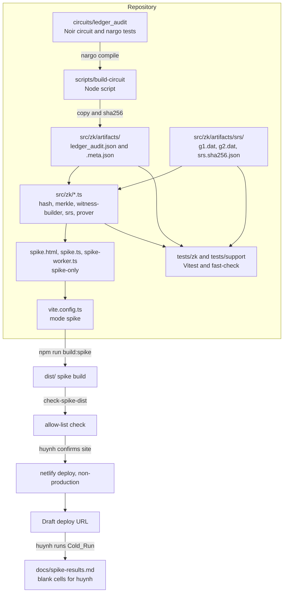
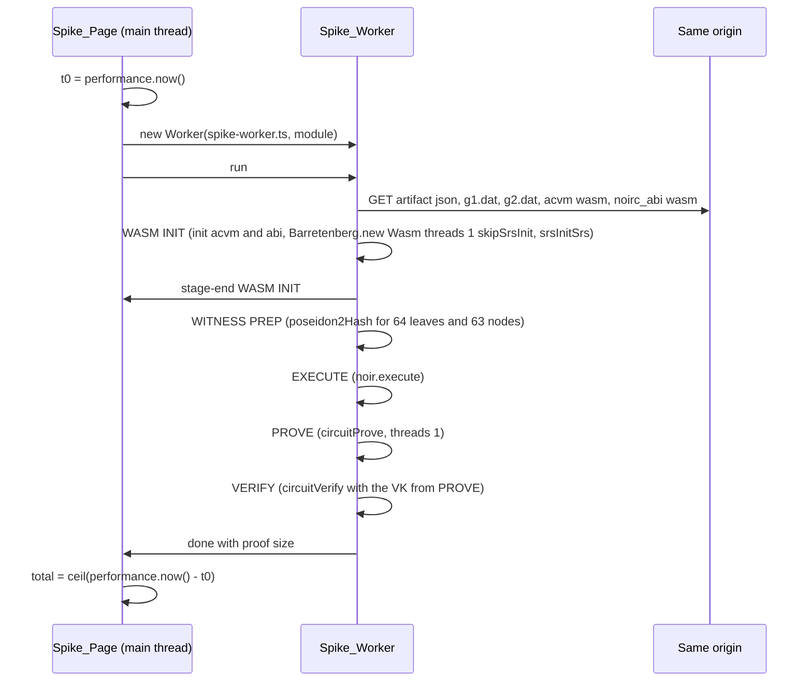

# Design Document: zk-spike

## Overview

The zk-spike answers one question before any UI work: is in-browser UltraHonk proving of the real CryptTerm `ledger_audit` circuit fast enough on huynh's machine? The spike builds the circuit at capacity N = 64 (Merkle depth 6), commits the compiled artifact and a vendored SRS, runs the circuit in a Web Worker on a temporary spike page with a single-threaded `bb.js`, and records stage timings. A non-production Netlify deploy supplies the numbers for the two gates (cold total under 30 s, and under 60 s with 4x CPU throttling). The spike also settles the open items in `.kiro/steering/noir.md` (hash variant, encodings, SRS size, and what `noir.execute` does on a failed constraint).

### Goals

- A real circuit with all constraints from `tech.md`, written test-first, with 13 required `nargo test` cases (plus extension tests added after the "tests written first" run).
- A TypeScript Witness_Builder whose Merkle root equals the circuit's root, proven by a property test.
- A spike page and worker that print five stage timings, proof size, `crossOriginIsolated` on page and worker, and an invalid-witness error report.
- An SRS that is served from the app's own origin, byte-identical to the published Aztec ceremony data, with a test that pins its sha256.
- A spike build that is invisible to the default build, and a results document with blank cells for huynh.

### Scope boundary

In scope: Requirements 1 to 14 of `requirements.md`.

Deferred to zk-core (unchanged from `requirements.md`): the Oracle and the six witness-class properties; the source scan of the spike files for forbidden APIs with its allow-list, self-test and Luhn check; the default-build inspection check of `dist/` and the `build.target` check; the test that runs the Build_Script with `nargo` absent. Until zk-core exists, the rules those checks would enforce stay in force and are verified by review or by inspecting `dist/`.

Out of scope: batch file format, signing, UI screens, the verifier screen, a `bb` CLI cross-check of proofs, raising capacity to 128.

### Environment facts

The `nargo` and `bb` rows were re-checked on 2026-11-20 (E-7). The other rows were checked on 2026-11-19.

| Fact | Evidence | Checked |
|------|----------|---------|
| `nargo` 1.0.0 is installed at `~/.nargo/bin/nargo`. `~/.nargo/bin` also holds `noir-execute`, `noir-inspector` and `noir-profiler`, which this design does not use. `nargo --version` prints exactly three lines: `nargo version = 1.0.0`, `noirc version = 1.0.0+275d3ab1a5c916c6ea73e8d6b943f685f574500c`, and `(git version hash: 275d3ab1a5c916c6ea73e8d6b943f685f574500c, is dirty: false)`. | `~/.nargo/bin/nargo --version`, `ls ~/.nargo/bin` (E-7). | 2026-11-20 |
| PATH. huynh's shell has `~/.nargo/bin` on `PATH` (fixed in the zsh profile). The agent shell does not load the profile, so `PATH` depends on how that shell was started: in the design session `command -v nargo` resolved to `~/.nargo/bin/nargo` (inherited environment), and in a clean `env -i /bin/bash` it resolved to nothing. Agent commands and scripts therefore run as `PATH="$HOME/.nargo/bin:$PATH" nargo ...` or with the full path. The Build_Script and the npm scripts find `nargo` through `PATH` and hard-code no path. | `command -v nargo` in both shells (E-7). | 2026-11-20 |
| The `bb` CLI 6.0.0 is at `~/.bb/bb`. | `~/.bb/bb --version` printed `6.0.0` (E-7). | 2026-11-20 |
| Node 24.14.1, npm 11.11.0. | `node --version`, `npm --version`. | 2026-11-19 |
| Registry: `@aztec-foundation/bb.js` dist-tags are `latest` 6.1.0 and `prerelease` 6.1.0-nightly.20261119. Version 6.0.0 exists and is the pin. `@noir-lang/noir_js` `latest` is 1.0.0. | `npm view <pkg> dist-tags`, `npm pack @aztec-foundation/bb.js@6.0.0`. `noir.md` says `latest` was 6.0.0 on 2026-11-18; it moved to 6.1.0. The pin does not change. | 2026-11-19 |
| Noir v1.0.0 is a published release (2026-10-29, not a prerelease). | GitHub releases API for `noir-lang/noir`. | 2026-11-19 |

**What `--help` settled (E-7, 2026-11-20).** `nargo test`, `nargo compile` and `nargo check` accept `--package`, `--workspace`, `--force`, `--deny-warnings`, `--silence-warnings`, `--skip-underconstrained-check` and `--skip-brillig-constraints-check`. `nargo test` also accepts `[TEST_NAMES]...` (substring match), `--exact`, `--list-tests`, `--no-run`, `--show-output`, `--no-fuzz`, `--only-fuzz`, `--format <pretty|terse|json>` and `-q`. None of the three subcommands, and not the top-level command, lists `--program-dir`. `nargo` finds `Nargo.toml` by walking up from the current directory, so every `nargo` call in this design runs with `circuits/ledger_audit` as the working directory (the npm script uses `cd`, the Build_Script uses the `cwd` option of `spawnSync`). The scripts never pass `--skip-underconstrained-check` or `--skip-brillig-constraints-check`, because the help text says those checks should run on production code. `nargo compile --help` does not state where the output goes, so the output path stays UNVERIFIED (Q8).

**First task of the spike:** run `nargo --version`, `bb --version` and `npm ls` (the last after the dependencies are added) and record the full output of each in the Results_Document (Requirement 1.1). If `nargo` is not 1.0.0, stop (Requirement 1.2). Nothing that depends on the circuit compiling or on `nargo` running on it is treated as settled. Each such claim is marked UNVERIFIED with the step that verifies it.

### Decisions accepted by huynh

huynh reviewed D1 to D7 on 2026-11-20 and accepted every default as written, and extended D7 by one test (see its row). They are no longer open. The "Reason" column is the reason the decision was raised.

| ID | Decision | Default taken | Reason | Status |
|----|----------|---------------|--------|--------|
| D1 | G1 file format for the vendored SRS: uncompressed (64 bytes per point) or compressed (32 bytes per point). | Uncompressed, 64 B per point. | Compressed init is checked by bb.js against SHA-256 hashes pinned in its binary, but needs whole 4 MiB chunks (at least 2^17 points) and took about 2.5 s to decompress in Node WASM. Uncompressed took about 63 ms and allows any power of two, but bb.js only checks the first two points. See "SRS design". | Accepted, 2026-11-20 |
| D2 | Whether to also vendor the Grumpkin SRS. | No. UNVERIFIED that UltraHonk with `ipaAccumulation: false` never needs it. | The check runs once the circuit exists and nargo runs on it. If proving fails with a Grumpkin-SRS error, a 4 MiB file is added and this becomes a user decision. | Accepted, 2026-11-20 |
| D3 | Where the Poseidon2 sponge lives in the circuit. | In-repo, built on `std::hash::poseidon2_permutation`. | The alternative is the `noir-lang/poseidon` git dependency. See Q1. | Accepted, 2026-11-20 |
| D4 | What the spike deploy does about `public/_redirects`, which points at `/index.html`. | In spike mode, skip `public/` and emit a one-line `_redirects` that rewrites `/` to `/spike.html`. | See Q7. | Accepted, 2026-11-20 |
| D5 | Requirement 11.3 says "no tracked file other than the Results_Document SHALL contain `spike.html` or `src/zk/spike.ts`". This spec's own documents contain those strings. | Read as "no source, config, script or test file". | `.kiro/specs/zk-spike/*` is part of the submission and stays. | Accepted, 2026-11-20 |
| D6 | Requirement 8.13 limits status and error text to 10 words, and Requirement 9.2 requires "the full error message text". | The 10-word limit applies to our own status and error lines. The raw error message is shown as quoted report data, rendered uppercase by CSS. | The two requirements cannot both hold for a long message. | Accepted, 2026-11-20 |
| D7 | Extra `nargo test` cases beyond the 13: `side_value_2_fails`, `review_flag_value_2_fails`, `padding_nonzero_salt_fails` and the four hash known-answer tests (`leaf_hash_matches_bb_js`, `node_hash_matches_bb_js`, `padding_leaf_matches_bb_js`, `empty_root_matches_bb_js`). Seven extension tests, 20 tests in total. | Added after the "tests written first" output is saved, so that run still shows exactly eight failures and five passes. | `security.md` section 4 requires a failing test per constraint; Requirement 5.3 requires exact counts in the first run. | Accepted, 2026-11-20; extended on the review date with `padding_nonzero_salt_fails` by huynh's decision |

- **D5.** huynh accepted this reading as written. `requirements.md` is not amended for it.
- **D6.** huynh accepted this reading as written. `requirements.md` is not amended for it.
- **What stays open.** Acceptance of D2 is acceptance of the default, not a finding. The UNVERIFIED claim inside D2 (no Grumpkin SRS needed) is item U7 in "Risks and Open Items" and is settled by the first Node proof (`proof-smoke.test.ts`). D1 and D3 to D7 carry no open claim of their own; the checks they depend on are listed as U1 to U15.

## Architecture





Dependency direction follows `structure.md`: `src/zk` imports nothing from `src/ui`. The spike files import from `src/zk` and nothing imports from them. Nothing under `src/` imports from `scripts/` or `tests/`.

## Resolved Open Questions

Evidence labels: **L-n** is a lookup (see "Lookup register"). **E-n** is an experiment run during design on 2026-11-19 in a scratch directory with `@aztec-foundation/bb.js` 6.0.0 and the four `@noir-lang` packages at 1.0.0 (Node WASM backend, single thread). Scratch directories were deleted afterwards. Experiment results are facts about this machine. Anything that needs the compiled circuit, or `nargo` running on it, is UNVERIFIED until the circuit exists and `nargo` has run on it. The `nargo` version output and `--help` text are verified (E-7, 2026-11-20).

### Q1. Poseidon2 in bb.js 6.0.0 and in Noir 1.0.0

**bb.js.** `Barretenberg` (async) has `poseidon2Hash({ inputs: Uint8Array[] }): Promise<{ hash: Uint8Array }>` and `poseidon2Permutation({ inputs: Uint8Array[] }): Promise<{ outputs: Uint8Array[] }>`. `BarretenbergSync` has the same two methods without promises (L4). Each element is a 32-byte big-endian field element (L4, E-1).

**Noir 1.0.0.** The standard library exposes only the permutation publicly: `std::hash::poseidon2_permutation<let N: u32>(input: [Field; N]) -> [Field; N]`, which needs N = 4 on BN254. The sponge `Poseidon2Hasher` is `pub(crate)`, and the doc comment says to use the `noir-lang/poseidon` library for a hash (L9). So there is no `std::hash::poseidon2::Poseidon2::hash` to call in 1.0.0.

**They match, with one trap (E-1).** For input lengths 1, 2, 3, 5 and 6, `poseidon2Hash` equals a sponge built only from `poseidon2Permutation`: state `[0, 0, 0, len * 2^64]`, add inputs into `state[0..2]` three at a time, permute after each block, and return `state[0]`. That is `ceil(len / 3)` permutations. Further facts from E-1:

- `poseidon2Permutation([0, 1, 2, 3])[0]` is `0x01bd538c2ee014ed5141b29e9ae240bf8db3fe5b9a38629a9647cf8d76c01737`, the value in the Noir stdlib doc comment (L9).
- `poseidon2Hash([1, 2, 3, 4, 5])` is `0x2247be7014a54d17342a7ef677f58d28877780d203860396967f5d0a18d259db`, the digest in the Noir stdlib test for `Poseidon2Hasher` (L9).
- The stdlib's internal `Poseidon2Hasher` runs an extra final permutation when the length is a multiple of 3. For length 3 and 6 it does not match `poseidon2Hash`. For lengths 1, 2 and 5 it does.

**Decision (D3).** Leaves hash six fields, a multiple of 3, which is the length where the two conventions differ. So the circuit implements the sponge itself in `src/hash.nr`, with the bb.js convention, on top of the public `poseidon2_permutation`. There are exactly two call shapes:

- `node_hash(left, right)`: one permutation of `[left, right, 0, 2 * 2^64]`, output element 0. This equals `poseidon2Hash([left, right])`.
- `leaf_hash(f)` with `f: [Field; 6]`: permute `[f0, f1, f2, 6 * 2^64]`, then permute `[s0 + f3, s1 + f4, s2 + f5, s3]`, output element 0. This equals `poseidon2Hash([f0..f5])`.

Why in-repo and not `noir-lang/poseidon`: no git dependency at compile time (reproducible offline), no dependency on a library whose recent releases include a breaking bug fix (v0.4.0, "perform_duplex ignores cache_size") and a stdlib-interface break (v0.3.0), and compatibility of those tags with `nargo` 1.0.0 is UNVERIFIED (L11). The cost is about 20 lines of Noir that the known-answer vectors below pin.

**Verification once the circuit exists and nargo runs on it (UNVERIFIED until then).**

1. Add Noir tests `leaf_hash_matches_bb_js`, `node_hash_matches_bb_js` and `padding_leaf_matches_bb_js` with the provisional vectors below. They must pass on the first run. If they do not, the Noir sponge differs from bb.js and the sponge in `hash.nr` is fixed before anything else.
2. The root parity property (P1) is the end-to-end check.
3. Fallback if the permutation itself differs between ACVM and bb.js: stop and report per Requirement 3.3, with the variants tried and the outputs on both sides. No other hash is adopted without huynh's approval.

**Provisional known-answer vectors (E-1, computed with bb.js 6.0.0 on this machine; confirmed against Noir on the first `nargo test`).** All values are field elements, hex is big-endian.

| Name | Inputs | Output |
|------|--------|--------|
| `PAD_LEAF` | `leaf([0, 0, 0, 0, 0, 0])` | `0x0286f724918d0f8663988824651273d4703d44b1cef1a9a31e4d1f6e0d35e8f8` |
| `LEAF_A` | `leaf([1, 1000000000000001, 0, 250000, 1, 987654321])` | `0x259c4874e82dc29fd6b1cf8be4d604bceaebdd7c7c2a9a4052444cfc9d25a1ad` |
| `LEAF_B` | `leaf([2, 1000000000000002, 1, 250000, 0, 123456789])` | `0x00a9e776d5c445c897eb24ef60bd057ef514d00fcb40bcf89a6d7cde29f5b1e8` |
| `NODE_A` | `node(LEAF_A, LEAF_B)` | `0x2f83e3c909349719e9cb57a5d79a7a0989f971c02246fe6fc9d47e882b600af4` |
| `NODE_SMALL` | `node(7, 8)` | `0x1f7a903ff6ebf6088f018bef42d630d28cc499eec89bec2ba6cc2763da3b957c` |
| `EMPTY_ROOT` | root of 64 `PAD_LEAF` leaves (level 1 to level 6 of `node(x, x)`) | `0x22d28221a316eb2b0ae742ae204890369a507e2d66bd93314f8f56c697af75c8` |

Intermediate all-padding levels (1 to 5): `0x1b3d40de…96ce`, `0x1e6fb0e7…691f`, `0x2ed44256…3ab3`, `0x1e3f4130…2e00`, `0x1bf3a157…03e9`. The full values go into `tests/zk/hash-kat.test.ts` and `noir.md` when the task runs.

### Q2. Noir integer types and whether 2^40 can pass the ABI

| Value | Noir type | Reason |
|-------|-----------|--------|
| `amount` | `u64` | An integer type as `tech.md` requires. 2^40 and anything below 2^64 can be encoded, so the circuit constraint `amount < 2^40` is what rejects it. 64 amounts of at most 2^40 - 1 sum to under 2^46, so `u64` sums cannot overflow after the range check. |
| `limit_cents` | `u64` (public) | Same reasoning. |
| `record_count` | `u32` (public) | Values 0 and 65 are encodable, so both bound checks are testable. |
| `side` | `u8` | D = 0, C = 1. Value 2 is encodable (E-3), so the explicit assertion is testable. |
| `review_flag` | `u8` | N = 0 (not set), Y = 1 (set). |
| `record_id`, `account`, `salt` | `Field` | Only hashed. The 2^64 and 2^248 bounds are Witness_Builder rules (Q3), not circuit constraints. |
| `merkle_root` | `Field` (public) | |

No signed integer, `i*` type, or float appears (Requirement 4.9).

**How noir_js encodes inputs (L7, L8, E-3).** `InputValue` is `string | number | boolean | InputMap | InputValue[]`. There is no `bigint`. `abiEncode` rejects JavaScript numbers above 2^53 - 1 and asks for strings. Bigint values therefore go in as decimal strings. E-3 ran `abiEncode` from `@noir-lang/noirc_abi` 1.0.0 against a hand-written ABI:

| Input | Result |
|-------|--------|
| `u64` amount `"1099511627776"` (2^40) | Encodes. |
| `u64` amount `"18446744073709551616"` (2^64) | Throws, and the message contains the value. |
| Value above the field modulus | Throws, and the message contains the value. |
| `u8` side `"2"` | Encodes. |
| `u8` side `"300"` | Throws, and the message contains the value. |
| Missing `limit_cents` | Throws: ``Expected argument `limit_cents`, but none was found``. |
| Array of 1 or 3 for a length-2 parameter | Throws, and the message includes the supplied values (E-3 showed `amount` and `salt` digits). |
| Unknown extra key, `0x` hex string | Accepted. |

Consequences:

- `amount_at_2_pow_40_fails` and `limit_at_2_pow_40_fails` reach the circuit, so the circuit assertion (not the ABI) rejects 2^40. In `nargo test` the values are Noir literals, so the ABI is not involved.
- Amounts of 2^64 and above, and out-of-range `u8`, are rejected by the ABI with a message that leaks the value. **The Witness_Builder must validate every range before calling noir_js** (Requirements 3.10 and 6.4), and no code path shows a raw `abiEncode` or `execute` error outside the invalid-witness report.
- Requirement 2.9 (missing public input, wrong array length) is covered by example tests on `abiEncode` errors.

### Q3. Encoding of `record_id` and `account`

Both are unsigned integers in the range 0 to 2^64 - 1, passed as `Field` (decimal string in the inputs, 32-byte big-endian in the hash). 2^64 - 1 is 20 digits, so any 19-digit PAN or account number fits. Leading zeros are not representable: the ledger-format spec owns the fixed-width text columns and maps a fixed-width digit string to this integer. `salt` is an integer in 0 to 2^248 - 1 (31 bytes, so a random salt never exceeds the field). The Witness_Builder rejects values outside these ranges with `FieldRangeError` naming the field and slot, without the value (Requirement 3.10). Spike_Witness accounts have 12 digits, so they can never be a PAN (13 to 19 digits).

### Q4. Padding_Posting and salt

`PADDING_POSTING = { record_id: 0, account: 0, side: 0 (D), amount: 0, review_flag: 0 (N), salt: 0 }`. Its leaf is `PAD_LEAF` (Q1 table). Side D and flag N are valid encodings, so no third value is needed. A fixed salt of 0 is acceptable because every padding leaf is public by construction (the public `record_count` already reveals which slots are padding). The circuit forces every slot at index `>= record_count` to equal this value in all six fields.

### Q5. What `noir.execute` does on failure (hypothesis, confirmed by the spike)

**Reading of the source (L6).** `Noir.execute` calls `abiEncode` (throws on ABI errors, see Q2) and then `executeProgram` from `acvm_js`. If execution rejects and the error has `rawAssertionPayload`, `noir_js` decodes it with `abiDecodeError`. For a string payload it sets `message` to `Circuit execution failed: <assertion string>`. For a non-string payload it attaches `decodedAssertionPayload`. It also tries to attach `noirCallStack` (file path, line and column strings). If the error has no `rawAssertionPayload`, it throws `new Error("Circuit execution failed: " + err, { cause: err })`.

**Hypothesis H5 (UNVERIFIED).** For the unbalanced witness, `execute` throws an `Error` whose message is `Circuit execution failed: DEBITS NOT EQUAL TO CREDITS`, with own properties that include `message`, `stack`, `rawAssertionPayload`, `acirFunctionId`, `callStack`, `noirCallStack`, and with no private input value in the message because assertion messages are static strings. The throw happens in `execute`, not later at proof time.

**Experiment (Requirement 9, run by huynh on the deployed page).** The invalid-witness control runs `execute` once on the modified witness and displays: threw (YES or NO), returned a witness (YES or NO), constructor name, own property names, full message, and the leak check. If `execute` does not throw, the worker attempts one proof and shows the result. A Vitest example test (`tests/zk/circuit-inputs.test.ts`) runs the same experiment in Node first, so the shape is known before the deploy. The finding replaces the "Unverified" bullet in `noir.md` (Requirement 9.5).

**Design rule that holds whatever the result:** assertion messages are string literals, never f-strings (L10), so a failed assertion cannot copy witness values into a message.

### Q6. noir_js and bb.js in Node (Vitest) and in the browser worker

**Packages.** `@noir-lang/noir_js` 1.0.0 depends on the other three `@noir-lang` packages at exactly 1.0.0 and on `pako ^3`. `@aztec-foundation/bb.js` 6.0.0 has an `exports` map with `browser` and `default` conditions (L1). Registry check: all five pinned versions exist (`npm pack` succeeded for each).

**Node (Vitest).** `import { Noir } from '@noir-lang/noir_js'` works in Node 24 (E-6). `acvm_js` and `noirc_abi` resolve to their `nodejs` builds through `main`, which initialise themselves, so `Noir.init()` does nothing. For bb.js the default `Barretenberg.new()` tries the native `bb` binary through a Unix socket and then falls back to WASM (L1). Tests use `Barretenberg.new({ backend: BackendType.Wasm, threads: 1, skipSrsInit: true })` so that they run the same WASM path as the browser, offline, with the vendored SRS. The WASM backend in Node runs on the calling thread and spawns no workers when `threads` is 1 (L1).

**Browser worker.**

- `new Worker(new URL('./spike-worker.ts', import.meta.url), { type: 'module' })` is the Vite-recommended form (L12). `vite.config.ts` sets `worker: { format: 'es' }` because the default is `'iife'`, which cannot code-split the dynamic import of the bb.js WASM chunk, and because `import.meta.url` is `undefined` in IIFE output (L12).
- `acvm_js` and `noirc_abi` web builds export an init function as `default`. Both are idempotent (`if (wasm !== undefined) return wasm`, L7). The worker initialises them explicitly with `?url` imports of the `.wasm` files, using the object form `init({ module_or_path: url })`, before `new Noir(...)`. `Noir.init()` then calls the same init functions again and returns at once. Sizes: `acvm_js_bg.wasm` 3,050,251 bytes, `noirc_abi_wasm_bg.wasm` 789,608 bytes.
- bb.js's browser build inlines its WASM as a gzip data URL inside two JS chunks, `barretenberg.js` (about 5.4 MB, single-thread) and `barretenberg-threads.js` (about 5.4 MB). The spike `dist/` therefore has no separate bb.js `.wasm` file. `fetchCode` fetches the `data:` URL, which is not a network request. Both chunks are emitted because the import is dynamic. Only the single-thread one runs when `crossOriginIsolated` is false (`fetchModuleAndThreads` uses `getSharedMemoryAvailable()`).
- `Barretenberg.new({ backend: BackendType.Wasm, threads: 1, skipSrsInit: true })`. `BackendType.Wasm` runs the WASM directly on the calling thread, which is the Spike_Worker, so there is no nested worker (L1, `useWorker` false). Without an explicit `backend`, inside a worker `typeof window` is `'undefined'` and the code would try the native backend first; an explicit backend avoids that.
- **Resolve condition (UNVERIFIED).** Vite must pick the `browser` build of bb.js, not the Node build with `fs` imports. Verify by building the spike and searching the worker chunk for `node:` and `from "fs"`. Fallback: `resolve.conditions: ['browser', 'module', 'import']` in spike mode.

**SRS supply** is in "SRS design". Short answer: `skipSrsInit: true`, then `api.srsInitSrs({ pointsBuf, numPoints, g2Point })` with bytes fetched from the app's origin. No patch is needed (L1, L2).

### Q7. How the spike build is selected, and how it deploys

- **Selection.** `vite build --mode spike`, wrapped as `npm run build:spike` (`tsc --noEmit && vite build --mode spike`). `vite.config.ts` becomes `defineConfig(({ mode }) => ...)`. In spike mode it sets `build.rolldownOptions.input` to `'spike.html'` (Vite 8 option name, L12). `spike.html` is then the only HTML entry, so `dist/` has `spike.html` and no `index.html`. In the default and test modes there is no `input` override, so Vite builds the root `index.html`, which never reaches `spike.html` or anything only the spike imports. That satisfies Requirement 11.1 without any delete step.
- **`build.target`** stays `'esnext'` in both modes (Requirement 11.4).
- **`public/_redirects` decision (D4).** It contains `/*  /index.html  200`, and the spike `dist/` has no `index.html`. Netlify serves an existing file first, so `/spike.html` would load, but `/` would rewrite to a missing `/index.html` and show a 404, which breaks the "open the deployed URL" step. In spike mode the config sets `publicDir: false` (so `public/_redirects` and `public/samples/` are not copied) and a small inline plugin emits `_redirects` containing `/  /spike.html  200`. `public/_redirects` itself is not edited. `_redirects` is on the allow-list in Requirement 12.5.
- **Deploy.** `netlify deploy --dir dist` with no `--prod`, run after `npm run build:spike` and `npm run check:spike-dist`. `netlify.toml` is not changed: its `command` is only used by Netlify's own builds and by `netlify deploy --build`, neither of which is used. The Netlify power's overview says a newly created site gets a production deploy by default (L14). Requirement 12.3 overrides that: the spike never uses `--prod`, even for a new site.

### Q8. Build_Script language, version string, atomic write, determinism

- **Language:** Node, ESM, file name exactly `scripts/build-circuit` (no extension), `#!/usr/bin/env node`. The repo has `"type": "module"`, so an extensionless file is ESM. npm script: `"build:circuit": "node scripts/build-circuit"`. Node gives `crypto.createHash`, `fs.renameSync`, and the same behaviour on every OS.
- **Version string (Requirement 7.3).** First line of `nargo --version`, with trailing whitespace removed. Verified on 2026-11-20 (E-7): that line is exactly `nargo version = 1.0.0`, and the Artifact_Meta `nargoVersion` value is that string. The second output line, `noirc version = 1.0.0+275d3ab1a5c916c6ea73e8d6b943f685f574500c`, carries a build suffix. It is not used, and no code or test reads any line but the first. Test 7.9 (`tests/zk/artifact.test.ts`) matches the string against `^nargo version = (\S+)$`, takes the captured token whole, and requires it to equal `1.0.0` by string equality. So `nargo version = 1.0.0-beta.1`, `nargo version = 1.0.0+build5`, `nargo version = 1.0.1`, an empty string, a missing value and a first line in another shape all fail, because the token is compared whole and never trimmed to its numeric part. The test runs against the committed Artifact_Meta and against a table of these mutated strings.
- **Steps.** (1) `nargo --version`; fail with `STEP version: ...` on error. (2) `nargo compile --force` with `circuits/ledger_audit` as the working directory (`spawnSync` option `cwd`; `nargo compile --help` lists `--force`, "Force a full recompilation", and no `--program-dir`, so the flag and the working-directory rule are verified, E-7). The script passes no `--skip-underconstrained-check` and no `--skip-brillig-constraints-check`. `--force` makes the output independent of a stale `target/` cache. (3) Read `circuits/ledger_audit/target/ledger_audit.json` (UNVERIFIED path: `nargo compile --help` does not state it, and the package name gives the file name; confirmed by the first real compile); fail with `STEP artifact missing` if absent, and check that it parses and has `bytecode` and `abi`. (3a) Step `path rewrite`: replace the absolute repo path and the home path in the compiled text, longest prefix first, in the resolve and realpath forms, each plain, forward-slash and JSON-escaped. `bytecode`, `abi` and `hash` stay unchanged, checked by a raw-text comparison and by a parsed comparison. The step fails closed (exit 1, nothing written) on any remaining absolute repo or home path, invalid JSON, a size-delta mismatch, or any absolute `file_map` path (one that starts with `/`, `~` or a drive letter). (4) Compute sha256 over the exact bytes to be written, which are the rewritten text. (5) Write `ledger_audit.json.tmp-<pid>` and `ledger_audit.meta.json.tmp-<pid>` into `src/zk/artifacts/` (same directory, so `rename` is atomic), then `rename` both into place. Before the renames, hold the old bytes in memory. If the second rename fails, restore the first file from memory. (6) A `finally` block removes any leftover `.tmp-*` file. Errors go to stderr as `build-circuit: step <name> failed: <reason>` with exit code 1. Nothing is written before every check passes, so a failure in steps 1 to 4 leaves both files byte-identical.
- **Meta file.** Exactly two keys, in this order, two-space indent, trailing newline: `{ "nargoVersion": "<first line>", "artifactSha256": "<64 lowercase hex>" }`. No timestamp, path or other value.
- **Determinism (Requirement 7.5, RESOLVED 2026-11-22, huynh's decision A).** The compiled JSON embeds absolute source paths in `file_map`, so the raw `target/ledger_audit.json` differs between checkouts (117059 and 117107 bytes in two fresh checkouts). The Build_Script therefore rewrites those paths to package-relative paths by textual replacement (step `path rewrite`, see the Steps bullet). The Artifact is the compiled JSON with that one change: `bytecode`, `abi` and `hash` are unchanged. Measured in task 4.3 (`docs/spike-results.md` rows T4.3-c and T4.3-d): the Artifact sha256 `2b08fea5…ecd5b` and the Artifact_Meta sha256 `d62b899b…34e01` are identical in the repo (two runs), in `<home>/ct-checkout-b`, and in a real path under `/private/tmp` with spaces and a dot in the directory names. The fallback of stripping `file_map` and `debug_symbols` was not taken, so the noir_js call-stack text is kept. The Artifact_Meta format and the version string are unchanged. The known limits of the Build_Script are listed in `docs/spike-results.md`, section `## Build_Script`.

### Q9. Timeouts and `numRuns`

Unit costs are measured, not guessed. E-4 measured 127 `poseidon2Hash` calls (the node-shaped call) in 12 ms and 64 leaf-shaped calls in 9 ms on this machine, so building 64 leaves and 63 nodes is about 20 ms. `noir.execute` time and proof time are UNVERIFIED until the first run.

| Test | numRuns | Rule for the timeout |
|------|---------|----------------------|
| P1 root parity, P2 one-cent change (execute only) | 100 each (raise only if fast) | `max(60 s, 5 x numRuns x (T_build + T_exec))` with `T_build` and `T_exec` measured on the first run. Start with 120 s. |
| P3 amount range (no hashing, no execute) | 300 (100 per range) | 30 s. |
| P4 proof round trip | exactly 3 | `T = 3 x 3 x (T_prove + T_verify)` (safety factor 3, three runs), rounded up to the next 10 s. Initial placeholder before any measurement: 900 s. Applies only to `vitest.proof.config.ts`. |
| P5 public-input tamper | exactly 3 runs, 3 variants each | Each run proves once and verifies 3 times, so use the same formula with `T_verify` counted four times. Initial placeholder: 900 s. Applies only to `vitest.proof.config.ts`. |

**Where each timeout lives.** The default Vitest `testTimeout` is 5000 ms (Vitest 5.1.1 source, `resolved.testTimeout ??= resolved.browser.enabled ? 15e3 : 5e3`, L16), and the default config does not raise it. P1 and P2 therefore pass their own timeout as the third argument of `it`, and P3 passes 30 s. The long proof timeouts are set only as `testTimeout` and `hookTimeout` in `vitest.proof.config.ts`, so no default-run file can inherit them. P4 and P5 pass no per-test timeout.

**Rule after the first measured run.** The proof smoke test (`tests/zk/proof/proof-smoke.test.ts`; see "Implementation order for the tasks phase", group 7) is the first Node proof. It prints `T_prove` and `T_verify` to stdout (no data). Replace the placeholder `PROOF_TEST_TIMEOUT_MS` constant in `vitest.proof.config.ts` with the formula result and record both numbers in `docs/spike-results.md` next to the browser numbers. Recompute whenever the circuit changes. The WASM backend in Node is the production path, so these numbers are comparable to (not equal to) browser numbers.

### Q10. Ceremony file format, layout, URLs, prefix validity

All facts below were checked on 2026-11-19 with `curl -I` and 64 KiB Range requests (L3, E-5). Nothing larger was downloaded.

- **Provenance.** The SRS is from the Aztec Ignition ceremony (L13). bb.js 6.0.0 pins `SRS_TOTAL_POINTS = 100000000` (L5).
- **Uncompressed G1 (`g1.dat`).** 64 bytes per point: x then y, each 32 bytes big-endian, no header. The first point is the generator `(1, 2)`: bytes `00…01` then `00…02` (E-5). File size 6,400,000,000 bytes = 10^8 points x 64.
- **Compressed G1 (`g1_compressed.dat`).** 32 bytes per point, no header. The first 32 bytes are `00…01`. bb.js `NetCrs` requests this file with `Range: bytes=0-(numPoints*32 - 1)` (L3).
- **G2 (`g2.dat`).** 128 bytes, no header. sha256 `01797bfc4de5a96f0e516a9ea4537d18786dc30cb991aca4274c95822b69c32f`. bb.js refuses any other bytes: `SrsInitSrs` hashes `g2_point` and compares it with a pinned constant (L5, E-2 accepted these bytes).
- **Hosts and responses (HEAD).**

| URL | Status | content-length | accept-ranges | content-type | etag |
|-----|--------|----------------|---------------|--------------|------|
| `https://crs.aztec-cdn.foundation/g1.dat` | 200 | 6400000000 | bytes | not sent | `12c497c995632581589e824133785bd9-763` |
| `https://crs.aztec-labs.com/g1.dat` | 200 | 6400000000 | bytes | `binary/octet-stream` | same etag |
| `https://crs.aztec-cdn.foundation/g1_compressed.dat` | 200 | 3200000000 | bytes | not sent | `51f3140a11a0b3bd651c7b5eca0f226a-382` |
| `https://crs.aztec-labs.com/g1_compressed.dat` | 200 | 1073741856 | bytes | `binary/octet-stream` | `2a4a2e61feec8bedcb59d1de8243b2d2-129` |
| `https://crs.aztec-cdn.foundation/g2.dat` | 200 | 128 | bytes | not sent | `09238fab083a646624e425566db43314` |
| `https://crs.aztec-labs.com/g2.dat` | 200 | 128 | bytes | `binary/octet-stream` | same etag |

A Range request `bytes=0-65535` returns `206` with `content-range: bytes 0-65535/<total>` on both hosts for both G1 files.
- **Prefix equality (E-5).** The first 65,536 bytes of `g1.dat` from the primary host, from the mirror, and from the local bb CLI cache (`~/.bb-crs/bn254_g1.dat`) have the same sha256, `2bf3b828bcbba7b806b1339dfa7c03b58334e36419205524689b2cdb05c59a33`. The same holds for the first 65,536 bytes of `g1_compressed.dat`, sha256 `97759270e0935cbb35c95222070bab985e5b70fcc705aca91ed77fecee1b563a`. The two hosts hold the same uncompressed object (equal etag) but differently sized compressed objects, with an identical prefix.
- **Valid prefix for bb.js 6.0.0.** Yes. `srsInitSrs` accepted uncompressed prefixes of 2^15, 2^16 and 2^17 points and compressed prefixes of 2^17 and 2^18 points (E-2). It rejects a compressed buffer that is not a positive multiple of 4,194,304 bytes (error text in "SRS design").

## Lookup register

These entries go into the "Lookups" section of `docs/spike-results.md` (Requirement 1.10), one row per entry, with the version the lookup applies to.

| ID | Topic | Source | Version |
|----|-------|--------|---------|
| L1 | `Barretenberg.new`, `skipSrsInit`, `initSRSChonk`, `srsInitSrs`, `BackendType.Wasm`, WASM threads selection | `npm pack @aztec-foundation/bb.js@6.0.0`: `src/barretenberg/index.ts`, `src/bb_backends/wasm.ts`, `src/barretenberg_wasm/*` | bb.js 6.0.0 |
| L2 | `BackendOptions` (`threads`, `skipSrsInit`, `wasmPath`, `crsPath`, `srsSize`) | same package, `src/bb_backends/index.ts` | bb.js 6.0.0 |
| L3 | CRS hosts, file names, Range request, bytes per point | same package, `src/crs/net_crs.ts`, `src/crs/browser/cached_net_crs.ts`, `src/crs/node/index.ts` | bb.js 6.0.0 |
| L4 | `poseidon2Hash`, `poseidon2Permutation`, `srsInitSrs`, `circuitStats`, `circuitProve`, `circuitVerify`, `circuitComputeVk` types | same package, `dest/node/cbind/generated/api_types.d.ts`, `async.d.ts` | bb.js 6.0.0 |
| L5 | `SrsInitSrs` checks, 4 MiB chunk hashes, prover key size, `SUBGROUP_SIZE`, "too many points" error, `circuitStats` fields | `AztecProtocol/aztec-packages` tag `v6.0.0`: `barretenberg/cpp/src/barretenberg/bbapi/bbapi_srs.cpp`, `bbapi_ultra_honk.cpp`, `srs/factories/bn254_g1_chunk_hashes.hpp`, `srs/factories/mem_bn254_crs_factory.cpp`, `ultra_honk/ultra_prover.cpp`, `ecc/curves/bn254/bn254.hpp` | bb 6.0.0 source |
| L6 | `Noir.execute`, error enrichment | `npm pack @noir-lang/noir_js@1.0.0`: `lib/program.mjs`, `lib/witness_generation.mjs` | noir_js 1.0.0 |
| L7 | ABI encode and decode, init functions | `@noir-lang/noirc_abi@1.0.0` and `@noir-lang/acvm_js@1.0.0` (`web/*.d.ts`, `web/*.js`); `noir-lang/noir` tag `v1.0.0`: `tooling/noirc_abi/src/input_parser/{mod,json}.rs`, `tooling/noirc_abi_wasm/src/lib.rs` | 1.0.0 |
| L8 | `InputValue`, `CompiledCircuit` types | `@noir-lang/types@1.0.0`, `lib/esm/types.d.ts` | 1.0.0 |
| L9 | `poseidon2_permutation` (public), `Poseidon2Hasher` (`pub(crate)`), known-answer values | `noir-lang/noir` tag `v1.0.0`: `noir_stdlib/src/hash/mod.nr`, `noir_stdlib/src/hash/poseidon2.nr` | Noir 1.0.0 |
| L10 | `#[test(should_fail_with = "...")]` is a substring match; `#[test]` with arguments is a fuzz test; assertion messages; integer overflow errors; `assert_max_bit_size` | `noir-lang/noir` tag `v1.0.0`: `docs/docs/tooling/tests.md`, `docs/docs/language/assert.md`, `docs/docs/language/data_types/{integers,fields}.md` | Noir 1.0.0 |
| L11 | `noir-lang/poseidon` tags v0.2.6 to v0.4.0, changelog | `github.com/noir-lang/poseidon` | tags v0.2.6, v0.3.0, v0.4.0 |
| L12 | Vite worker constructor, `worker.format`, `build.rolldownOptions.input`, top-level `input`, `?url`, `publicDir`, `assetsInlineLimit` | Context7 `/vitejs/vite/v8.3.5` (docs for Vite 8.3.5; the repo pins 8.3.8) | Vite 8.3.5 docs |
| L13 | Aztec Ignition ceremony | `github.com/AztecProtocol/ignition-verification` | n/a |
| L14 | Netlify CLI flow | Netlify power `netlify-deployment` overview | n/a |
| L16 | Vitest config discovery (`vitest.config.*` then `vite.config.*`, `--config`), `exclude` replaces the default list and is extended with `configDefaults.exclude`, `include`, `testTimeout`, `hookTimeout`, `fileParallelism`, `vitest list` | Context7 `/vitest-dev/vitest/v5.0.3` (`docs/config/index.md`, `docs/config/exclude.md`; the nearest listed version to the pinned 5.1.1), checked against the installed package `node_modules/vitest` 5.1.1: `dist/chunks/defaults.*.js` (`defaultExclude`), `dist/chunks/constants.*.js` (`CONFIG_NAMES`), `dist/chunks/cac.*.js` (CLI options and commands), `dist/chunks/index.*.js` (`testTimeout` default) | Vitest 5.1.1 |
| E-1 | Poseidon2 parity | scratch script on bb.js 6.0.0, WASM backend | 2026-11-19 |
| E-2 | `srsInitSrs` timing and acceptance with local ceremony prefixes | scratch script | 2026-11-19 |
| E-3 | `abiEncode` probe with a hand-written ABI | scratch script on noirc_abi 1.0.0 | 2026-11-19 |
| E-4 | Known-answer values and hash timing | scratch script | 2026-11-19 |
| E-5 | HEAD and 64 KiB Range requests against both CRS hosts, and comparison with the local bb cache | `curl` | 2026-11-19 |
| E-6 | `npm ls` of the five pinned packages and `import('@noir-lang/noir_js')` in Node 24 | scratch install | 2026-11-19 |
| E-7 | `~/.nargo/bin/nargo --version`, `~/.bb/bb --version`, `ls ~/.nargo/bin`, `command -v nargo` (design session shell and clean `env -i /bin/bash`), and `--help` of `nargo`, `nargo compile`, `nargo test`, `nargo check` (read-only; no `nargo new`, `compile` or `test` was run) | shell | 2026-11-20 |

**Context7 caveat.** The libraries `/noir-lang/noir` and `/websites/noir-lang` reflect the `master` branch, not 1.0.0. Where a Noir behaviour matters here, the design uses the tagged `v1.0.0` source instead. Context7's answers on `should_fail_with` and `assert_max_bit_size` agree with the tagged docs. The registry wins on package names and versions.

## Components and Interfaces

### SRS design (Requirement 14)

#### How bb.js 6.0.0 takes a local SRS (no patch needed)

- By default `Barretenberg.new` calls `initSRSChonk`, which downloads `g1_compressed.dat` (2^19 points by default, 16 MiB), `g2.dat`, and 2^16 Grumpkin points (4 MiB) from `https://crs.aztec-cdn.foundation` with a fallback to `https://crs.aztec-labs.com` (L1, L3). In a browser it also writes them to IndexedDB through `idb-keyval`. The spike must make none of these requests.
- The override is the `skipSrsInit: true` option in `BackendOptions` (L2). With it, `Barretenberg.new` returns without touching the network. The SRS is then supplied by calling `await api.srsInitSrs({ pointsBuf, numPoints, g2Point })` (L4). `pointsBuf` is a `Uint8Array`, `numPoints` is a number, `g2Point` is the 128-byte `g2.dat` contents.
- `srsInitSrs` chooses the format from `pointsBuf.length / numPoints`: 64 means uncompressed, 32 means compressed, anything else throws `SrsInitSrs: invalid points_buf size. Expected 32 or 64 bytes per point, got <n>` (L5). **Pass exactly `numPoints x bytesPerPoint` bytes.**
- What bb.js validates (L5, E-2):
  - Always: `g1_points[0]` is the canonical BN254 generator; `g1_points[1]` equals the canonical trusted-setup point; `g2_point` has the canonical SHA-256 (`01797bfc…c32f`), is not the point at infinity, and is in the prime-order subgroup.
  - Compressed path only: the buffer length must be a positive multiple of 4,194,304 bytes (131,072 points), and each 4 MiB chunk is hashed and compared with a SHA-256 pinned in the binary (`BN254_G1_CHUNK_HASHES`, 763 chunks). The uncompressed path has no such check. A short prefix is accepted on both paths (it only has to cover what the prover asks for).
- **Grumpkin.** `initSRSChonk` also calls `srsInitGrumpkinSrs`. UltraHonk with `ipaAccumulation: false` commits on BN254 only, so the spike does not call it. **UNVERIFIED (D2):** a real prove must succeed without it. Verification: the first Node proof (`tests/zk/proof/proof-smoke.test.ts`, run by `npm run test:proof`, task group 7) runs with `skipSrsInit: true` and only `srsInitSrs`. If it fails with an uninitialised-Grumpkin-SRS message, stop and ask huynh, because vendoring 2^16 Grumpkin points (4 MiB, `grumpkin_g1_v2.dat`, 64 bytes per point) is a second binary file.
- The `crsPath` and `wasmPath` options are not used. `wasmPath` is only for overriding where bb.js loads its WASM from; the default needs no network.

#### Choosing the point count (Requirement 14.2, 14.3, 14.8)

Measurement (after the artifact exists, run in a Vitest helper or a scratch Node script, not in the app):

```ts
const stats = await api.circuitStats({
  circuit: { name: 'ledger_audit', bytecode: acirBytes, verificationKey: new Uint8Array(0) },
  includeGatesPerOpcode: false,
  settings: PROOF_SETTINGS, // { ipaAccumulation: false, oracleHashType: 'poseidon2', disableZk: false, optimizedSolidityVerifier: false }
});
// stats.numGates       = builder.get_finalized_total_circuit_size()
// stats.numGatesDyadic = builder.get_circuit_subgroup_size(numGates)   (a power of two)
```

`acirBytes` is the artifact's base64 `bytecode` after base64 decoding and gunzip (the same conversion `UltraHonkBackend` does internally). `circuitStats` is the call `acirGetCircuitSizes` wraps (L4, L5). The `bb` CLI gives a cross-check: `~/.bb/bb gates -b circuits/ledger_audit/target/ledger_audit.json -t noir-recursive` (`noir-recursive` is Poseidon2 with ZK, matching `PROOF_SETTINGS`). UNVERIFIED: that the CLI accepts the `nargo` JSON file and the exact output format.

Formula, from `UltraProver::construct_proof` (L5):

```
key_size       = polynomials.max_end_index()            // at most the dyadic size, includes lookup tables
if ZK flavor:  key_size = max(key_size, 2^(log2(SUBGROUP_SIZE) + 1))     // SUBGROUP_SIZE = 256 for BN254, so 512
commitment key = CommitmentKey(key_size)
```

So `requiredPoints = max(numGatesDyadic, 512)` and `N = requiredPoints` (already a power of two; if not, round up to the next power of two). Nothing else is added: the ZK floor is the only extra beyond the circuit size. The verification key computation is expected to use the same commitment-key size, and `circuitVerify` is expected to need only point 0 and the G2 point (UNVERIFIED; the first prove and verify with `N` points settle both).

The statistic and the prover's own dyadic size are computed by different functions (`_stats` versus `ProverInstance::compute_dyadic_size`, which also accounts for lookup tables). So the relation is UNVERIFIED. Validation: the first full prove (`proof-smoke.test.ts`, task group 7, then Property 4) runs with exactly `N` points. If `N` is too small, the C++ factory throws `prover trying to get too many points in MemBn254CrsFactory! <have> vs <need>` (L5). `<need>` is exact, so the next try is `nextPow2(need)`. This is the failure behaviour for Requirement 14.8: the worker catches an error whose message contains `too many points`, shows `FAILED PROVE: SRS TOO SMALL FOR CIRCUIT` with the two numbers, and the task is repeated with the larger `N`. An optional minimality probe runs the same prove with `N / 2` points and expects that error.

Record in `noir.md` "Settled choices": `numGates`, `numGatesDyadic`, `requiredPoints`, chosen `N`, the date and the commands. The user's 2^16 is not assumed: `N` is whatever the formula gives, and no value is hard-coded in code (the loader reads `pointCount` from the manifest).

| N (points) | Uncompressed file (64 B per point) | Compressed alternative (32 B per point) |
|------------|-------------------------------------|------------------------------------------|
| 2^14 | 1 MiB | not allowed (needs 4 MiB multiples) |
| 2^15 | 2 MiB | not allowed |
| 2^16 | 4 MiB | not allowed |
| 2^17 | 8 MiB | 4 MiB (one chunk) |
| 2^18 | 16 MiB | 8 MiB (two chunks) |

#### Format decision (D1)

| | Uncompressed (default) | Compressed |
|---|------------------------|------------|
| File | first `N x 64` bytes of `g1.dat` | first `k x 4 MiB` bytes of `g1_compressed.dat`, `numPoints = k x 131072` |
| Init time in Node WASM, one thread (E-2) | 63 ms at 2^16, 25 ms at 2^15, 83 ms at 2^17 | about 2.5 s at 2^17, about 5.1 s at 2^18 |
| Point counts allowed | any power of two | multiples of 2^17 |
| Integrity checked by bb.js at init | points 0 and 1, and G2 | every 4 MiB chunk against hashes pinned in the binary, plus points 0 and 1, and G2 |
| Chunk 0 sha256 | n/a | `fad8203ae1fd103658d4bb33b2b4cf126a28352b5de4684737cff23cc15fb94b`, equal to the first pinned hash in `bn254_g1_chunk_hashes.hpp` and to the first 4 MiB of the local bb cache (E-5) |

The default is uncompressed: it honours "smallest power of two that fits" and removes seconds of decompression from the Cold_Run, which the gates measure. The price is weaker runtime integrity, which the sha256 test and the re-verification below cover. huynh accepted this default (D1). If the format is ever changed to compressed, only three things change: the file name content, the manifest `format` and `bytesPerPoint`, and the byte range. The code reads those from the manifest.

#### Obtaining the files (done once, in the SRS task)

```
# g1 prefix. N and END = N*64 - 1 come from the measurement above.
curl --fail -sS -H "Range: bytes=0-$END" -o src/zk/artifacts/srs/g1.dat https://crs.aztec-cdn.foundation/g1.dat
# expect HTTP 206 and a file of exactly N*64 bytes
curl --fail -sS -o src/zk/artifacts/srs/g2.dat https://crs.aztec-cdn.foundation/g2.dat
# expect 128 bytes, sha256 01797bfc4de5a96f0e516a9ea4537d18786dc30cb991aca4274c95822b69c32f
```

The byte range is `N x 64` bytes starting at offset 0 (no header, Q10). Then `shasum -a 256` on each file. The same range is requested from the mirror host `https://crs.aztec-labs.com/g1.dat`; the sha256 values must match.

#### Where the expected values live (Requirement 14.5, 14.6)

`src/zk/artifacts/srs/srs.sha256.json`, committed next to the data files. Reasons: one source of truth that the test and the loader both read (the loader takes `pointCount` and `bytesPerPoint` from it, so no number is repeated in code); a plain JSON file is machine-readable, unlike `noir.md`; and the test cross-checks `noir.md` so the two cannot drift. Shape:

```json
{
  "format": "bn254-g1-uncompressed-be64",
  "pointCount": 65536,
  "bytesPerPoint": 64,
  "files": {
    "g1.dat": {
      "bytes": 4194304,
      "sha256": "<64 lowercase hex>",
      "source": "https://crs.aztec-cdn.foundation/g1.dat",
      "mirror": "https://crs.aztec-labs.com/g1.dat",
      "byteRange": "bytes=0-4194303"
    },
    "g2.dat": {
      "bytes": 128,
      "sha256": "01797bfc4de5a96f0e516a9ea4537d18786dc30cb991aca4274c95822b69c32f",
      "source": "https://crs.aztec-cdn.foundation/g2.dat",
      "mirror": "https://crs.aztec-labs.com/g2.dat",
      "byteRange": null
    }
  }
}
```

(The numbers in the example are for N = 2^16 and are illustrative; the task writes the measured ones.)

#### The sha256 test (`tests/zk/srs.test.ts`, Requirement 14.6)

Fails when: the manifest is missing, is not valid JSON, lacks a key, has a hash that is not 64 lowercase hex characters, has `pointCount x bytesPerPoint` different from the `g1.dat` `bytes`; a data file is missing; a data file's length or sha256 differs from the manifest; or `g2.dat` is not 128 bytes with the canonical sha256. It also reads `.kiro/steering/noir.md` and fails if either manifest sha256 is not present in that text (so the two records agree). A second test checks `pointCount >= max(numGatesDyadic, 512)` using `circuitStats` on the committed artifact (Requirements 14.2 and 14.8).

#### Independent re-verification (Requirement 14.4), run by huynh

The sha256 test only proves the files are unchanged since they were recorded. It does not prove they equal the ceremony data. That proof is the comparison below, run once at commit time and again whenever the files change.

1. `node scripts/verify-srs.ts` (Node 24 strips types, so no build step; the file uses erasable syntax only). It requests the same `bytes=0-<END>` range from the mirror host, compares byte for byte and by sha256 with the committed `g1.dat`, and does the same for `g2.dat`.
2. The same script then does the compressed-route cross-check: it requests `ceil(N / 131072)` 4 MiB chunks of `g1_compressed.dat` from the primary host, calls `srsInitSrs` on a WASM `Barretenberg` with `skipSrsInit: true`, and bb.js itself checks each chunk against its pinned hash and returns the decompressed bytes. The script compares the first `N x 64` returned bytes with the committed `g1.dat`. This ties the committed file to hashes that are in bb.js's own source, independent of either download host.
3. It prints `PASS` or `FAIL` per file and the byte counts, nothing else. Its output is pasted into the Results_Document. It is a developer script that uses the network; the app never does.

#### How the files reach `dist/` and the worker (Requirement 14.7, 12.5)

`src/zk/srs-assets.ts` (not spike-only):

```ts
import g1Url from './artifacts/srs/g1.dat?no-inline';
import g2Url from './artifacts/srs/g2.dat?no-inline';
import manifest from './artifacts/srs/srs.sha256.json';
export const SRS_URLS = { g1: g1Url, g2: g2Url } as const;
export const SRS_MANIFEST = manifest;
```

- `.dat` is not a type Vite treats as an asset by name, so the import is explicit (`?no-inline`, L12). `g2.dat` is 128 bytes, below the 4 KiB `assetsInlineLimit`, so without `?no-inline` Vite would inline it as a base64 data URL and no `g2.dat` file would exist in `dist/`. UNVERIFIED that Vite 8.3.8 emits both as files; `check-spike-dist` fails if `dist/assets/` does not contain two `.dat` files.
- Emitted names are hashed, like `assets/g1-<hash>.dat`. They contain no `spike`. The default build only contains them once something imports `srs-assets.ts`, which the spike does not do on the default path. Either way the default-build rule (no file path containing `spike`) holds.
- The worker `fetch`es the two URLs (same origin, GET, no body, default cache so that "Disable cache" in DevTools makes the Cold_Run honest), checks `response.ok` and the byte length, computes sha256 with `crypto.subtle.digest` and compares it with the manifest (this detects transit corruption and truncation), and passes the bytes to `srsInitSrs`.
- Vitest does not use these URLs. `src/zk/srs.ts` takes a `SrsSource` (`{ readG1(): Promise<Uint8Array>; readG2(): Promise<Uint8Array> }`), so tests supply a source that reads the same files from disk and the browser supplies one that uses `fetch`.

### Circuit design (`circuits/ledger_audit`)

All Noir below is illustrative and UNVERIFIED until `nargo` compiles it. Syntax rules come from the `v1.0.0` tagged docs and stdlib (L9, L10). Before writing the real code, the task looks up each construct it uses (numeric generics in array lengths, `struct` visibility, `global` of integer type, `assert` with message) in the Noir 1.0.0 docs and records the lookup (Requirement 1.9).

#### Layout

```
circuits/ledger_audit/
  Nargo.toml            [package] name = "ledger_audit", type = "bin", authors = [""], compiler_version = "=1.0.0"  (UNVERIFIED that "=" is accepted)
                        no [dependencies]
  src/main.nr           constants, main, mod declarations
  src/posting.nr        Posting struct, side and flag constants, padding_posting(), is_padding(), leaf_fields()
  src/hash.nr           leaf_hash(), node_hash() built on std::hash::poseidon2_permutation
  src/merkle.nr         compute_root(leaves)
  src/test_support.nr   witness builders used only by tests
  src/tests.nr          the nargo tests
```

Target output `circuits/ledger_audit/target/` is already ignored by `.gitignore`.

#### Interface and constants

```noir
// src/main.nr
global N: u32 = 64;                       // Capacity. The only place 64 appears.
global DEPTH: u32 = 6;                    // log2(N); asserted with static_assert(1 << DEPTH == N)
global AMOUNT_BOUND: u64 = 1099511627776; // 2^40, exclusive upper bound

fn main(
    merkle_root: pub Field,
    record_count: pub u32,
    limit_cents: pub u64,
    postings: [Posting; N],               // private by default
) { ... }                                 // no return value
```

```noir
// src/posting.nr
pub struct Posting {
    pub record_id: Field,
    pub account: Field,
    pub side: u8,         // 0 = D (debit), 1 = C (credit)
    pub amount: u64,      // integer cents
    pub review_flag: u8,  // 0 = N (not set), 1 = Y (set)
    pub salt: Field,
}
```

Leaf layout: six ordered field elements `[record_id, account, side, amount, review_flag, salt]` (the order in `tech.md`). The Padding_Posting is all zero (Q4). `leaf_fields(p)` returns `[p.record_id, p.account, p.side as Field, p.amount as Field, p.review_flag as Field, p.salt]`.

#### Hash and Merkle tree

```noir
// src/hash.nr  (UNVERIFIED syntax)
use std::hash::poseidon2_permutation;
global TWO_POW_64: Field = 18446744073709551616;

pub fn node_hash(left: Field, right: Field) -> Field {
    poseidon2_permutation([left, right, 0, 2 * TWO_POW_64])[0]
}

pub fn leaf_hash(f: [Field; 6]) -> Field {
    let s1 = poseidon2_permutation([f[0], f[1], f[2], 6 * TWO_POW_64]);
    poseidon2_permutation([s1[0] + f[3], s1[1] + f[4], s1[2] + f[5], s1[3]])[0]
}
```

Tree layout: leaf index `i` is position `i` at level 0, in slot order 0 to 63. A parent at level `l + 1`, position `j`, is `node_hash(left = level_l[2j], right = level_l[2j + 1])`. The root is the single node at level 6. All 64 leaves are hashed, real or padding. `compute_root` uses six reduction steps. Preferred form: one generic helper `fn halve<let IN: u32, let OUT: u32>(nodes: [Field; IN]) -> [Field; OUT]` with `static_assert(IN == 2 * OUT, ...)`, called six times with annotated result types. UNVERIFIED that numeric-generic inference works that way in 1.0.0; fallback: six small non-generic functions (`halve_64`, `halve_32`, `halve_16`, `halve_8`, `halve_4`, `halve_2`).

Why no Merkle path code: the circuit hashes all 64 leaves and recomputes the whole tree, so there are no sibling paths and no dynamic indexing.

#### Constraint list

Assertions run in this order. Each message is a string literal, unique, and not a substring of any other (L10: `should_fail_with` matches substrings). No message is an f-string.

| # | Assertion | Message | Requirement |
|---|-----------|---------|-------------|
| 1 | `record_count >= 1` | `RECORD COUNT BELOW 1` | 4.6 |
| 2 | `record_count <= N` | `RECORD COUNT ABOVE CAPACITY` | 4.6 (separate assertion, Requirement 5.2) |
| 3 | `limit_cents < AMOUNT_BOUND` | `LIMIT OUT OF RANGE` | 4.7 |
| 4 | for every slot: `side <= 1` | `SIDE NOT D OR C` | 2.6, 2.8 |
| 5 | for every slot: `review_flag <= 1` | `FLAG NOT Y OR N` | 2.7, 2.8 |
| 6 | for every slot: `amount < AMOUNT_BOUND` | `AMOUNT OUT OF RANGE` | 4.2 |
| 7 | for every slot with `i >= record_count`: `is_padding(posting)` (all six fields zero) | `PADDING SLOT NOT NEUTRAL` | 4.5 |
| 8 | `compute_root(all 64 leaves) == merkle_root` | `MERKLE ROOT MISMATCH` | 4.1 |
| 9 | `debit_total == credit_total` | `DEBITS NOT EQUAL TO CREDITS` | 4.3 |
| 10 | for every slot with `i < record_count`: `(amount <= limit_cents) | (review_flag == 1)` | `OVER LIMIT WITHOUT REVIEW FLAG` | 4.4 |

Steps 4 to 7 run inside the per-slot loop, over all 64 slots, so padding slots are range-checked too. Order matters because the ACVM reports the first failing opcode: range checks come before any sum, so no sum can overflow before its inputs are checked.

**Sums without wraparound.** `debit_total` and `credit_total` are `u64`, accumulated over all 64 slots (`if side == 0 { debit += amount } else { credit += amount }`; padding contributes 0). After step 6 each amount is at most 2^40 - 1, so each total is below 2^46, far below the `u64` limit, and `u64` addition in Noir fails on overflow (L10). No arithmetic is done on a value that was not range-checked. No field-element comparison appears: every `<`, `<=` is between typed integers, whose width the type constrains at the entry point.

**Soundness checklist (`security.md` section 4, `tech.md`).** No `unconstrained` function exists in the circuit (Requirement 4.8). No `i*` or float type (Requirement 4.9). Every slot, real or padding, is hashed into the root. `record_count` is bounded on both sides. `side` and `review_flag` are asserted, not assumed. The circuit stays satisfiable only if the root, balance, range and padding rules hold. Signature verification is not in the circuit. The soundness review of this circuit is done by huynh outside Kiro, at the checkpoint in "Checkpoint: soundness review gate". Nothing downstream of the artifact starts before huynh gives the go-ahead there.

#### Test construction in Noir

`src/test_support.nr` provides:

- `LIMIT: u64 = 1000000`.
- `base_postings(real: u32) -> [Posting; N]`: for an even `real`, slots `2k` and `2k + 1` are a debit and a credit of the same amount `100000 + k`, with `review_flag` 0; `record_id = 100000 + i`, `account = 1000000000000000 + i`, `salt = 7000000 + i`; slots from `real` upward are `padding_posting()`.
- `root_of(postings) -> Field`: the leaves through `leaf_hash` and `compute_root`. A test gets its expected root from the same Noir functions as the circuit, so no `bb.js` is needed. The hash itself is pinned against `bb.js` by the known-answer tests (extension tests, below) and by the parity property.
- `with_slot(postings, i, posting) -> [Posting; N]`: a modified copy.

A test calls `main(root_of(p), count, LIMIT, p)` directly (L10 shows tests calling `main`). Tests take no arguments, because in 1.0.0 a `#[test]` function with arguments is a fuzz test (L10).

| Test | Witness | Expected | Message tested | Single constraint |
|------|---------|----------|----------------|-------------------|
| `valid_batch_passes` | `base_postings(10)`, count 10 | passes | none | none violated |
| `unbalanced_by_one_cent_fails` | `base_postings(10)` with slot 0 amount + 1 (still at most `LIMIT`); root of the modified postings | fails | `DEBITS NOT EQUAL TO CREDITS` | 9 |
| `over_limit_unflagged_fails` | slot 0 debit `LIMIT + 1`, flag N; slot 1 credit `LIMIT + 1`, flag Y; rest as base; balanced | fails | `OVER LIMIT WITHOUT REVIEW FLAG` | 10 |
| `over_limit_flagged_passes` | slots 0 and 1 as above but both flag Y | passes | none | none |
| `amount_at_2_pow_40_fails` | slot 0 debit 2^40 flag Y; slot 1 credit 2^40 - 1 flag Y; slot 2 credit 1; balanced; only slot 0 is at 2^40 | fails | `AMOUNT OUT OF RANGE` | 6 |
| `amount_2_pow_40_minus_1_passes` | slot 0 debit 2^40 - 1 flag Y; slot 1 credit 2^40 - 2 flag Y; slot 2 credit 1 | passes | none | none |
| `amount_equal_limit_unflagged_passes` | slot 0 debit `LIMIT` flag N; slot 1 credit `LIMIT` flag N | passes | none | none |
| `nonzero_padding_fails` | `base_postings(10)`; slot 10 = debit, amount 5, other fields zero; slot 1 credit amount + 5; balanced; root of the supplied slots | fails | `PADDING SLOT NOT NEUTRAL` | 7 |
| `wrong_root_fails` | `base_postings(10)`, root `root_of(p) + 1` | fails | `MERKLE ROOT MISMATCH` | 8 |
| `record_count_64_passes` | `base_postings(64)`, count 64 | passes | none | none |
| `record_count_0_fails` | all 64 slots `padding_posting()`, count 0, root of those leaves | fails | `RECORD COUNT BELOW 1` | 1 |
| `record_count_65_fails` | `base_postings(64)`, count 65 | fails | `RECORD COUNT ABOVE CAPACITY` | 2 |
| `limit_at_2_pow_40_fails` | `base_postings(10)`, `limit_cents = 2^40` | fails | `LIMIT OUT OF RANGE` | 3 |

Eight tests end in `_fails` and use `#[test(should_fail_with = "<message>")]`; five end in `_passes` and use `#[test]`. Requirement 5.2's fallback to `#[test(should_fail)]` applies only if a lookup shows `should_fail_with` cannot match an ACIR assertion message in 1.0.0 (UNVERIFIED; verified in the written-first run: with constraints, each `_fails` test must pass with its own message, and a deliberate swap of two messages must make both fail).

**Extension tests (D7), added after the written-first output is saved:** `side_value_2_fails` (`SIDE NOT D OR C`), `review_flag_value_2_fails` (`FLAG NOT Y OR N`), `leaf_hash_matches_bb_js` (`LEAF_A`, `LEAF_B`), `node_hash_matches_bb_js` (`NODE_A`, `NODE_SMALL`), `padding_leaf_matches_bb_js` (`PAD_LEAF`), `empty_root_matches_bb_js` (`EMPTY_ROOT`) and `padding_nonzero_salt_fails` (`PADDING SLOT NOT NEUTRAL`, constraint 7, table below). That is seven extension tests, so 13 + 7 = 20 tests pass in the final run. They cover the constraints the 13 required tests do not and pin the hash. They appear only after the skeleton run so that run still shows eight failures and five passes.

| Extension test | Witness | Expected | Message tested | Single constraint |
|----------------|---------|----------|----------------|-------------------|
| `padding_nonzero_salt_fails` | `base_postings(10)`, count 10 (below 64). Slot 10 is a Padding_Slot with `salt` = 1 and `record_id`, `account`, `side`, `amount`, `review_flag` all 0. Every other padding slot is `padding_posting()`. Balanced, every amount in range, within limit. `merkle_root` is `root_of` of the supplied slots, so constraint 8 holds. | fails, `#[test(should_fail_with = "PADDING SLOT NOT NEUTRAL")]` | `PADDING SLOT NOT NEUTRAL` | 7 |

`padding_nonzero_salt_fails` reuses the message of `nonzero_padding_fails`, because both tests exercise the same constraint 7 assertion with different inputs (`nonzero_padding_fails` changes `amount`, this one changes `salt`). The distinct-message rule of Requirement 5.2 applies to the 13 required tests. The extension tests need no unique message, as `side_value_2_fails` and `review_flag_value_2_fails` already reuse the messages of their own constraints in the same way.

#### Tests-written-first plan (Requirement 5.3, 5.4, 5.19)

1. Create the package with the final `Posting`, `hash`, `merkle` and `test_support` code and the 13 tests, and a `main` with the final signature and an empty body (no assertions). It compiles with unused-variable warnings.
2. Run `nargo --version`, then `nargo test` through the npm script `test:circuit` (`cd circuits/ledger_audit && nargo test`). `nargo test --help` lists no `--program-dir` (E-7), so the working directory is what selects the package. Before the run, `nargo test --list-tests` (read-only, listed in `--help`) must print exactly the 13 test names. Save the complete output, exit status and date under "Tests written first" in `docs/spike-results.md`. Do not pass `--deny-warnings` in this run, because the skeleton compiles with unused-variable warnings.
3. Expected: the eight `_fails` tests FAIL (the test is expected to fail and does not), the five `_passes` tests PASS, exit status non-zero. If any `_fails` test passes, fix that test and repeat (Requirement 5.19). If a test fails to compile, fix it before this run.
4. Add the constraints from the table, then the extension tests. Expected: all tests pass, exit status 0, none skipped.

### TypeScript design (`src/zk`, not spike-only unless marked)

All files use kebab-case, named exports and strict TypeScript. Bigint cents never go through `Number`. No `any` without a comment.

| File | Exports | Notes |
|------|---------|-------|
| `field.ts` | `FIELD_MODULUS`, `CAPACITY` (64), `AMOUNT_BOUND_CENTS` (2^40, exclusive), `ID_MAX` (2^64 - 1), `SALT_BOUND` (2^248, exclusive), `fieldToBytes32(v)`, `bytes32ToField(b)` | Constants only plus two converters. |
| `posting.ts` | `Posting`, `Side`, `ReviewFlag`, `Cents`, `PADDING_POSTING`, `SIDE_DEBIT`, `SIDE_CREDIT`, `FLAG_NO`, `FLAG_YES`, `leafInputs(p)` | `leafInputs` returns the six bigints in leaf order. |
| `errors.ts` | `FieldRangeError`, `PostingFieldName` | See "Data models". |
| `hash.ts` | `Hasher`, `Poseidon2Api`, `createHasher(api)` | Calls `api.poseidon2Hash({ inputs })` for every leaf and node. No constants, no field arithmetic. |
| `merkle.ts` | `merkleRoot(hasher, leaves)` | Requires 64 leaves; returns the level-6 node. Pairing order as in the circuit. |
| `witness-builder.ts` | `buildCircuitInputs`, `assembleCircuitInputs`, `validatePosting`, `validateScalars` | See below. |
| `circuit-inputs.ts` | `CircuitInputs`, `toCircuitInputs(...)` | Produces the noir_js `InputMap` with decimal strings. |
| `gzip.ts` | `gunzip(bytes)`, `base64ToBytes(s)` | `DecompressionStream('gzip')`, available in Node 24 and in browsers. Needed because `circuitProve` takes the uncompressed ACIR and witness. |
| `srs.ts` | `SrsSource`, `SrsBytes`, `loadSrs(source, manifest)`, `initSrs(api, srs)` | `loadSrs` checks length and sha256 against the manifest and throws a coded error (`SRS_FETCH`, `SRS_HASH`). |
| `srs-assets.ts` | `SRS_URLS`, `SRS_MANIFEST` | Browser-side asset URLs (above). |
| `artifact.ts` | `loadArtifactFromUrl(url)`, `ARTIFACT_URL` | `import artifactUrl from './artifacts/ledger_audit.json?url&no-inline'`; fetches and parses. UNVERIFIED that `?url&no-inline` combine. |
| `prover.ts` | `PROOF_SETTINGS`, `createBb(srs)`, `acirBytes(artifact)`, `executeCircuit(noir, inputs)`, `proveCircuit(api, acir, witness)`, `verifyProofWithVk(api, vk, publicInputs, proof)`, `circuitSizes(api, acir)` | Thin wrappers over `noir_js` and bb.js. No UI code. |

**Witness_Builder.**

```ts
export interface WitnessInput { readonly postings: readonly Posting[]; readonly limitCents: Cents } // real postings, 1..64
export interface BuiltInputs { readonly inputs: CircuitInputs; readonly merkleRoot: bigint; readonly recordCount: number }

// Validates ranges, pads to 64 with PADDING_POSTING, hashes, builds the input map.
export function buildCircuitInputs(hasher: Hasher, input: WitnessInput): Promise<BuiltInputs>;

// Lower level, used by tests to craft violating witnesses. Still range-validates every field.
export function assembleCircuitInputs(
  hasher: Hasher, slots: readonly Posting[] /* exactly 64 */, recordCount: number,
  limitCents: Cents, rootOverride?: bigint,
): Promise<BuiltInputs>;

export function validatePosting(p: Posting, slot: number): void; // throws FieldRangeError
```

Order inside `buildCircuitInputs` and `assembleCircuitInputs`: (1) validate `recordCount` and `limitCents`, (2) validate every slot (`recordId` and `account` at most 2^64 - 1, `side` and `reviewFlag` in {0, 1}, `amountCents` below 2^40, `salt` below 2^248), throwing on the first violation in slot order, (3) only then hash and build the map. So no hash call and no `noir_js` call happens for an invalid value (Requirement 6.4). The validators compare bigints and never convert a value to a string for the error.

**`CircuitInputs` shape** (decimal strings for every integer and field; `merkle_root` as a decimal string too, because the Q2 probe shows both decimal and `0x` strings are accepted and the bundle rule is "decimal strings"):

```ts
interface CircuitPosting { record_id: string; account: string; side: string; amount: string; review_flag: string; salt: string }
interface CircuitInputs { merkle_root: string; record_count: string; limit_cents: string; postings: CircuitPosting[] } // 64 entries
```

**Prover wrappers (all with `threads: 1`, single-thread WASM, direct mode):**

```ts
export const PROOF_SETTINGS = { ipaAccumulation: false, oracleHashType: 'poseidon2', disableZk: false, optimizedSolidityVerifier: false } as const;
// Same as UltraHonkBackend's default when no options are passed (L1, backend.ts getProofSettingsFromOptions).

export async function createBb(srs: SrsBytes): Promise<Barretenberg> {
  const api = await Barretenberg.new({ backend: BackendType.Wasm, threads: 1, skipSrsInit: true });
  await api.srsInitSrs({ pointsBuf: srs.g1, numPoints: srs.pointCount, g2Point: srs.g2 });
  return api;
}
// PROVE: api.circuitProve({ circuit: { name, bytecode: acir, verificationKey: new Uint8Array(0) }, witness: gunzip(compressedWitness), settings })
//   returns { proof: Uint8Array[], publicInputs: Uint8Array[], vk: { bytes, hash, ... } }; with an empty VK the response carries the computed VK.
// VERIFY: api.circuitVerify({ verificationKey: vk.bytes, publicInputs, proof, settings }) -> { verified }
```

Why the low-level calls and not `UltraHonkBackend`: `generateProof` passes an empty VK and discards the one it computes, and `verifyProof` recomputes the VK by building a prover instance again (L1, `backend.ts`). Using `circuitProve` and `circuitVerify` directly keeps VERIFY about verification only, as a shipped verifier would behave. The proof size shown is `32 x proof.length` bytes (proof field elements, public inputs excluded). The public inputs come back in ABI order of the public parameters, `[merkle_root, record_count, limit_cents]` (UNVERIFIED; P5 asserts the decoded values). `circuitProve` also verifies its own proof before returning (L5), so a prove that returns has already passed one verification. The explicit VERIFY stage is the requirement's separate check. This is recorded in `noir.md`, replacing the `UltraHonkBackend` snippet there for this project.

#### Spike-only modules

| File | Content |
|------|---------|
| `spike.html` | Static page shell: header, `DEMO DATA` label, controls, result areas. Loads `/src/zk/spike.ts`. |
| `src/zk/spike.ts` | Page logic: creates the worker, owns the clock, renders the view model. Plain DOM, no React. |
| `src/zk/spike-worker.ts` | Worker: init, five stages, invalid-witness run. |
| `src/zk/spike-protocol.ts` | Message types (below). |
| `src/zk/spike-view.ts` | Pure view-model reducer and the copy table. Unit-testable without a browser. |
| `src/zk/spike-report.ts` | Pure functions: `describeError`, `containsWholeToken`, `findLeakedFields`, `modifyFirstSlotByOneCent`. |
| `src/zk/spike-witness.ts` | The fixed Spike_Witness, labelled `SYNTHETIC DEMO DATA`. |

#### Spike_Witness

A TypeScript constant of 64 `Posting`s (`recordCount` 64, no padding), generated by a fixed formula in the source (no randomness), so the file is small and reviewable. Rules, each enforced by a unit test:

- The first line of the file is a comment containing `SYNTHETIC DEMO DATA`.
- `recordId = 100000001 + i`, `account = 900000000000 + 7919 * i` (12 digits, so never a PAN), `salt = 5000000000 + 104729 * i`. Every one of `recordId`, `account`, `amountCents` and `salt` is at least 100000, so a whole-token match in the leak check is not an accident of small numbers.
- 32 pairs: slot `2k` debit, slot `2k + 1` credit, same amount. Amounts are `150000 + 12345 * k` for ordinary pairs. Pairs with `k % 8 == 7` use `1250000 + k` and both slots have `reviewFlag` 1. Slot 0 belongs to pair `k = 0`, so its amount is `150000`, and adding one cent still satisfies `amount <= limit` (Requirement 9.1).
- `limitCents` is `1000000`. All amounts are below 2^40.
- The Merkle root is **not committed**. WITNESS PREP computes it with bb.js at run time, so it can never go stale and the stage measures real work. A known-answer check on a small fixture covers hash drift instead (`hash-kat.test.ts`).

#### Worker protocol (`spike-protocol.ts`)

```ts
export type Stage = 'WASM INIT' | 'WITNESS PREP' | 'EXECUTE' | 'PROVE' | 'VERIFY';
export type FailReason =
  | 'FETCH' | 'SRS_HASH' | 'SRS_REJECTED' | 'WASM_ERROR'      // WASM INIT
  | 'FIELD_RANGE'                                              // WITNESS PREP (field and slot, no value)
  | 'CONSTRAINT'                                               // EXECUTE
  | 'SRS_TOO_SMALL' | 'PROVER_ERROR'                           // PROVE
  | 'PROOF_REJECTED' | 'VERIFIER_ERROR';                       // VERIFY

export type PageToWorker = { type: 'run' } | { type: 'run-invalid' };

export type WorkerToPage =
  | { type: 'stage-start'; stage: Stage }
  | { type: 'stage-end'; stage: Stage; ms: number }            // Math.floor of a performance.now() difference in the worker
  | { type: 'init-detail'; label: 'ARTIFACT' | 'ACVM AND ABI' | 'BB' | 'SRS FETCH' | 'SRS INIT'; ms: number }
  | { type: 'done'; proofBytes: number; workerIsolated: boolean }
  | { type: 'failed'; stage: Stage; reason: FailReason; workerIsolated: boolean;
      have?: number; need?: number; field?: string; slot?: number }
  | { type: 'invalid-report'; report: InvalidReport; workerIsolated: boolean };
```

No message carries a posting, a leaf, a root, a limit, a salt, or an error message string, except `invalid-report`, which is the synthetic-data experiment the requirements ask for.

**Clock.** Stage timings are differences of `performance.now()` inside the worker, floored. `TOTAL` is measured only on the page: `t0 = performance.now()` immediately before `new Worker(...)`, and `total = Math.ceil(performance.now() - t0)` when the `done` message arrives. Flooring the parts and ceiling the whole guarantees `TOTAL >= sum of the five` even after rounding (Requirement 8.5, 8.6). The five stages run strictly in sequence in one `async` function, each `await`ed.

**Stages.**

| Stage | Work |
|-------|------|
| WASM INIT | Fetch the artifact, `g1.dat`, `g2.dat`; initialise `acvm_js` and `noirc_abi` WASM with the `?url` URLs; `Barretenberg.new({ backend: Wasm, threads: 1, skipSrsInit: true })`; verify sha256 of the SRS bytes; `srsInitSrs`; gunzip the ACIR. `init-detail` messages report the five parts so huynh can see where cold-start time goes. They are secondary rows labelled as parts of WASM INIT and are not in the sum. |
| WITNESS PREP | `buildCircuitInputs(hasher, spikeWitness)`: validates, hashes 64 leaves and 63 nodes with `poseidon2Hash`. |
| EXECUTE | `new Noir(artifact).execute(inputs)`. |
| PROVE | `circuitProve` with an empty VK and the gunzipped witness. |
| VERIFY | `circuitVerify` with the VK from PROVE. |

**Failure display rule (Requirements 8.9, 14.8).** On a throw in a stage the worker sends `failed` with the stage name and a `FailReason` chosen by a classifier (e.g. an error whose message contains `too many points` becomes `SRS_TOO_SMALL` with `have` and `need` parsed from the message). The raw message is never sent. The page keeps every stage timing that already arrived, shows `FAILED <STAGE>: <reason copy>`, and shows no success text, no TOTAL and no proof size. A worker `error` event or `messageerror` maps to a failure of the stage that was running. `verified === false` maps to `PROOF_REJECTED`.

**Invalid-witness run (Requirement 9).** Triggered by `run-invalid` in a fresh worker:

1. `modifyFirstSlotByOneCent(spikeWitness)` returns a copy with slot 0 `amountCents + 1n` (the original constant is never mutated; a test freezes it and checks it is unchanged).
2. Build inputs with the modified copy (leaves and root recomputed), so only the balance constraint can reject it.
3. Call `noir.execute(inputs)` exactly once inside `try/catch`, then `describeError`:

```ts
export interface ErrorShape {
  readonly typeofThrown: string;                 // typeof the thrown value
  readonly ctorName: string | null;              // null when not an object
  readonly ownPropertyNames: readonly string[] | null; // Object.getOwnPropertyNames(error), includes non-enumerable
  readonly message: string | null;
}
export interface InvalidReport {
  readonly threw: boolean;
  readonly returnedWitness: boolean;
  readonly error: ErrorShape | null;             // null shows NOT APPLICABLE
  readonly leaked: readonly LeakField[];         // empty means NO
  readonly proof: null | { threw: boolean; error: ErrorShape | null; verified: boolean | null };
}
export type LeakField = 'AMOUNT' | 'SALT' | 'ACCOUNT' | 'RECORD ID';
```

If the thrown value is not an object, the page shows its `typeof` where the constructor name and property names would be. If `execute` returned a witness, the worker initialises the SRS (it is loaded only now, because a throwing `execute` never needs it), attempts one `circuitProve`, and if a proof is returned, verifies it and reports `TRUE` or `FALSE`.

4. **Leak check.** `findLeakedFields(texts, postings)` where `texts` is the error message plus every own-property value that is a string, plus each string inside an own-property array, plus `JSON.stringify` of any other plain-object own property (a superset of "any string value", chosen to be safer). For each posting and each of the four fields it builds two tokens, the decimal form and the `0x`-prefixed lowercase hex form of the bigint, and searches case-insensitively. A match counts only as a whole token: the character before and the character after must not be a letter or a digit (so an underscore, a colon, a space, the string start and the string end all count as delimiters).

```ts
export function containsWholeToken(haystack: string, token: string): boolean {
  const h = haystack.toLowerCase(), t = token.toLowerCase();
  for (let i = h.indexOf(t); i !== -1; i = h.indexOf(t, i + 1)) {
    const before = i === 0 ? '' : h[i - 1]!;
    const after = i + t.length >= h.length ? '' : h[i + t.length]!;
    if (!/[a-z0-9]/.test(before) && !/[a-z0-9]/.test(after)) return true;
  }
  return false;
}
```

5. The result goes to the page as text. Nothing is written to `console.*` (Requirement 9.7).
6. The page starts a 120 s timer. If the worker has not sent `invalid-report` by then, the page terminates it and shows `FAILED INVALID WITNESS RUN: TIMEOUT`. A failure before `execute` shows `FAILED <STAGE>`. In both cases the controls stay usable and no report values are shown (Requirement 9.8).

#### Spike page (`spike.html` and `spike.ts`)

Plain DOM, one `<main>`, monospace, green text on black. All visible text is produced from the copy table in `spike-view.ts` and is uppercase in the source; the raw error message in the invalid-witness report is shown in a `<pre>` with CSS `text-transform: uppercase` (D6).

- Header: `CRYPTTERM ZK SPIKE` and a permanent `DEMO DATA` label (Requirement 8.16). The longer string `SYNTHETIC DEMO DATA` appears only in the comment at the top of `spike-witness.ts`, so it cannot reach a default build.
- Controls: `RUN` and `INVALID WITNESS`. Both are disabled from the moment a worker is created until it finishes, fails or times out (Requirement 8.14).
- Status line: `RUNNING: <STAGE>` within 250 ms of each `stage-start` (the page updates synchronously on the message), then `VERIFIED` on success, or `FAILED <STAGE>: <REASON>`. EveEvery status and error line is at most 10 words (a unit test counts the words of every copy string, with the stage name and the slot number included). The failure template is `FAILED <STAGE>: <REASON>`, so the longest line, `FAILED WITNESS PREP: REVIEW FLAG OUT OF RANGE SLOT 12`, has 10 words.
- Timings table on success: `WASM INIT`, `WITNESS PREP`, `EXECUTE`, `PROVE`, `VERIFY` in whole milliseconds, then `TOTAL`, then `PROOF SIZE (BYTES)`, then `CROSS ORIGIN ISOLATED (PAGE)` and `CROSS ORIGIN ISOLATED (WORKER)` as `TRUE` or `FALSE`. On failure the completed stage rows stay and TOTAL and proof size are absent.
- Invalid-witness area: `EXECUTE THREW`, `RETURNED WITNESS`, `ERROR CONSTRUCTOR`, `ERROR PROPERTIES`, `ERROR MESSAGE`, `PRIVATE VALUE IN ERROR` (`NO`, or `YES: AMOUNT, SALT`), and the proof lines when applicable.

Copy table (excerpt; the full table is the only source of visible strings):

| Key | Text |
|-----|------|
| `FAIL_FETCH` | `FILE LOAD FAILED` |
| `FAIL_SRS_HASH` | `SRS HASH DOES NOT MATCH MANIFEST` |
| `FAIL_SRS_REJECTED` | `SRS REJECTED BY PROVER LIBRARY` |
| `FAIL_FIELD_RANGE` | `<FIELD> OUT OF RANGE AT SLOT <N>` |
| `FAIL_CONSTRAINT` | `CIRCUIT CONSTRAINT FAILED` |
| `FAIL_SRS_TOO_SMALL` | `SRS TOO SMALL FOR CIRCUIT` |
| `FAIL_PROOF_REJECTED` | `PROOF REJECTED BY VERIFIER` |
| `TIMEOUT` | `NO RESULT WITHIN 120 SECONDS` |

The view model is a pure reducer `reduce(state, event)` with states `idle`, `running`, `succeeded`, `failed`, `timedOut`. Unit tests cover: controls disabled while running, a second `run` event ignored, stage rows preserved on failure, TOTAL and proof size absent on failure, and the success view never containing `FAILED`.

### Build and deploy design

#### Files and scripts

`package.json` changes:

- `dependencies` (exact, no operators; `.npmrc` already has `save-exact=true`): `@noir-lang/noir_js` 1.0.0, `@noir-lang/acvm_js` 1.0.0, `@noir-lang/noirc_abi` 1.0.0, `@noir-lang/types` 1.0.0, `@aztec-foundation/bb.js` 6.0.0. `@aztec/bb.js` is not installed.
- `scripts` (five new, `build` and `test` unchanged):
  - `build:circuit`: `node scripts/build-circuit`.
  - `test:circuit`: `cd circuits/ledger_audit && nargo test` (no `--program-dir`, which `nargo` 1.0.0 does not list, E-7).
  - `test:proof`: `vitest run --config vitest.proof.config.ts`. Runs only the proof tests (see "Test split: default run and proof run" in Testing Strategy). It is not part of `npm test`.
  - `build:spike`: `tsc --noEmit && vite build --mode spike`.
  - `check:spike-dist`: `node scripts/check-spike-dist`.
- `tsconfig.json` `include` gains `vitest.proof.config.ts`, so that `tsc --noEmit` type-checks it like `vite.config.ts`.
- A test (`tests/zk/pins.test.ts`) reads `package.json` and asserts the five pins match `/^\d+\.\d+\.\d+$/` and equal the required versions, and that `@aztec/bb.js` is absent (Requirements 1.4 and 1.7). The `npm ls` and `npm view` steps in Requirements 1.1 to 1.6 are command output pasted into the Results_Document.

`vite.config.ts` (sketch; keeps `build.target: 'esnext'`):

```ts
import { configDefaults, defineConfig } from 'vitest/config';

export default defineConfig(({ mode }) => {
  const spike = mode === 'spike';
  return {
    plugins: spike ? [spikeRedirects()] : [react()],
    publicDir: spike ? false : 'public',
    worker: { format: 'es' },
    build: {
      target: 'esnext',
      ...(spike ? { rolldownOptions: { input: 'spike.html' } } : {}),
    },
    test: {
      environment: 'node',
      include: ['tests/**/*.test.ts'],
      // Default run: no proof generation. Setting `exclude` replaces Vitest's default list (L16), so the defaults are spread back in.
      exclude: [...configDefaults.exclude, 'tests/zk/proof/**'],
    },
  };
});
// spikeRedirects(): a build plugin that emits _redirects containing "/  /spike.html  200\n"
```

The exact exclude pattern is `tests/zk/proof/**`, resolved against the repo root (L16: patterns resolve against `root`, which is `process.cwd()` by default). The `.prop.test.ts` and `.test.ts` files in that directory still match `include`, and `exclude` removes them. The current file has no `exclude`, so Vitest uses `["**/node_modules/**", "**/.git/**"]` (`defaultExclude`, Vitest 5.1.1). UNVERIFIED until the proof directory exists: that `npx vitest list` prints no file under `tests/zk/proof/`. The task that creates the directory runs that command, and the test-split guard (Testing Strategy) checks the same fact on every default run.

UNVERIFIED: that `publicDir: false` plus the emitted file behaves as described in Vite 8.3.8, and that the string form of `input` is accepted. The build task checks `dist/`.

**`vitest.proof.config.ts` (new, repo root, sketch).**

```ts
import { configDefaults, defineConfig } from 'vitest/config';

// Placeholder until the proof smoke test is measured (Q9). Applies to this config only.
const PROOF_TEST_TIMEOUT_MS = 900_000;

export default defineConfig({
  test: {
    environment: 'node',
    include: ['tests/zk/proof/**/*.test.ts'],
    exclude: [...configDefaults.exclude],
    testTimeout: PROOF_TEST_TIMEOUT_MS,
    hookTimeout: PROOF_TEST_TIMEOUT_MS,
    fileParallelism: false, // one proof at a time, so timings are not inflated by a second prover
  },
});
```

Why a second config file and not a Vitest project: Vitest discovers only `vitest.config.*` and `vite.config.*` on its own (`CONFIG_NAMES`, L16), so `vitest.proof.config.ts` is never picked up by a bare `vitest run`. It is used only through `--config` (L16). With `test.projects` inside `vite.config.ts`, a bare `vitest run` would run every project, proofs included, and the default run would depend on a `--project` flag that anyone can forget. The separate file does not read `vite.config.ts` (an explicit `--config` file replaces it, L16). The proof tests need no React plugin and no build options, since Node 24 is expected to load the top-level await in bb.js natively (UNVERIFIED until the first run). UNVERIFIED: that `fileParallelism: false` is accepted in a `defineConfig` `test` block in 5.1.1. The CLI lists the option (`--no-file-parallelism`, `dist/chunks/cac.*.js`), and the first `npm run test:proof` run confirms the config key.

#### Default build excludes the spike (Requirement 11.1)

`index.html` is the only entry in default mode. `spike.html`, `spike-worker.ts` and everything they import are unreachable from it, so Vite does not emit them. The check is inspection of `dist/` after `npm run build`: no path contains `spike` (case-insensitive) and no file text contains `SYNTHETIC DEMO DATA`. The automated check is deferred to zk-core.

#### `scripts/check-spike-dist`

A Node script, run before every deploy. It lists `dist/` recursively and fails (exit 1, listing the offending paths) on any file outside this allow-list: `spike.html`, `_redirects`, and under `assets/`: `*.js`, `*.wasm`, `*.dat`, `*.json`, `*.css`. It also fails on any other `.html` (including `index.html`), on `_headers`, on `*.map`, and when a required file is missing: `spike.html`, a worker script, one `ledger_audit*.json`, two `.dat` files, the `acvm_js` and `noirc_abi` WASM files. It prints the sizes of the largest files. It is the dist check of Requirements 11.2 and 12.5 and is spike-only.

#### Deploy flow (Requirement 12)

1. `npm run build:spike`, then `npm run check:spike-dist`. Stop on a listed unexpected file and ask huynh.
2. `netlify status`. Report the site name and account to huynh. Wait for a written confirmation. If the output differs from what huynh confirmed, or there is no linked site, stop and ask which site and account to use.
3. `netlify deploy --dir dist` (no `--prod`, ever, even for a newly created site). No `--build`.
4. Record the draft URL and the date. If the command fails or prints no URL, stop and report the output; do not retry as a production deploy.
5. Write the "Browser steps for huynh" section. Do not open the page, press the control, or review the network panel (Requirement 12.7, 12.11). No `_headers` file, no `Cross-Origin-*` header in `netlify.toml`.

### Results document template (`docs/spike-results.md`, Requirement 13)

Sections, in order: header (deploy URL, deploy date `YYYY-MM-DD`, version table), "Gate table", "Cold_Run procedure", "Tests written first", "Lookups", "Invalid-witness report", "Spike-only files", "Browser steps for huynh". The version table is filled from `nargo --version`, `npm ls`, `node --version` (Requirement 13.2). Every measured cell and every result cell is empty.

```markdown
| Target | Cold_Run total (ms) | WASM INIT (ms) | WITNESS PREP (ms) | EXECUTE (ms) | PROVE (ms) | VERIFY (ms) | Proof size (bytes) | Chrome version | Machine | Pass or fail |
|--------|---------------------|----------------|-------------------|--------------|------------|-------------|--------------------|----------------|---------|--------------|
| Normal_Gate: under 30 s | | | | | | | | | | |
| Throttled_Gate: under 60 s with Chrome DevTools 4x CPU throttling | | | | | | | | | | |
```

The text under it states: `bb.js` runs with `threads: 1`; one Cold_Run supplies each gate; a gate passes only if its total is strictly below its target; failing either gate means switching to Option_B (Circom with snarkjs). The procedure lists the six steps of Requirement 13.5 in order.

**"Browser steps for huynh"** (result cells blank):

1. Open Chrome, open the deploy URL, wait up to 10 s for the `RUN` control. Result: ______
2. Open DevTools, Network tab, tick "Disable cache", clear the log, reload. Press `RUN` once. Result: ______
3. After the run, record: number of requests ____, every request same-origin? ____, any request with a body? ____, **any request to `crs.aztec-cdn.foundation` or `crs.aztec-labs.com`? ____ (must be none)**, any request to another origin? ____.
4. Confirm `CROSS ORIGIN ISOLATED (PAGE)` and `(WORKER)` both read `FALSE`. Result: ______
5. Copy the stage timings, `TOTAL` and `PROOF SIZE` into the gate table (Normal_Gate row). Repeat with CPU throttling "4x slowdown" for the Throttled_Gate row.
6. Press `INVALID WITNESS`, wait up to 120 s, and copy the displayed values into "Invalid-witness report".
7. If no `RUN` control within 10 s, a `FAILED` result, or no result within 120 s: copy the stage name, the text, and the URL and tell the Spike_Team (Requirement 12.8).
8. Run `node scripts/verify-srs.ts` and paste its output (Requirement 14.4).

### Noir_Notes updates the tasks make (not made by this design)

When the corresponding task finishes, `.kiro/steering/noir.md` gets: "Settled choices" (hash variant and conventions from Q1, field encodings from Q3, padding from Q4, side and flag values, Merkle layout, circuit sizes and chosen `N`, SRS files with URL, byte range and sha256, the single-thread answer and settings); the `API as looked up` section (the low-level `circuitProve` and `circuitVerify` path, the observed `execute` failure shape replacing the "Unverified" bullet); and the version quirks log (2026-11-19: `@aztec-foundation/bb.js` `latest` moved from 6.0.0 to 6.1.0 while the pin stays 6.0.0; Context7 `/noir-lang/noir` reflects `master` and not 1.0.0; the Noir 1.0.0 stdlib has no public Poseidon2 sponge). This design does not edit steering files.

## Data Models

### TypeScript

```ts
export type Cents = bigint;                          // integer cents, 0 <= value < 2^40 when valid
export type Side = 0 | 1;                            // 0 = D, 1 = C
export type ReviewFlag = 0 | 1;                      // 0 = N, 1 = Y

export interface Posting {
  readonly recordId: bigint;                         // 0 .. 2^64 - 1
  readonly account: bigint;                          // 0 .. 2^64 - 1
  readonly side: Side;
  readonly amountCents: Cents;                       // 0 .. 2^40 - 1
  readonly reviewFlag: ReviewFlag;
  readonly salt: bigint;                             // 0 .. 2^248 - 1
}

export const PADDING_POSTING: Posting = { recordId: 0n, account: 0n, side: 0, amountCents: 0n, reviewFlag: 0, salt: 0n };

export type PostingFieldName =
  | 'recordId' | 'account' | 'side' | 'amountCents' | 'reviewFlag' | 'salt'   // per slot
  | 'limitCents' | 'recordCount';                                              // not per slot

export class FieldRangeError extends Error {
  readonly field: PostingFieldName;
  readonly slot: number | null;                      // null for limitCents and recordCount
  // message: "<LABEL> OUT OF RANGE AT SLOT <n>" or "<LABEL> OUT OF RANGE"; never the value
}
```

`FieldRangeError` does not extend the global `RangeError`, so tests can tell the two apart. `LABEL` maps `recordId` to `RECORD ID`, `account` to `ACCOUNT`, `side` to `SIDE`, `amountCents` to `AMOUNT`, `reviewFlag` to `REVIEW FLAG`, `salt` to `SALT`, `limitCents` to `LIMIT`, `recordCount` to `RECORD COUNT`. The error object has no property that holds the value. Bigint values appear in `InputMap` only as decimal strings (Requirement from `security.md` section 3).

```ts
export interface SrsManifest {                       // src/zk/artifacts/srs/srs.sha256.json
  readonly format: 'bn254-g1-uncompressed-be64' | 'bn254-g1-compressed-32';
  readonly pointCount: number;
  readonly bytesPerPoint: 64 | 32;
  readonly files: Readonly<Record<'g1.dat' | 'g2.dat', SrsFileEntry>>;
}
export interface SrsFileEntry {
  readonly bytes: number; readonly sha256: string; // 64 lowercase hex
  readonly source: string; readonly mirror: string; readonly byteRange: string | null;
}
export interface SrsBytes { readonly g1: Uint8Array; readonly g2: Uint8Array; readonly pointCount: number }

export interface ArtifactMeta {                      // src/zk/artifacts/ledger_audit.meta.json, exactly these two keys
  readonly nargoVersion: string;                     // first line of `nargo --version`, trailing whitespace removed
  readonly artifactSha256: string;                   // 64 lowercase hex over the exact bytes of ledger_audit.json
}
```

### Noir

The `Posting` struct and the constants are in "Circuit design". Public inputs are `merkle_root: Field`, `record_count: u32`, `limit_cents: u64`. The private input is `postings: [Posting; 64]`. There is no return value.

## Correctness Properties

*A property is a characteristic or behavior that should hold true across all valid executions of a system-essentially, a formal statement about what the system should do. Properties serve as the bridge between human-readable specifications and machine-verifiable correctness guarantees.*

### Property 1: Witness_Builder root is accepted by the circuit

*For any* valid witness (`recordCount` in 1..64, balanced real postings, every real posting at or below the limit or flagged, every other slot the Padding_Posting), building the inputs with the Witness_Builder (bb.js hashing for every leaf and node) and executing the circuit with `noir.execute` returns a witness without throwing.

**Validates: Requirements 3.8, 6.2** (and exercises 2.3, 3.1, 3.2, 3.4, 3.9)

Test: `tests/zk/root-parity.prop.test.ts`. Seed 20261101. numRuns 100. Execution only, no proving. Runs under the default `npm test`.

### Property 2: Changing one amount by one cent is rejected

*For any* valid witness, any slot index in 0..63 and any direction (+1 or -1 cent) for which the new amount stays within 0 to 2^40 - 1, executing the circuit with that one amount changed and the original public `merkle_root` throws.

**Validates: Requirements 6.3** (and exercises 4.1, 4.3, 4.5, 4.10)

Test: `tests/zk/one-cent-change.prop.test.ts`. Seed 20261102. numRuns 100. Runs under the default `npm test`. The slot and direction are drawn after the witness, from the set of allowed (slot, direction) pairs, which is never empty, so no run is skipped. Slots at or above `recordCount` are included, and changing a padding amount must also throw.

### Property 3: Out-of-range amounts are rejected before any input is built

*For any* valid witness, any slot index in 0..63 and any amount drawn from 2^40 to 2^64 - 1, from 2^53 - 2 to 2^53 + 2, or from the field modulus minus 2 to the field modulus plus 2, building the inputs throws a `FieldRangeError` whose `field` is `amountCents` and whose `slot` is that index, before the hasher is called and before any circuit input exists, and the error message contains neither the decimal form nor the `0x` hex form of the amount.

**Validates: Requirements 6.4** (and the amount part of 3.10)

Test: `tests/zk/amount-range.prop.test.ts`. Runs under the default `npm test`. Seed 20261103. numRuns 300 in total: one test with three `fc.assert` calls of 100 runs each, one per amount range, so each range is covered exactly 100 times. A spy hasher counts calls and must read zero.

### Property 4: A proof of a valid witness verifies

*For any* valid witness, the proof generated by bb.js (single-thread WASM, vendored SRS, Poseidon2 oracle, ZK on) verifies with `circuitVerify` returning true, and the three decoded public inputs equal `merkle_root`, `record_count` and `limit_cents` of the witness.

**Validates: Requirements 6.5** (and 14.2 in practice, because it runs with exactly the committed SRS)

Test: `tests/zk/proof/proof.prop.test.ts`. Seed 20261104. numRuns exactly 3. Runs only under `npm run test:proof`, never under `npm test`. Timeout from the rule in Q9, set in `vitest.proof.config.ts` (placeholder 900 s until measured).

### Property 5: A proof does not verify against a changed public input

*For any* valid witness and its proof, and for each of the three public inputs (`merkle_root`, `record_count`, `limit_cents`), replacing that one public input by a different value while keeping the other two makes verification return false or throw.

**Validates: Requirements 6.6** (and exercises 4.10)

Test: `tests/zk/proof/proof-tamper.prop.test.ts`. Seed 20261105. numRuns exactly 3, three variants per run. Runs only under `npm run test:proof`. The replacement is `value + 1` for `record_count` and `limit_cents` (kept below 2^32 and 2^40) and `(root + 1) mod p` for `merkle_root`. Timeout as Property 4.

### Property 6: Recorded hash vectors are reproduced

*For any* recorded known-answer vector (`PAD_LEAF`, `LEAF_A`, `LEAF_B`, `NODE_A`, `NODE_SMALL`, `EMPTY_ROOT`), the hasher built on bb.js returns exactly the recorded field element. The same table also checks that each hasher output equals a reference sponge built only from `poseidon2Permutation` for the two call shapes (length 2 and length 6).

**Validates: Requirements 3.11** (and the Poseidon2 side of 3.2)

Test: `tests/zk/hash-kat.test.ts`. Table-driven over the fixed vectors (no random generation, so no seed or `numRuns`; the table is the universal quantifier). The expected values are the ones recorded in `noir.md`, copied into the test file and compared with `noir.md` by the same check that the SRS test uses.

Example-based checks that complement the properties: Requirement 7.8 (artifact sha256) and 7.9 (nargo version) in `tests/zk/artifact.test.ts`; the SRS sha256 test (Requirement 14.6) and the size check in `tests/zk/srs.test.ts`.

## Error Handling

| Condition | Where | Handling | What the user sees |
|-----------|-------|----------|--------------------|
| `nargo` missing or not 1.0.0 | first task, Build_Script | Stop before circuit code (Requirement 1.2). Script exits 1 and prints `build-circuit: step version failed: ...` | Report to huynh with installed and expected version |
| `npm ls` shows a different version, missing or invalid package | first task | Stop before code that uses it (Requirement 1.3) | Report to huynh |
| `nargo compile` fails or the JSON is missing | Build_Script | Exit 1, message names the step, existing artifact and meta untouched, temp files removed | stderr line |
| Posting field out of range, bad `recordCount` or `limitCents` | Witness_Builder | `FieldRangeError(field, slot)`; no hashing, no noir_js call; message has no value | `FAILED WITNESS PREP: AMOUNT OUT OF RANGE AT SLOT 12` |
| `abiEncode` throws | noir_js | Never shown raw (messages contain values, E-3). Reached only by example tests and the invalid-witness report. | Fixed copy in the app; raw text only in the report |
| Circuit constraint fails in `execute` | worker | Classified as `CONSTRAINT`; message not forwarded (except in the invalid-witness report) | `FAILED EXECUTE: CIRCUIT CONSTRAINT FAILED` |
| SRS fetch fails or length wrong | worker | `FETCH` | `FAILED WASM INIT: FILE LOAD FAILED` |
| SRS sha256 differs from manifest | worker | `SRS_HASH`; `srsInitSrs` not called | `FAILED WASM INIT: SRS HASH DOES NOT MATCH MANIFEST` |
| bb.js rejects the SRS (bad size, point 0 or 1, G2 hash, chunk hash) | worker | `SRS_REJECTED` | `FAILED WASM INIT: SRS REJECTED BY PROVER LIBRARY` |
| `prover trying to get too many points` | worker PROVE | `SRS_TOO_SMALL` with `have` and `need` | `FAILED PROVE: SRS TOO SMALL FOR CIRCUIT` plus the two numbers; the task repeats with `nextPow2(need)` (Requirement 14.8) |
| Other prover error | worker PROVE | `PROVER_ERROR` | `FAILED PROVE: PROVER ERROR` |
| `verified === false` | worker VERIFY | `PROOF_REJECTED` | `FAILED VERIFY: PROOF REJECTED BY VERIFIER` |
| Worker `error` or `messageerror` event | page | Failure of the stage that was running | `FAILED <STAGE>: ...` |
| Invalid-witness run exceeds 120 s | page timer | Terminate worker, show `TIMEOUT`, keep controls usable | `FAILED INVALID WITNESS RUN: TIMEOUT` |
| Unexpected file in spike `dist/` | `check-spike-dist` | Exit 1 listing paths; do not deploy until huynh confirms | Report to huynh |
| `netlify status` shows a different or no site | deploy flow | Stop, no deploy, ask which site and account | Question to huynh |
| Deploy command fails or prints no URL | deploy flow | Stop, report output, never retry as production | Report to huynh |

## Testing Strategy

**Dual approach.** Property tests (fast-check) verify the universal statements above. Example tests cover specific values, boundaries and wiring. `nargo test` covers the circuit's fixed cases. Browser steps are done by huynh. No browser automation is installed or run (Requirement 12.11).

**Property test configuration.** Library: fast-check 4.10.3, already installed. Not implemented from scratch. At least 100 runs for Properties 1 to 3 (they run under `npm test`); exactly 3 for Properties 4 and 5 (they run only under `npm run test:proof`); fixed seeds as listed; each test tagged `Feature: zk-spike, Property <n>: <text>` in a comment. One property test per property. The `numRuns` minimums in Requirements 6.2 to 6.6 are binding, and nothing in this design lowers them.

**Where generated-input testing applies.** It applies to the Witness_Builder, the hashing wrapper, and the circuit's accept and reject behaviour over generated witnesses. It does not apply to the Netlify deploy, the page layout, the build scripts, or the circuit's fixed boundary cases, which use `nargo test` and example tests. The acceptance-criteria prework (with a reflection step) reduced the testable criteria to six properties: 3.8 and 6.2 are the same check; 2.3, 3.1, 3.2, 3.4 and 3.9 are all exercised by Property 1; 4.1, 4.3, 4.5 and 4.10 are exercised by Property 2.

**Seeds, output and generators.** Each property test has a fixed integer seed written in its source. `tests/support/pbt.ts` prints the seed and `numRuns` to stdout at the start of every run, and fast-check includes the shrunk counterexample in the failure message. Each test carries a comment `Feature: zk-spike, Property <n>: <text>`. The generators live in `tests/support/zk-arbitraries.ts`. `validWitnessArb` draws `recordCount` in 1..64, a limit, and real postings that balance by construction: all but the last posting are drawn at random with amounts below 2^34, the last posting takes the net difference on the opposite side (amount 0 when there is only one posting), and `reviewFlag` is forced to 1 whenever an amount exceeds the limit. Every other slot is `PADDING_POSTING`.

**Where tests live.** `vite.config.ts` includes `tests/**/*.test.ts`, which matches `.prop.test.ts`, and excludes `tests/zk/proof/**` (see "Test split: default run and proof run"). The "Script" column says which command runs the file. The "Group" column is the task group in "Implementation order for the tasks phase".

| File | Kind | Requirements | Spike-only | Script | Group |
|------|------|--------------|------------|--------|-------|
| `tests/zk/root-parity.prop.test.ts` | property | 3.8, 6.2 | no | `npm test` | 6 |
| `tests/zk/one-cent-change.prop.test.ts` | property | 6.3 | no | `npm test` | 6 |
| `tests/zk/amount-range.prop.test.ts` | property | 6.4 | no | `npm test` | 6 |
| `tests/zk/proof/proof.prop.test.ts` | property | 6.5 | no | `npm run test:proof` | 10 |
| `tests/zk/proof/proof-tamper.prop.test.ts` | property | 6.6 | no | `npm run test:proof` | 10 |
| `tests/zk/proof/proof-smoke.test.ts` | example, one proof of the Spike_Witness | 14.2, 14.8 (SRS point count proven by a real prove), 8.3, and the checks U6, U7, U10, U11 | yes | `npm run test:proof` | 7 |
| `tests/zk/proof-isolation.test.ts` | example (test-split guard) | 6.1 (proof properties stay under `tests/zk/` with the `.prop.test.ts` suffix), and the rule that the default run never proves | no | `npm test` | 7 |
| `tests/zk/hash-kat.test.ts` | table-driven | 3.11, 3.2 | no | `npm test` | 6 |
| `tests/zk/artifact.test.ts` | example | 7.8, 7.9 (sha256 recompute, 64-hex check, exact `1.0.0`, mutated version strings fail) | no | `npm test` | 4 |
| `tests/zk/srs.test.ts` | example | 14.6, 14.2, 14.8 (manifest, hashes, size covers circuit by `circuitStats`, noir.md agreement; reads the SRS files, calls no prover) | no | `npm test` | 5 |
| `tests/zk/srs-wiring.test.ts` | example | 14.7 (every `Barretenberg.new(` in `src/zk` passes `skipSrsInit: true`) | no | `npm test` | 7 |
| `tests/zk/pins.test.ts` | example | 1.4, 1.7 | no | `npm test` | 1 |
| `tests/zk/witness-builder.test.ts` | example | 3.7 (spy: every leaf and node goes through `poseidon2Hash`), 3.9, 3.10 (record id, account, salt, scalars, error has field and slot and no value) | no | `npm test` | 6 |
| `tests/zk/circuit-inputs.test.ts` | example | 2.4, 2.5 (ABI shape: three public inputs, private `postings`, no return), 2.9 (missing public input, 63 or 65 postings throw), Q5 experiment in Node | no | `npm test` | 6 |
| `tests/support/pbt.ts`, `zk-arbitraries.ts`, `zk-env.ts` | helpers | 6.1, 6.7 | no | both | 6 |
| `tests/zk/spike-report.test.ts` | example | 9.1 (modification does not touch the original), 9.2 to 9.4 (`describeError`, `containsWholeToken` boundaries, hex form, underscore as delimiter) | yes | `npm test` | 10 |
| `tests/zk/spike-view.test.ts` | example | 8.5, 8.9, 8.13, 8.14, 8.15, 8.16, 9.8 | yes | `npm test` | 10 |
| `tests/zk/spike-witness.test.ts` | example | 8.3 (executes in Node), 8.4, 10.6, the digit-length rules | yes | `npm test` | 7 |
| `tests/zk/results-document.test.ts` | example | 13.3, 13.4, 13.7, 13.8 (headers, two rows, blank cells) | yes | `npm test` | 10 |

**Test environment.** `tests/support/zk-env.ts` has two factories. `createNoirEnv()` loads `src/zk/artifacts/ledger_audit.json` from disk and creates `Noir`. `createHasherEnv()` creates a WASM single-thread `Barretenberg` with `skipSrsInit: true` and never calls `srsInitSrs`, because `poseidon2Hash` needs no SRS (UNVERIFIED: E-1 and E-4 do not record whether the SRS was initialised; the first run of Property 1 settles it, and if hashing needs the SRS the factory loads the committed prefix, which adds file reads and no proving). A third factory, `createProverEnv()`, also initialises the SRS from the files on disk. Only files under `tests/zk/proof/` import it. No test makes a network request. Every file that creates a `Barretenberg` calls `destroy()` on it in `afterAll`.

**`nargo test`.** The 13 required cases plus the extension tests (Circuit design). Run through `npm run test:circuit`, which is not part of `npm test`. The written-first output is saved to the Results_Document before constraints exist.

**Manual steps by huynh.** The browser steps in the Results_Document template, including the network-panel review and `node scripts/verify-srs.ts`. The Spike_Team writes the steps and leaves every result cell blank.

### Test split: default run and proof run

| | `npm test` (default) | `npm run test:proof` |
|---|----------------------|----------------------|
| Command | `vitest run` with `vite.config.ts` | `vitest run --config vitest.proof.config.ts` |
| Selects | `tests/**/*.test.ts` minus `tests/zk/proof/**` | `tests/zk/proof/**/*.test.ts` |
| Files | Properties 1 to 3, every example and table test | Properties 4 and 5, `proof-smoke.test.ts` |
| Proving (`circuitProve`, `circuitVerify`) | never | yes |
| Timeouts | Vitest default 5 s, plus explicit per-test values for Properties 1 to 3 | `testTimeout` and `hookTimeout` from `vitest.proof.config.ts` (placeholder 900 s) |
| Needs a browser | no | no |
| Needs `nargo` | no (reads the committed Artifact) | no |
| Needs the SRS files | only `srs.test.ts` (sha256 and `circuitStats`) | yes (`createProverEnv()`) |
| Verifies | Requirements 3.x, 6.2 to 6.4, 7.8, 7.9, 14.6 and the rest of the table | Requirements 6.5 and 6.6, and the one-proof smoke check |

Properties 4 and 5 keep the `.prop.test.ts` suffix that Requirement 6.1 requires, and sit in `tests/zk/proof/`, which is below `tests/zk/`. `requirements.md` is not amended: its traceability row for Requirement 6 names `tests/zk/*.prop.test.ts`, and the proof properties now live one directory deeper, so that row is read as `tests/zk/**/*.prop.test.ts`.

**Test-split guard (`tests/zk/proof-isolation.test.ts`, default run).** It reads the repository files and fails when: (1) a file under `tests/` outside `tests/zk/proof/` contains `circuitProve`, `circuitVerify`, `createProverEnv` or `UltraHonkBackend`; (2) a file under `tests/zk/proof/` does not end in `.test.ts`, or a file there that holds a property (it imports `fast-check`) does not end in `.prop.test.ts`; (3) `vite.config.ts` does not contain the string `tests/zk/proof/**`; (4) `package.json` has no `test:proof` script, or the `test` script is not exactly `vitest run`, or `test:proof` does not contain `--config vitest.proof.config.ts`; (5) `vitest.proof.config.ts` is missing. Check (1) is what keeps the statement "the default run never proves" true after later edits. The one-time `npx vitest list` check (see the Vite config sketch) confirms the exclude pattern against Vitest itself, because the guard only reads text.

### Default-run cost estimate and measurement

This is an estimate with reasoning, not a measurement. Each figure marked UNVERIFIED is settled by the first run.

| Item | Estimate | Reasoning |
|------|----------|-----------|
| Hashing per Property 1 or 2 run | about 20 ms | E-4 measured 127 `poseidon2Hash` calls in 12 ms and 64 leaf-shaped calls in 9 ms. |
| `noir.execute` of a 64-slot witness per run | tens of milliseconds, UNVERIFIED | The circuit has 64 leaf hashes (2 permutations each), 63 node hashes (1 each), so 191 `poseidon2_permutation` calls, plus about 64 slots of integer range checks and comparisons. The ACVM solves the permutation as a native black-box function inside the `acvm_js` WASM, so each call is microseconds, not a Brillig program. No proof system runs. |
| Property 1 total, 100 runs | about 5 s to 20 s | 100 x (20 ms + 30 to 150 ms). |
| Property 2 total, 100 runs | about 5 s to 20 s | Same cost per run, and the throwing path adds an error decode (L6). Each failing `execute` also builds an `Error` with a call stack. |
| Property 3 total, 300 runs | under 2 s | No hashing and no `execute`: validators compare bigints and throw before any input is built, and the spy hasher must read zero. |
| Fixed cost per file | 1 s to 3 s | One `Barretenberg` WASM instantiation and one `Noir` init, UNVERIFIED. |
| Every other default test | under 5 s in total | Parsing, sha256 of two small files, `circuitStats` on the artifact (WASM, no proving, UNVERIFIED that it needs no SRS), regexes. |
| Whole `npm test` | about 15 s to 60 s | Files run in parallel workers, so wall-clock is closer to the slowest file plus start-up. |

**Judgement.** Properties 1 to 3 and the example tests are likely fast enough for the default run, so none is moved. The estimate rests on `execute` costing well under a second. If that is wrong by a factor of 10 (about 1 s per run), Properties 1 and 2 take about 100 s each and the default run stops being fast. That is the one risk, listed as U16.

**Measurement step (task group 6, after Properties 1 to 3 pass for the first time).** Run `npx vitest run --reporter=verbose` once and record in `docs/spike-results.md`: the duration of each of the three property files, and the total wall-clock of `npm test`. Record them next to the Q9 proof timings. No batch data is printed.

**Fallback if the default run is too slow (trigger: `npm test` above 60 s wall-clock on huynh's machine, or Property 1 or 2 above 40 s).** `numRuns` is not lowered, because Requirements 6.2 and 6.3 fix it at 100. If the cause is test overhead and not `execute`, fix the overhead first (one shared `Noir` and one shared hasher per file, no per-run `Barretenberg.new`). If `execute` itself is the cost, the only option left is to move Property 1 or 2 to `test:proof`. That is a decision for huynh and is not made here, because it changes where the parity gate runs.

**Checks that stay manual or review-only.** Source review for Requirements 3.7, 4.8, 4.9, 8.1, 8.6, 9.7, 10.3 to 10.5; inspection of `dist/` for 11.1 and 11.4.

### Traceability of the proof requirements

| Requirement | Covering test | Command |
|-------------|---------------|---------|
| 6.2 | Property 1, `tests/zk/root-parity.prop.test.ts` | `npm test` |
| 6.3 | Property 2, `tests/zk/one-cent-change.prop.test.ts` | `npm test` |
| 6.4 | Property 3, `tests/zk/amount-range.prop.test.ts` | `npm test` |
| 6.5 | Property 4, `tests/zk/proof/proof.prop.test.ts` | `npm run test:proof` |
| 6.6 | Property 5, `tests/zk/proof/proof-tamper.prop.test.ts` | `npm run test:proof` |
| 6.1 | Directory and suffix rules, enforced by `tests/zk/proof-isolation.test.ts` | `npm test` |
| 6.7 | Seed and `numRuns` printed by `tests/support/pbt.ts` in both commands | both |
| 4.10 (proof side) | Property 5 | `npm run test:proof` |
| 14.2, 14.8 (a real prove at the committed point count) | `tests/zk/proof/proof-smoke.test.ts`, then Property 4 | `npm run test:proof` |

Requirements 6.5 and 6.6 are verified by `npm run test:proof`, and by that command only.

## Security Considerations

Tied to `.kiro/steering/security.md`:

- **No batch data off the browser (section 1).** The worker makes only same-origin `GET` requests with no body: the artifact, `g1.dat`, `g2.dat`, and the two WASM files. The SRS is public ceremony data, not batch data, but the spike still avoids the ceremony hosts so the Cold_Run network review can assert "none". bb.js's browser build contains the host strings and an IndexedDB cache, but `skipSrsInit: true` means neither is reached; `srs-wiring.test.ts` guards the option, and the network panel review confirms it.
- **bb.js and WASM load from the app's origin.** bb.js's WASM is a `data:` URL inside same-origin JS chunks. `acvm_js` and `noirc_abi` WASM are `?url` assets. No third-party runtime origin appears.
- **Logging.** The worker may log only stage names and millisecond values. The page logs nothing. No error text, posting field, leaf, root, limit or salt reaches `console.*`, `localStorage`, `sessionStorage`, IndexedDB, cookies or the Cache API. `FieldRangeError` messages carry a label and a slot index only.
- **Errors leak values.** noir_js and `noirc_abi` error messages can contain input values (E-3). The only place a raw message is shown is the invalid-witness report, which runs on the synthetic Spike_Witness and is required by Requirement 9. In the real app a later spec must map every error to fixed copy. Circuit assertion messages are fixed strings (no f-strings), so a failed assertion cannot echo a private value.
- **No signing key (section 2).** Nothing in this spec creates a signature or imports a signing library. The demo key work belongs to the ledger-format spec.
- **Amounts are bigint cents (section 3).** `Cents` is `bigint`; `Number` never touches an amount. Amounts enter the ABI as decimal strings. Values near 2^53 and near the field modulus are rejected by Property 3, not wrapped.
- **Circuit soundness (section 4).** The constraint table covers each rule in sections 4 and `tech.md`: range checks on every slot including padding, bound padding, `record_count` in 1..N, explicit `side` and `review_flag`, no comparison on an unchecked field element. Every constraint has a failing `nargo test` (the 13 required plus the extension failing tests `side_value_2_fails`, `review_flag_value_2_fails` and `padding_nonzero_salt_fails`). The soundness review is done by huynh outside Kiro, at the gate in "Checkpoint: soundness review gate".
- **Bundle (section 6)** and **verifier fail-closed (section 5)** are outside this spike.
- **Synthetic data only.** Spike_Witness is labelled, uses 12-digit accounts, and contains no real data. The SRS files are public.

## Checkpoint: soundness review gate

**This is a task boundary. Nothing downstream of the Artifact starts before it is passed.** Downstream means the Build_Script run, the Artifact and Artifact_Meta, the SRS size derivation (it needs the Artifact), the worker, the page, the spike build and the deploy.

**When it applies.** After every `nargo test` case passes (the 13 required cases and the seven extension cases this design adds: `side_value_2_fails`, `review_flag_value_2_fails`, `leaf_hash_matches_bb_js`, `node_hash_matches_bb_js`, `padding_leaf_matches_bb_js`, `empty_root_matches_bb_js`, `padding_nonzero_salt_fails`: 13 required plus 7 extension tests, 20 in total, exit status 0, none skipped) and before the Artifact is committed, the Spike_Team stops and waits for huynh's explicit go-ahead, given in writing in the session. Silence, a passing test run or a later unrelated instruction is not a go-ahead.

**What the Spike_Team hands over at the stop.**

1. The circuit source files: `circuits/ledger_audit/Nargo.toml` and every file under `circuits/ledger_audit/src/` (`main.nr`, `posting.nr`, `hash.nr`, `merkle.nr`, `test_support.nr`, `tests.nr`), by path.
2. The constraint table from "Circuit design" (ten assertions, each with its message and requirement), as it stands in the final source.
3. The complete `nargo test` output, its exit status, the date and the `nargo --version` output.
4. A list of every constraint with the test or tests that cover it. From the design: constraint 1 `record_count_0_fails`; 2 `record_count_65_fails`; 3 `limit_at_2_pow_40_fails`; 4 `side_value_2_fails`; 5 `review_flag_value_2_fails`; 6 `amount_at_2_pow_40_fails` (the bound is inclusive by `amount_2_pow_40_minus_1_passes`); 7 `nonzero_padding_fails` and `padding_nonzero_salt_fails`; 8 `wrong_root_fails`; 9 `unbalanced_by_one_cent_fails`; 10 `over_limit_unflagged_fails`. The hash is pinned by the four `_matches_bb_js` tests. The list is regenerated from the final source, not copied from this design.
5. The compiler output of one `nargo compile` run in the package (the output is expected in the git-ignored `target/`, path UNVERIFIED per Q8, and nothing is written to `src/zk/artifacts/`), so that the warnings from the under-constrained check are visible. The scripts never pass `--skip-underconstrained-check` or `--skip-brillig-constraints-check` (E-7).
6. The UNVERIFIED items that remain on the circuit side, each with the evidence the run produced: U1 (syntax and the numeric-generic helper, or the six `halve_*` fallback), U2 (`should_fail_with` matches each message, with the result of the message-swap check), U3 (the Noir sponge equals bb.js, shown by the known-answer tests), and the `compiler_version = "=1.0.0"` form in `Nargo.toml`.
7. Known coverage gaps the design does not close, listed so that huynh can decide at the gate. Constraint 7 requires all six padding fields to be zero. `nonzero_padding_fails` changes only `amount`, and `padding_nonzero_salt_fails` closes the `salt` gap by changing only `salt`. The remaining open gap: no test sets a non-zero `record_id`, `account`, `side` or `review_flag` in a padding slot. D7 fixes the extension cases at the seven named above, so the design does not add tests for these four. huynh decides at the gate whether to ask for them.

**What happens only after the go-ahead.** In this order: run the Build_Script; compute the sha256 of the Artifact; write Artifact_Meta; commit the Artifact and Artifact_Meta (group 4). Then the SRS size derivation, which needs the Artifact (group 5), and everything after it. If huynh's review requires a circuit change, the work returns to group 2, all circuit tests and the hash known-answer tests run again, and the gate is passed again.

**Deviation from `tech.md`, for this spec only.** `tech.md` says "Run the soundness-reviewer agent (Opus 5.5) before merging a circuit change that alters constraints". This spec creates and invokes no Kiro agent for that review. huynh does the review outside Kiro, and the gate above is how it fits into the task order. The steering files are not edited to record this deviation, and this spec edits no steering file except `noir.md`, which the requirements already require (3.5, 3.6, 9.5, 14.3, 14.5). The security rule in `security.md` section 4 (a failing `nargo test` for every constraint) stays in force and is part of the handover.

## Implementation order for the tasks phase

The tasks phase follows this order. Each group names the requirements it satisfies. A group starts only after the previous group is done, except where the text says otherwise. The module and test lists elsewhere in this design are consistent with it (the "Group" column in "Testing Strategy" repeats it for tests). The goal is to reach a measurable deploy first.

| Group | Work | Requirements |
|-------|------|--------------|
| 1 | Toolchain check and dependency pins. Run `nargo --version`, `bb --version` and `npm ls` and record the full output in the Results_Document; stop if `nargo` is not 1.0.0. Add the five pinned dependencies, with `npm view` checks. `tests/zk/pins.test.ts`. Create the Results_Document skeleton (headings, empty gate table, the "Lookups" section with one row per lookup used so far). | 1.1 to 1.10, 13.1, 13.7 (headings only) |
| 2 | Circuit. Create the `nargo` package with `Posting`, `hash`, `merkle`, `test_support` and the 13 tests, and a constraint-free `main`. Run `nargo test --list-tests`, then `npm run test:circuit`, and save the output under "Tests written first" (eight `_fails` failing, five `_passes` passing; fix and repeat if any `_fails` passes). Then add the ten constraints. Then add the seven extension cases from D7 (the two `_value_2_fails` tests, `padding_nonzero_salt_fails` and the four `_matches_bb_js` tests). All 20 tests pass, none skipped. | 2.1 to 2.9, 3.1, 3.2, 3.4, 3.9, 3.11 (circuit side), 4.1 to 4.10, 5.1 to 5.19 |
| 3 | **Checkpoint: soundness review gate.** Stop. Hand over the items in "Checkpoint: soundness review gate". Wait for huynh's written go-ahead. | 4.10 (review), `security.md` section 4 |
| 4 | Build_Script and artifact. `scripts/build-circuit`, `package.json` script `build:circuit`, the committed Artifact and Artifact_Meta with their sha256, `tests/zk/artifact.test.ts` (sha256 and version tests), the idempotence check (run twice, then from a copied checkout). These are not spike-only and gate everything downstream. | 7.1 to 7.9, 2.1 |
| 5 | SRS. Measure the circuit size from the Artifact (`circuitStats`, with `bb gates` as a cross-check), derive the point count, take the files, write the manifest, `tests/zk/srs.test.ts`, `scripts/verify-srs.ts`, and the `srs-assets.ts` loader. Record the sizes and sha256 values in `noir.md`. | 14.1 to 14.6, 14.9 |
| 6 | Witness_Builder and the measurement gate. `field.ts`, `posting.ts`, `errors.ts`, `hash.ts`, `merkle.ts`, `circuit-inputs.ts`, `witness-builder.ts`; `tests/support/pbt.ts`, `zk-arbitraries.ts`, `zk-env.ts`. `circuit-inputs.ts` is the encoder that turns validated postings into the decimal-string input map. The group also holds the default-run tests that decide whether the measured witness is correct: Properties 1 to 3, `hash-kat.test.ts`, `witness-builder.test.ts`, `circuit-inputs.test.ts` (including the Node `execute` failure experiment, Q5). Then the default-run measurement step (see "Default-run cost estimate and measurement"). A wrong witness makes the timings meaningless, so these run before the page exists. | 3.1 to 3.11, 6.1 to 6.4, 6.7, 2.4, 2.5, 2.9 |
| 7 | Spike worker and page, and the pre-flight proof. `gzip.ts`, `artifact.ts`, `prover.ts`, `srs-wiring.test.ts`, `spike-protocol.ts`, `spike-view.ts`, `spike-report.ts`, `spike-witness.ts` with `spike-witness.test.ts`, `spike-worker.ts`, `spike.ts`, `spike.html`. Also here, for the reason given below: `vitest.proof.config.ts`, the `test:proof` script, the `tests/zk/proof/` directory with `proof-smoke.test.ts`, the `exclude` line in `vite.config.ts`, and `tests/zk/proof-isolation.test.ts`. | 8.1 to 8.16, 9.1 to 9.8, 10.1 to 10.6, 14.7, 14.8, 6.1 |
| 8 | Spike build mode and dist check. The `spike` branch of `vite.config.ts`, `build:spike`, `scripts/check-spike-dist`, and the `_redirects` emission (D4). Run `npm run build` (default) and inspect `dist/` for `spike`, then `npm run build:spike` and `npm run check:spike-dist`. | 11.1, 11.2, 11.4, 12.4, 12.5, 12.6 |
| 9 | Deploy and Results_Document. `netlify status`; report site and account to huynh; wait for written confirmation; non-production `netlify deploy --dir dist`; dist check against Requirement 12.5; record URL and date; write the Results_Document (gate table with blank cells, Cold_Run procedure, "Spike-only files", "Browser steps for huynh"), but do not declare it complete until group 10 has run (U18). Then declare it complete and STOP for huynh's browser steps. | 10.7, 11.3, 12.1 to 12.3, 12.7, 12.9, 12.10, 13.1 to 13.9 |
| 10 | After the deploy and BEFORE the Results_Document is declared complete (huynh's decision on U18, option (a)): the spike-only unit tests `spike-view.test.ts`, `spike-report.test.ts` and `results-document.test.ts`, and the proof properties `proof.prop.test.ts` and `proof-tamper.prop.test.ts` under `npm run test:proof`, with the timeout rule in Q9. | 6.5, 6.6, 8.5, 8.9, 8.13 to 8.16, 9.1 to 9.4, 9.8, 13.3, 13.4, 13.7, 13.8 |

**Why the proof configuration and one proof run are in group 7 and not group 10.** The spike-only unit tests and Properties 4 and 5 can wait until after the deploy, because no gate number depends on them. The first real prove cannot. It settles four things that would otherwise surface for the first time in huynh's browser, where each failure costs a rebuild and a redeploy: U6 (the committed point count `N` is enough, Requirement 14.8), U7 (no Grumpkin SRS needed, D2), U10 (the error text the worker classifies as `SRS_TOO_SMALL`) and U11 (public-input order). It also gives `T_prove` and `T_verify` for the Q9 timeout rule. So the one-proof smoke test of the Spike_Witness, `tests/zk/proof/proof-smoke.test.ts`, and the split wiring it needs are in group 7, before the deploy. It runs only under `npm run test:proof`. Properties 4 and 5 (3 runs each) stay in group 10.

**`spike-witness.test.ts` is in group 7, not group 10.** It is not one of the three tests named for group 10. It checks that the Spike_Witness executes without error and meets the digit-length rules, so a wrong witness would make every timing meaningless. It is the same reason that puts Properties 1 to 3 in group 6.

**Exposure of group 10.** `spike-view.ts` and `spike-report.ts` ship in the deployed page before their tests run. A defect found in group 10 forces a redeploy. The affected results are the invalid-witness report (the leak check in `containsWholeToken` and `findLeakedFields`) and the page states in `spike-view.ts`. The Cold_Run gate numbers do not depend on those two modules. The design finds no reason to move the tests earlier, and records this exposure as U17, which huynh accepted on 2026-11-20.

**Ordering of group 10 against Requirement 13.9 (resolved by huynh, 2026-11-20).** Requirement 13.9 says that when the Results_Document is complete the Spike_Team starts no further spike tasks and waits for huynh. `results-document.test.ts` asserts blank result cells (Requirement 13.8), which stops being true once huynh fills in the table. huynh accepted the design's recommendation, option (a): group 10 (the spike-only unit tests and the proof properties) runs after the deploy and BEFORE the Results_Document is declared complete and before the stop. That keeps Requirements 13.8 and 13.9 literally true and costs only waiting time before the hand-over. The deploy task (group 9) still stops for huynh's browser steps, and that stop comes after group 10. `requirements.md` is not amended. Option (b), running group 10 after huynh releases the stop, is not used.

## Risks and Open Items

Everything below is UNVERIFIED now and has a step that settles it, except where marked verified.

| ID | Item | Verified by | If it fails |
|----|------|-------------|-------------|
| U1 | The Noir code compiles on `nargo` 1.0.0 as sketched (struct visibility, `global` integers, numeric-generic helper, `compiler_version = "=1.0.0"`) | First `nargo compile` and `nargo test` | Adjust syntax after looking up the construct; use the six hand-written `halve_*` functions |
| U2 | `should_fail_with` matches each assertion message in ACIR tests | The `_fails` tests pass with constraints; swapping two messages makes both fail | Use `#[test(should_fail)]` for that test and record the reason (Requirement 5.2) |
| U3 | The Noir sponge equals bb.js `poseidon2Hash` | The extension known-answer tests, then Property 1 | Stop per Requirement 3.3; report variants, vectors and outputs |
| U4 | `nargo compile` output path. Partly verified on 2026-11-20 (E-7): the `nargo --version` first line is `nargo version = 1.0.0`, `nargo compile --force` exists, and no subcommand lists `--program-dir`. Only the path (`target/ledger_audit.json`) is still UNVERIFIED, because `--help` does not state it | One real `nargo compile` in group 2 or 4 | Adapt the script; the sha256 and version tests only need the final file and the first line |
| U5 | Artifact is byte-identical across runs and across checkouts. **Resolved 2026-11-22** (huynh's decision A) | Run twice, then from two other directories (task 4.3, rows T4.3-c and T4.3-d of `docs/spike-results.md`): identical sha256 | None needed. The Build_Script rewrites absolute `file_map` paths; the fallback of stripping `file_map` and `debug_symbols` was not taken |
| U6 | Circuit size, and `numGatesDyadic` equals what the prover needs | `circuitStats` (group 5), then the first full prove with `N` points: `proof-smoke.test.ts` under `npm run test:proof` (group 7) | Use `nextPow2(need)` from the error text |
| U7 | No Grumpkin SRS is needed (D2, accepted as the default) | `proof-smoke.test.ts`: first Node proof with `skipSrsInit` and `srsInitSrs` only | Stop and ask huynh; vendor a 4 MiB Grumpkin file |
| U8 | Vite picks the `browser` build of bb.js in the worker | Search the built worker chunk for Node-only imports | `resolve.conditions` in spike mode |
| U9 | `?no-inline` and `?url&no-inline` emit real files; `publicDir: false` plus an emitted `_redirects` works; string `input` is accepted | `npm run build:spike`, then `check:spike-dist` | Use `assetsInlineLimit: 0` in spike mode or a build plugin that copies the files |
| U10 | The WASM backend reports C++ errors through the thrown message so the classifier can match `too many points` | The minimality probe in `proof-smoke.test.ts`: the same prove with `N / 2` points, expected to throw (first deliberately small-SRS prove) | Classify by `BBApiException` name or fall back to `PROVER_ERROR` |
| U11 | Public inputs come back in ABI order | `proof-smoke.test.ts` asserts the decoded values, then Property 4 | Map by position found in the first run |
| U12 | `noir.execute` shape on failure (H5) | Node example test, then the browser report | Update `noir.md` and the quirks log (Requirement 9.6) |
| U13 | Proof time in Node and the browser | `proof-smoke.test.ts` (Node), then huynh's Cold_Run (browser) | Apply the timeout rule in Q9 |
| U14 | `bb gates` accepts the `nargo` JSON and prints parsable numbers | Run once | Use only the `circuitStats` figure |
| U15 | `node scripts/verify-srs.ts` runs with Node 24 type stripping under the repo's `tsconfig` | Run once | Rename to `.mjs` with JSDoc |
| U16 | The default `npm test` stays fast: `noir.execute` of a 64-slot witness costs well under a second, so Properties 1 and 2 (100 runs each) plus the rest finish in about 15 s to 60 s. The estimate and its reasoning are in "Default-run cost estimate and measurement" | The measurement step in group 6: durations of the three property files and of the whole `npm test` | `numRuns` stays (Requirements 6.2 and 6.3). Remove per-run overhead first. If `execute` itself is the cost, moving Property 1 or 2 to `test:proof` is a decision for huynh |
| U17 | `spike-view.ts` and `spike-report.ts` are deployed before their tests run (group 10) | Group 10 tests | Fix and redeploy. Only the invalid-witness report and the page states are affected, not the gate numbers. **Status: Accepted by huynh, 2026-11-20.** |
| U18 | Group 10 comes after the deploy, but Requirement 13.9 says no further spike tasks after the Results_Document is complete, and `results-document.test.ts` asserts blank cells (13.8) that huynh later fills | The tasks phase follows option (a) from "Implementation order for the tasks phase" | Option (a): run group 10 before the Results_Document is declared complete. **Status: Resolved by huynh's decision, 2026-11-20** (he accepted the recommendation). The explanation above stays. The deploy task still stops for huynh's browser steps, after group 10. `requirements.md` is unchanged. |
| U19 | `poseidon2Hash` works under `skipSrsInit: true` with no `srsInitSrs`, so the default-run tests need no SRS | First run of Property 1 | `createHasherEnv()` loads the committed SRS prefix. No proving is added. **Status: Accepted by huynh, 2026-11-20** (the fallback as written). The claim stays UNVERIFIED until the first run of Property 1; only the risk is accepted. |

**Requirements that cannot both hold.** Requirement 8.13 against 9.2 (D6) and the literal "no tracked file" in 11.3 (D5). huynh accepted the readings in the design as written, and `requirements.md` is not amended for them. Neither blocks the design.

**Repo size.** `g1.dat` is `N x 64` bytes (4 MiB at 2^16, 8 MiB at 2^17; compressed alternative per the table above), `g2.dat` is 128 bytes, and the artifact JSON includes `debug_symbols` and the `file_map` with source text, so it may be hundreds of KB or more (size not known until compiled). Binary files do not diff or compress well, so each re-commit with a different `N` adds a full copy to git history. Choose `N` once, from the measurement, before committing the SRS. An optional `.gitattributes` line `src/zk/artifacts/srs/*.dat binary` stops line-ending conversion. The spike `dist/` also carries two 5.4 MB bb.js chunks (one never executed), about 3.8 MB of `acvm_js` and `noirc_abi` WASM, and the SRS, all downloaded on a Cold_Run with the cache disabled.

**Not decided here.** The proof-size convention (`32 x proof.length`, public inputs excluded; the later bundle spec may count differently). The Grumpkin SRS (D2) and the SRS file format (D1) are accepted defaults. The one open claim inside them is U7.

## Files this spec creates or changes

### Spike-only (Requirement 11.3)

Removal steps, in order: delete these files; delete the `spike` branch from `vite.config.ts` (keep `worker.format` and `build.target`); delete `build:spike` and `check:spike-dist` from `package.json`; run `npm run build` and `npm test`; confirm no source, config, script or test file contains `spike.html` or `src/zk/spike.ts` (D5).

| Path | Purpose |
|------|---------|
| `spike.html` | Page shell |
| `src/zk/spike.ts` | Page logic |
| `src/zk/spike-worker.ts` | Worker |
| `src/zk/spike-protocol.ts` | Message types |
| `src/zk/spike-view.ts` | View model and copy |
| `src/zk/spike-report.ts` | Error shape, token matching, one-cent modification |
| `src/zk/spike-witness.ts` | Synthetic witness |
| `scripts/check-spike-dist` | `dist/` allow-list check |
| `tests/zk/spike-report.test.ts`, `spike-view.test.ts`, `spike-witness.test.ts`, `results-document.test.ts` | Tests of the above |
| `tests/zk/proof/proof-smoke.test.ts` | One proof of the Spike_Witness (imports `spike-witness.ts`, so it goes with it). Run by `npm run test:proof` |
| `vite.config.ts` (the `spike` mode branch only) | Spike build selection and `_redirects` plugin |
| `package.json` scripts `build:spike`, `check:spike-dist` | Spike commands |

`docs/spike-results.md` stays after the removal (it is the record). The SRS files, the SRS test and the SRS wiring test are **not** in this list and are not removed.

### Not spike-only

| Path | Purpose |
|------|---------|
| `circuits/ledger_audit/Nargo.toml`, `src/main.nr`, `posting.nr`, `hash.nr`, `merkle.nr`, `test_support.nr`, `tests.nr` | The circuit and its tests |
| `scripts/build-circuit` | Build_Script |
| `scripts/verify-srs.ts` | SRS re-verification |
| `src/zk/artifacts/ledger_audit.json`, `ledger_audit.meta.json` | Committed Artifact and Artifact_Meta |
| `src/zk/artifacts/srs/g1.dat`, `g2.dat`, `srs.sha256.json` | Vendored SRS and expected values |
| `src/zk/field.ts`, `posting.ts`, `errors.ts`, `hash.ts`, `merkle.ts`, `witness-builder.ts`, `circuit-inputs.ts`, `gzip.ts`, `srs.ts`, `srs-assets.ts`, `artifact.ts`, `prover.ts` | Shared zk modules |
| `tests/zk/root-parity.prop.test.ts`, `one-cent-change.prop.test.ts`, `amount-range.prop.test.ts` | Property tests, run by `npm test` |
| `tests/zk/proof/proof.prop.test.ts`, `tests/zk/proof/proof-tamper.prop.test.ts` | Proof property tests (new directory `tests/zk/proof/`), run only by `npm run test:proof` |
| `tests/zk/hash-kat.test.ts`, `artifact.test.ts`, `srs.test.ts`, `srs-wiring.test.ts`, `pins.test.ts`, `witness-builder.test.ts`, `circuit-inputs.test.ts` | Example tests |
| `tests/zk/proof-isolation.test.ts` | Test-split guard: the default run never proves |
| `tests/support/pbt.ts`, `zk-arbitraries.ts`, `zk-env.ts` | Shared test support |
| `vitest.proof.config.ts` (new, repo root) | Vitest config for the proof run only: include `tests/zk/proof/**/*.test.ts`, long timeouts |
| `package.json`, `package-lock.json` (five dependencies and five scripts: `build:circuit`, `test:circuit`, `test:proof`, `build:spike`, `check:spike-dist`) | Pins and commands |
| `tsconfig.json` (`include` gains `vitest.proof.config.ts`) | Type-check the new config |
| `vite.config.ts` (`worker.format: 'es'`, config shape, `test.exclude` of `tests/zk/proof/**`) | Shared config |
| `.gitattributes` (optional, one line for `*.dat`) | Binary handling |
| `docs/spike-results.md` | Results_Document |
| `.kiro/steering/noir.md` (updated by the tasks, see above) | Settled choices and quirks |
| `tests/PBT-LOG.md` | Entries only if a property finds a real bug (Requirement 6.8) |
